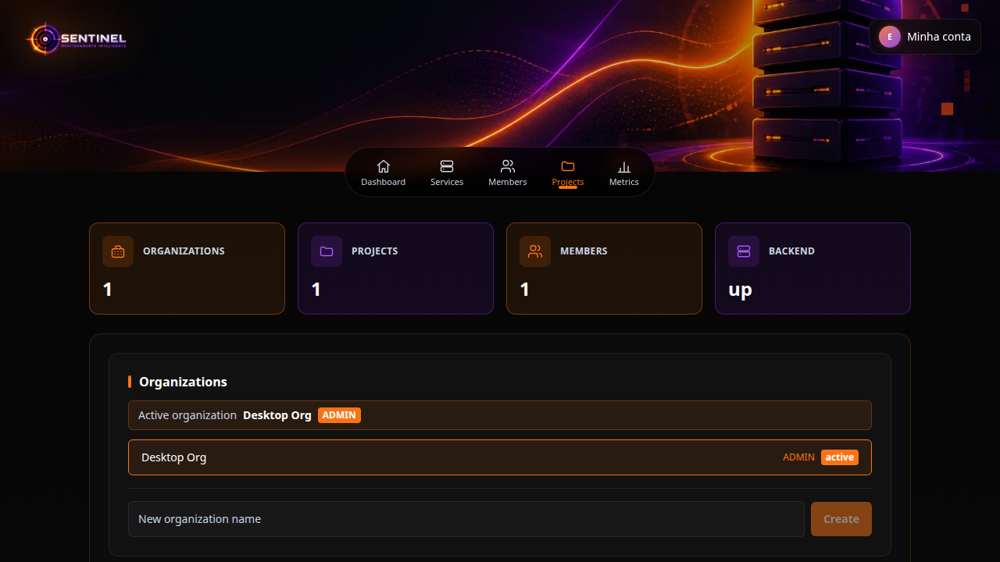
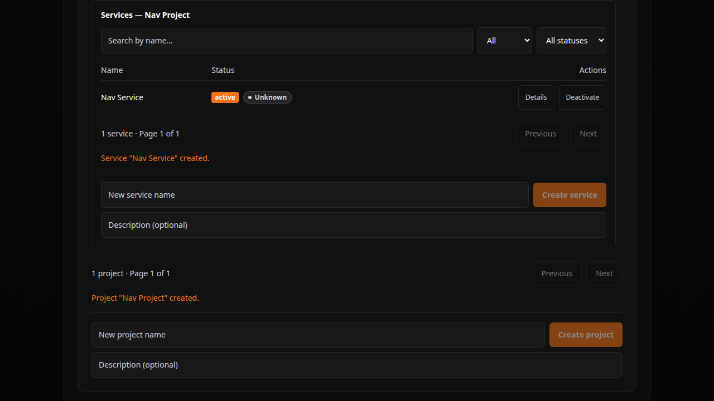
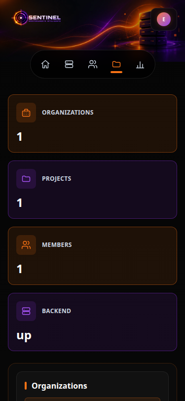

# Sentinel — Plataforma de Observabilidade e Gerenciamento de Incidentes

Aplicação multi-tenant que monitora serviços HTTP, agrega métricas históricas, avalia regras de alerta e conduz o ciclo de vida de incidentes — com autenticação stateless, isolamento por organização e RBAC por papel.

---

## Apresentação e objetivo do projeto

O Sentinel é uma plataforma auto-hospedável de observabilidade para equipes que precisam saber, em tempo real, se seus serviços estão disponíveis e — quando não estão — organizar a resposta a esse incidente.

O objetivo do projeto é cobrir o ciclo completo dentro de um único sistema:

1. **observar** — executar checagens HTTP/HTTPS periódicas contra monitores cadastrados;
2. **medir** — persistir o histórico de checagens e derivar disponibilidade, taxa de falha e latência por janela de tempo;
3. **avisar** — avaliar regras de alerta a cada checagem e manter o estado `FIRING`/`RESOLVED` dos alertas;
4. **responder** — abrir, acompanhar e resolver incidentes com linha do tempo imutável, manualmente ou por automação a partir de um alerta;
5. **sintetizar** — apresentar um dashboard operacional por projeto com saúde dos serviços, alertas ativos, incidentes abertos e atividade recente.

Tudo é escopo de uma **organização (tenant)**: usuários, papéis e dados nunca vazam entre organizações.

## Problemas que a plataforma resolve

| Problema | Como o Sentinel aborda |
| --- | --- |
| Serviços caem e ninguém percebe até o usuário reclamar | motor de monitoramento com tick agendado, pool dedicado de workers e classificação de falha (DNS, conexão, timeout, TLS, HTTP) |
| Dados de disponibilidade dispersos ou inexistentes | histórico **append-only** de checagens (`monitor_checks`) com métricas agregadas por janela (`1h`/`6h`/`24h`/`7d`/`30d`) |
| Alerta duplicado, regra mal calibrada ou alerta "fantasma" | motor de alertas com matriz de validação tipo × operador, deduplicação em duas camadas e ciclo `FIRING → RESOLVED` com resolução rastreada |
| Incidente tratado por chat, sem registro de quem fez o quê | incidentes com máquina de estados (4 estados, 6 transições) e **timeline append-only** gravada na mesma transação da mudança |
| Vários clientes/projetos no mesmo ambiente sem isolamento | multi-tenancy com hierarquia Organization → Project → Service → Monitor → AlertRule, RBAC por papel e `404` genérico anti-enumeração |
| Chamadas internas expostas a SSRF | guarda SSRF no cadastro **e** na execução do monitor, com revalidação imediatamente antes da conexão e sem seguir redirects |
| Conta comprometida = acesso irrestrito | access token JWT de curta duração + refresh token rotativo em cookie `HttpOnly`, CSRF double-submit, rate limiting e headers de segurança |

> **Fora do escopo atual**: notificações (e-mail, Slack, webhook), recuperação/verificação de senha, MFA, trilha de auditoria, tracing distribuído e testes de carga. Ver [Limitações conhecidas](#status-atual-do-desenvolvimento-e-limitações-conhecidas).

## Funcionalidades implementadas

Só o que está presente no código e documentado em `docs/`.

### Identidade e sessão

- Cadastro (`POST /api/v1/auth/register`) e login (`POST /api/v1/auth/login`) com senha hasheada com BCrypt.
- **Access token JWT HS256** de 15 min, mantido **em memória** no frontend (nunca em `localStorage`).
- **Refresh token opaco** em cookie `HttpOnly`/`SameSite=Strict` (7 dias) com **rotação**, revogação por reuso e logout idempotente.
- Bootstrap de sessão via `POST /api/v1/auth/refresh`; `GET /api/v1/auth/me` para o usuário corrente.
- CSRF **double-submit** (cookie `XSRF-TOKEN` + header `X-XSRF-TOKEN`) nas escritas autenticadas por cookie.
- Rate limiting em memória: login 5/min, registro 3/min, refresh 10/min e `GET /api/v1/organizations` 60/min por IP (resposta `429` + `Retry-After`).

### Organizações multi-tenant e membros

- Criação e listagem de organizações; a criadora nasce `ADMIN` na mesma transação.
- Papéis por organização: `ADMIN` / `OPERATOR` / `VIEWER`, com regra do **último ADMIN** (`409 LAST_ADMIN_REQUIRED`) sob lock pessimista.
- Gestão de membros (listar/invitar/alterar papel/remover) restrita a `ADMIN`.
- `TenantContext` + interceptor + `@TenantScoped`; autorização lida **por requisição** no servidor.
- Isolamento cross-tenant com `404` genérico anti-enumeração em 4–5 níveis de hierarquia.

### Projetos, serviços e monitores

- CRUD de **projetos** com paginação, filtros, ordenação e ativação/desativação (`409 PROJECT_NAME_DUPLICATE` em duas camadas).
- CRUD de **serviços** por projeto, com dois eixos independentes: `active` (catálogo) e `status` (`UNKNOWN`/`OPERATIONAL`/`DEGRADED`/`UNAVAILABLE`, escrito apenas pelo avaliador).
- CRUD de **monitores HTTP/HTTPS** por serviço, com unicidade por serviço e **guarda SSRF** que recusa alvo privado/loopback antes de persistir (`400 MONITOR_TARGET_NOT_ALLOWED`).
- Autorização encadeada Organization → Project → Service → Monitor sempre via consultas tenant-scoped (nunca `findById` avulso).

### Motor de monitoramento e histórico

- Scheduler com tick configurável, seleção de monitores elegíveis no banco, dispatcher com pool dedicado, backpressure e guarda de execução em voo.
- Execução via `java.net.http` **sem seguir redirects**, com revalidação SSRF imediata antes da conexão.
- Classificação de cada execução (`SUCCESS`, `DEGRADED_SIGNAL`, `TARGET_FAILURE`, `SENTINEL_INTERNAL_FAILURE`) e de falha (`DNS`, `CONNECT`, `TIMEOUT`, `TLS`, `HTTP_ERROR`, `SSRF_REVALIDATION`, `INTERNAL`).
- Persistência **append-only** em `monitor_checks` (migration `V8`) e avaliação da janela de 3 execuções que escreve o `status` do serviço.
- Endpoint de histórico `GET .../monitors/{monitorId}/checks`.

### Métricas históricas

- `GET .../monitors/{monitorId}/metrics?range=` e `GET .../services/{serviceId}/metrics?range=` com faixas `1h`/`6h`/`24h`/`7d`/`30d`.
- Grades completas de bucket, fórmulas de disponibilidade/taxa com arredondamento `HALF_UP` e breakdown por monitor no nível do serviço.
- UI no frontend: seletor de faixa, resumo, gráfico SVG e detalhamento (`MetricsSection`/`MetricsChart`).

### Regras de alerta

- CRUD de **regras de alerta** por serviço, com escopo opcional de monitor do mesmo serviço.
- Matriz de validação tipo × operador (`AlertRuleValidationMatrix`), faixas de threshold e exclusividade numérico × status.
- 5 tipos de regra: média de latência, taxa de sucesso, contagem de falhas de alvo, disponibilidade e status do serviço.
- Ativação/desativação idempotente com fail-safe para os pais inativos.

### Motor de alertas

- Avaliação **a cada checagem** (sem scheduler próprio), com snapshot da condição no alerta (tipo, operador, thresholds, janela, severidade).
- Deduplicação em duas camadas (pré-check + índice parcial único) e isolamento por regra/monitor/etapa.
- Ciclo `FIRING → RESOLVED` com motivo de resolução (`AUTO`, `RULE_DEACTIVATED`, `PARENT_INACTIVE`); `NO_DATA`/`ERROR` nunca resolvem.
- Leitura em `GET .../services/{serviceId}/alerts` e `GET .../alerts/{alertId}` (escrita `405`).

### Incidentes e automação

- Ciclo de vida **manual** de incidentes: criar, listar, atualizar, transicionar status, ler timeline e associar/desassociar alertas.
- Máquina de estados pura (4 estados, 6 transições, `RESOLVED` terminal), timeline **append-only** com carimbos estritamente crescentes e `@Version` para `409 CONFLICT` sob concorrência.
- Associação **N alertas : 1 incidente**, idempotente.
- **Automação opt-in** (`autoCreateIncident` na regra): alerta que nasce abre incidente automaticamente, com correlação por serviço e teto de 3 tentativas.
- Painéis `IncidentsPanel` / `IncidentDetail` no detalhe do serviço.

### Dashboard operacional

- `GET .../projects/{projectId}/dashboard?range=` (`1h`/`6h`/`24h`/`7d`/`30d`) em **uma única resposta**: saúde dos serviços, disponibilidade, alertas `FIRING`, incidentes ativos, serviços que pedem atenção e atividade recente.
- Somente leitura (GET-only, `405` em escrita), sem cache, sem tabela própria.

### Segurança e operação

- Headers de segurança no backend **e** no frontend: CSP, HSTS, `Referrer-Policy`, `Permissions-Policy`, `X-Content-Type-Options: nosniff`, `X-Frame-Options: DENY`.
- Fail-fast no perfil `prod`: `DATABASE_URL`, `DATABASE_USERNAME`, `DATABASE_PASSWORD` e `JWT_SECRET` (≥ 32 caracteres) obrigatórios no startup.
- `ddl-auto: validate` + `flyway.validate-on-migrate: true` — divergência de schema derruba o startup, nunca altera tabela.
- Endpoints de saúde: `/api/v1/health` e `/actuator/health` (detalhes ocultos).
- Scripts de backup/verificação/restore do banco em `scripts/database/` (ciclo exercitado e validado — ver [docs/database-backup-restore.md](docs/database-backup-restore.md)).

## Tecnologias

### Frontend (`frontend/package.json`)

| Tecnologia | Versão |
| --- | --- |
| Next.js (App Router) | `16.3.6` |
| React / React DOM | `19.2.8` |
| TypeScript | `^5` |
| Tailwind CSS | `^4` (via `@tailwindcss/postcss`) |
| ESLint / eslint-config-next | `^9` / `16.3.6` |
| Vitest | `^3.2.7` |
| Playwright | `^1.64.0` |

### Backend (`backend/pom.xml`)

| Tecnologia | Versão / nota |
| --- | --- |
| Java | **21** (`java.version=21`) |
| Spring Boot | **4.1.1** (parent) |
| Módulos | Web, Data JPA, Validation, Actuator, Security, OAuth2 Resource Server, Flyway |
| Build | Maven **3.9+** (sem wrapper no repositório) |
| Migrações | Flyway — `V1` … `V12` |

### Banco e infraestrutura

| Tecnologia | Versão / nota |
| --- | --- |
| PostgreSQL | **17** (imagem `postgres:17-alpine` no `docker-compose.yml`) |
| Docker / Docker Compose | plugin `docker compose` v2 |
| Portas | banco **5433** (host) · backend **8080** · frontend **3000** |

### Ferramentas de qualidade

| Ferramenta | Uso |
| --- | --- |
| JUnit 5 + Testcontainers + spring-security-test | testes de backend (banco real por teste) |
| Vitest | 217 testes unitários/helpers do frontend |
| Playwright | 8 specs / 14 testes E2E em navegador |
| ESLint + `tsc --noEmit` | lint e type-check do frontend |
| GitHub Actions | workflow em `.github/workflows/ci.yml` (**preparado, ainda não ativado** — ver [docs/continuous-integration.md](docs/continuous-integration.md)) |
| Bash + `pg_dump`/`pg_restore` | scripts de backup e restore em `scripts/database/` |

## Estrutura de diretórios

```
project-sentinel/
├── README.md
├── .env.example                  # placeholders de variáveis (versionado)
├── docker-compose.yml            # apenas PostgreSQL 17 (porta 5433)
├── .github/workflows/ci.yml      # pipeline de CI (preparado, não ativado)
├── docs/                         # contratos, decisões e status (23 documentos)
│   ├── screenshots/              # imagens usadas neste README
│   ├── architecture-foundation.md · identity.md · organizations.md
│   ├── projects.md · services.md · monitors.md · monitoring-engine.md
│   ├── operational-state.md · history-metrics.md
│   ├── alert-rules.md · alert-engine.md · alert-incident-automation.md
│   ├── incidents.md · dashboard.md
│   ├── security-hardening.md · operational-security.md · resilience.md
│   ├── performance.md · database-backup-restore.md
│   ├── continuous-integration.md · frontend-e2e.md
│   └── homologation-readiness.md · production-checklist.md
├── scripts/database/             # backup.sh · verify-backup.sh · restore.sh
├── backend/                      # Spring Boot (monólito modular)
│   ├── pom.xml
│   └── src/
│       ├── main/java/com/sentinel/
│       │   ├── SentinelApplication.java · SecurityConfig.java · JwtConfiguration.java
│       │   ├── identity/         # auth, token (refresh), users
│       │   ├── organization/     # context (TenantContext), model, dto, repository, service, web
│       │   ├── project/          # model, repository, dto, service, web
│       │   │   ├── monitor/      # monitores + histórico de checagens
│       │   │   ├── alert/        # regras + entidade Alert (+ automation/)
│       │   │   ├── incident/     # ciclo de vida de incidentes
│       │   │   ├── dashboard/    # dashboard operacional (GET-only)
│       │   │   └── security/     # guarda SSRF
│       │   ├── alerting/         # motor de avaliação de alertas
│       │   ├── monitoring/       # scheduler, dispatcher, executor HTTP
│       │   ├── security/         # RateLimitFilter
│       │   ├── error/ · health/ · config/
│       ├── main/resources/       # application*.yml + Flyway (V1–V12)
│       └── test/java/            # testes JUnit 5 + Testcontainers
└── frontend/                     # Next.js 16
    ├── package.json · playwright.config.ts · next.config.ts
    ├── src/
    │   ├── app/                  # page.tsx (home) · login/ · register/ · layout.tsx
    │   ├── components/           # painéis: Services, Monitors, AlertRules, Alerts,
    │   │                         # Incidents, Metrics, Dashboard, AuthStatus…
    │   └── lib/                  # clientes de API + testes Vitest
    └── e2e/                      # specs Playwright + helpers + screenshots
```

> Os contratos de API detalhados (paths, códigos de erro e decisões) estão em `docs/` — este README não duplica a tabela de endpoints.

## Pré-requisitos

| Requisito | Versão | Observação |
| --- | --- | --- |
| JDK | **21** | ex.: OpenJDK 21 (homologado com 21.0.12) |
| Maven | **3.9+** | sem wrapper no repo — usa o `mvn` do sistema |
| Node.js | **≥ 20.9** (exigência do Next 16) | homologado e usado na CI com **Node 22** |
| npm | acompanha o Node | `npm ci` em `frontend/` |
| Docker + plugin `docker compose` v2 | qualquer versão recente | sobe o PostgreSQL 17; também é exigido pelos testes de backend (Testcontainers) |
| Git | 2.x | — |
| Google Chrome (só para E2E local) | versão do sistema | a config do Playwright usa `channel: "chrome"` localmente |

> Se o `mvn` não encontrar o Java, defina `JAVA_HOME`, ex.: `export JAVA_HOME=/usr/lib/jvm/java-21-openjdk-amd64`.
> PostgreSQL **não** precisa estar instalado na máquina: o `docker-compose.yml` da raiz sobe o banco.

## Variáveis de ambiente

O repositório versiona apenas `.env.example` (placeholders). Arquivos `.env`, `.env.local` e `.env.*.local` são ignorados pelo Git.

```bash
cp .env.example .env      # opcional — os defaults já funcionam para dev local
```

### Backend e banco

| Variável | Placeholder / default | Descrição |
| --- | --- | --- |
| `DATABASE_URL` | `jdbc:postgresql://localhost:5433/sentinel` | URL JDBC do PostgreSQL (obrigatória no perfil `prod`) |
| `DATABASE_USERNAME` | `sentinel` | usuário do banco (obrigatória no perfil `prod`) |
| `DATABASE_PASSWORD` | `change-me` | senha do banco; usada também pelo `docker-compose.yml`; **obrigatória no perfil `prod`** |
| `SERVER_PORT` | `8080` | porta HTTP do backend |
| `SPRING_PROFILES_ACTIVE` | `dev` | perfil Spring: `dev`, `test` ou `prod` |
| `JWT_SECRET` | *(vazio)* | segredo HS256, **≥ 32 caracteres**; vazio em `dev` → segredo efêmero no startup; **obrigatória no perfil `prod`** |
| `JWT_ACCESS_TTL_SECONDS` | `900` | TTL do access token (15 min) |
| `JWT_REFRESH_TTL_DAYS` | `7` | TTL do refresh token |
| `JWT_COOKIE_NAME` | `refresh_token` | nome do cookie de refresh |
| `JWT_COOKIE_PATH` | `/api/v1/auth` | path do cookie de refresh |
| `JWT_COOKIE_SECURE` | `false` | o perfil `prod` força `true` |
| `JWT_COOKIE_SAME_SITE` | `Strict` | atributo `SameSite` do cookie |
| `CORS_ALLOWED_ORIGINS` | `http://localhost:3000` | origens permitidas, separadas por vírgula (wildcard com credenciais aborta o startup) |
| `MONITORING_ENABLED` | `true` | `false` pausa a coleta sem redeploy |
| `MONITORING_SCHEDULER_DELAY_MS` | `10000` | intervalo do tick de checagens |
| `MONITORING_WORKER_COUNT` | `4` | workers do pool dedicado |
| `MONITORING_QUEUE_CAPACITY` | `200` | capacidade da fila de execução |

### Frontend (build-time)

| Variável | Placeholder / default | Descrição |
| --- | --- | --- |
| `NEXT_PUBLIC_API_URL` | `http://localhost:8080` | base URL da API — é **embutida no build**, defina antes de `npm run build` |

Nenhum valor real de credencial ou segredo é versionado no repositório.

## Como subir o ambiente

Ordem sempre **banco → backend → frontend** (o backend aplica as migrations do Flyway no startup e aborta se o banco estiver inacessível).

### 1. Banco — PostgreSQL 17 (porta 5433)

```bash
docker compose up -d
docker compose ps        # deve ficar "healthy"
```

> A porta do host é **5433** (a 5432 já pode estar ocupada por outro PostgreSQL).

### 2. Backend — Spring Boot (porta 8080)

```bash
cd backend
mvn spring-boot:run
```

Subindo, o Flyway aplica `V1`…`V12` e o servidor responde em `http://localhost:8080/api/v1/health`.

### 3. Frontend — Next.js (porta 3000)

```bash
cd frontend
npm install
npm run dev
```

Acesse `http://localhost:3000` (redireciona para `/login` quando anônimo).

### Build de produção (opcional)

```bash
cd backend && mvn package          # gera backend/target/sentinel-backend-0.1.0-SNAPSHOT.jar
cd frontend && npm run build && npm start
```

Para o perfil `prod` defina `SPRING_PROFILES_ACTIVE=prod` e as variáveis obrigatórias da tabela acima — o startup **aborta** sem elas.

## Uso

Fluxo real da aplicação, do zero até um incidente:

1. **Criar conta** — acesse `http://localhost:3000/register`, informe nome, e-mail e senha (política do backend: 8+ caracteres com letra e dígito) e envie. O cadastro **não** emite token: você é levado ao `/login`.
2. **Entrar** — em `/login`, use as credenciais criadas. O login devolve o usuário + access token e grava o cookie de refresh; sessões expiradas são renovadas silenciosamente pelo refresh token.
3. **Criar uma organização** — na home, no painel **Organizations**, informe o nome e clique em *Create*. Você entra como `ADMIN` e a organização fica ativa.
4. **Convidar pessoas** (opcional) — no painel **Members**, um `ADMIN` pode convidar por e-mail (o usuário já precisa existir), alterar papel (`ADMIN`/`OPERATOR`/`VIEWER`) e remover membros.
5. **Criar um projeto** — no painel **Projects**, informe o nome (e descrição) e crie. Clique em *Details* para expandir o projeto e ver `Dashboard` e `Services`.
6. **Criar um serviço** — no painel **Services** do projeto expandido.
7. **Criar um monitor** — no detalhe do serviço, cadastre um monitor HTTP/HTTPS com método e alvo. Alvos privados/loopback são recusados (`400 MONITOR_TARGET_NOT_ALLOWED`).
8. **Acompanhar a coleta** — com o motor ativo (`MONITORING_ENABLED=true`), as checagens rodam no intervalo configurado; o serviço passa a `OPERATIONAL`/`DEGRADED`/`UNAVAILABLE` e o histórico aparece em *Last checks*.
9. **Ver métricas** — no monitor e no serviço, escolha a faixa (`1h`…`30d`) para ver disponibilidade, taxa de falha e latência em gráfico.
10. **Definir regras de alerta** — no detalhe do serviço, crie regras (latência, taxa de sucesso, falhas de alvo, disponibilidade ou status do serviço). Marque `autoCreateIncident` se quiser incidente automático.
11. **Acompanhar alertas** — as regras são avaliadas a cada checagem; alertas aparecem em `FIRING` e voltam a `RESOLVED` quando a condição se resolve.
12. **Gerenciar incidentes** — abra manualmente ou receba o automático, associe alertas, faça as transições de status e consulte a timeline.
13. **Dashboard** — no projeto expandido, o painel resume saúde, disponibilidade, alertas ativos, incidentes e atividade recente na faixa escolhida.

Trocar de organização no seletor da home troca todo o contexto (projetos, serviços, membros) — a organização ativa é apenas preferência de UI e é sempre validada contra a lista de organizações do usuário.

## Testes

### Backend (unitários + integração)

```bash
cd backend
mvn test
```

- **JUnit 5 + Testcontainers**: cada teste que precisa de banco sobe um `postgres:17-alpine` próprio — **Docker precisa estar em execução**.
- Baseline documentado: **867 testes, 0 falhas** (relatórios Surefire da última execução local, `mvn clean test`).
- Cobre identidade/refresh, multi-tenancy e IDOR adversarial, concorrência (último ADMIN, unicidade), RBAC, guards SSRF, motor de monitoramento, motor de alertas, incidentes, dashboard e tratamento global de erros.

### Frontend — unitários (Vitest)

```bash
cd frontend
npm run test          # vitest run
```

- **217 testes em 11 arquivos** (`src/lib/*.test.ts`) — executado e verificado nesta atualização: `Test Files 11 passed · Tests 217 passed`.
- Ambiente `node`: testam clientes de API, helpers de formatação/validação e páginas de auth, **sem** renderização de DOM.

### Frontend — E2E (Playwright)

```bash
cd frontend
npm run test:e2e          # headless
npm run test:e2e:headed   # Chrome visível
npm run test:e2e:ui       # UI interativa
```

**O que a suíte exige antes de rodar** (não há `webServer` no `playwright.config.ts`):

1. PostgreSQL de pé — `docker compose up -d`;
2. backend em `http://localhost:8080` — `cd backend && mvn spring-boot:run`;
3. frontend em `http://localhost:3000` — `cd frontend && npm run dev` (ou `build` + `start`);
4. **Chrome do sistema** instalado (local usa `channel: "chrome"`; em CI o Chromium é instalado pelo Playwright).

Sem esses quatro itens a suíte falha por infraestrutura, não por defeito de produto. Estrutura: **8 specs / 14 testes** (auth, a11y, organização, projeto) — ver [docs/frontend-e2e.md](docs/frontend-e2e.md).

## Comandos de validação do frontend

```bash
cd frontend

npm run lint          # ESLint
npm run type-check    # tsc --noEmit
npm run test          # Vitest (217 testes)
npm run build         # build de produção do Next.js
```

Pipeline local completo (todas as etapas com exit 0):

```bash
cd frontend && npm run lint && npm run type-check && npm run test && npm run build && npm run test:e2e
cd backend && mvn clean test
```

## Status atual do desenvolvimento e limitações conhecidas

### Onde o projeto está

| Etapa | Estado | Fonte |
| --- | --- | --- |
| Prompts 01–18 (fundação → identidade → multi-tenancy → projetos/serviços/monitores → coleta → métricas → alertas → incidentes → automação → dashboard → hardening) | **construídos** | `docs/` |
| Homologação final (P18) | **APTO COM RESSALVAS** — fluxo completo executado, 12/12 migrations, isolamento/RBAC/SSRF aprovados, `ERROR=0` | [docs/homologation-readiness.md](docs/homologation-readiness.md) |
| Etapa Pós-Roadmap 01 (a11y + suíte E2E) | **APROVADO COM RESSALVAS** — 14/14 E2E (42/42 estáveis), correções A11Y-01/02/03 | [docs/frontend-e2e.md](docs/frontend-e2e.md) |
| Etapa 02.1 (headers, rate limiting, fail-fast de produção) | **concluída** | [docs/operational-security.md](docs/operational-security.md) |
| Etapa 02.2 (CI no GitHub Actions) | **preparada localmente, NÃO ativada** — o workflow existe e foi validado, mas o repositório não tem remote: zero execuções no GitHub | [docs/continuous-integration.md](docs/continuous-integration.md) |
| Etapa 02.3 (backup/restore) | **exercitado e validado** localmente (sem backup agendado) | [docs/database-backup-restore.md](docs/database-backup-restore.md) |
| Baseline de testes | backend **867/0/0** · frontend **217/217** · E2E **14/14** | execuções registradas nos relatórios e nos docs |
| Checklist de produção | **APTO COM RESSALVAS** — provedor de hospedagem **não escolhido** (decisão do responsável) | [docs/production-checklist.md](docs/production-checklist.md) |

### Limitações e pendências conhecidas

**Não implementado (declarado ausente):**

- notificações (e-mail, Slack, webhook) e integrações externas;
- recuperação e verificação de senha; MFA;
- trilha de auditoria (`incident_events` é timeline de domínio, **não** audit log);
- observabilidade do próprio Sentinel (logs estruturados → coletor, métricas de aplicação, tracing) — só `health`/`info`;
- SLO/error budget e alerta interno do sistema;
- testes de carga e pen-test/revisão de segurança independente;
- retenção/expurgo do histórico de checagens.

**Limitações operacionais verificadas:**

- **CI não ativada**: `.github/workflows/ci.yml` está pronto e validado (`actionlint`), mas sem remote não há nenhuma execução remota nem required checks.
- **Rate limiting por instância** (em memória, `ConcurrentHashMap`) — não é global entre réplicas; identificação de cliente usa `X-Forwarded-For` sem validar a origem do proxy.
- **CSP com `unsafe-inline`** (necessário para Tailwind/Next.js) e **HSTS só efetivo atrás de HTTPS** — em produção a recomendação é emitir/reforçar CSP e HSTS no reverse proxy.
- **Rotação de `JWT_SECRET` sem downtime não existe**: trocar o segredo invalida todos os tokens emitidos.
- **`DATABASE_URL`/`DATABASE_USERNAME` sem fail-fast em prod**: credencial errada só falha ao conectar.
- **Suíte E2E cobre apenas** `/`, `/login` e `/register` (+ painéis dentro da home) — painéis que exigem dados de domínio mais complexos (alertas, incidentes, métricas com checagens reais) ficaram fora da automação e foram exercitados manualmente na homologação. Os testes dependem de servidores de pé e usam `channel: "chrome"` (versão do navegador não fixada pelo Playwright).
- **Ressalva de UI aceita**: 2 ocorrências de checkbox `h-4 w-4` ficam abaixo de 44 px (exceção justificada na etapa de a11y).
- **Última execução registrada** do Playwright (`frontend/test-results/.last-run.json`) consta como `passed` sem testes falhos; esta atualização **não reexecutou** a suíte E2E (exige servidores + Chrome).

## Screenshots

Capturas da interface (desktop e mobile), sem dados pessoais ou sensíveis:

| Desktop — visão geral | Desktop — painel de serviços |
| --- | --- |
|  |  |

| Mobile — 375 px |
| --- |
|  |

> Capturas adicionais (incluindo o menu de conta aberto) foram **deliberadamente omitidas** por exibirem e-mail e nome de usuário. Novas imagens podem ser geradas com `cd frontend && node e2e/capture-screenshots.mjs` (servidores de dev precisam estar de pé) e devem ser revisadas antes de entrar no repositório.

## Documentação do projeto

Todo o detalhe de contrato, decisões e estado vive em [`docs/`](docs/) — 23 documentos:

| Área | Documentos |
| --- | --- |
| Fundação e identidade | [architecture-foundation](docs/architecture-foundation.md) · [identity](docs/identity.md) |
| Multi-tenancy e recursos | [organizations](docs/organizations.md) · [projects](docs/projects.md) · [services](docs/services.md) · [monitors](docs/monitors.md) |
| Coleta e métricas | [monitoring-engine](docs/monitoring-engine.md) · [operational-state](docs/operational-state.md) · [history-metrics](docs/history-metrics.md) |
| Alertas e incidentes | [alert-rules](docs/alert-rules.md) · [alert-engine](docs/alert-engine.md) · [alert-incident-automation](docs/alert-incident-automation.md) · [incidents](docs/incidents.md) · [dashboard](docs/dashboard.md) |
| Segurança e resiliência | [security-hardening](docs/security-hardening.md) · [operational-security](docs/operational-security.md) · [resilience](docs/resilience.md) · [performance](docs/performance.md) |
| Operação e qualidade | [database-backup-restore](docs/database-backup-restore.md) · [continuous-integration](docs/continuous-integration.md) · [frontend-e2e](docs/frontend-e2e.md) |
| Status | [homologation-readiness](docs/homologation-readiness.md) · [production-checklist](docs/production-checklist.md) |

O frontend tem um README próprio em [`frontend/README.md`](frontend/README.md).
