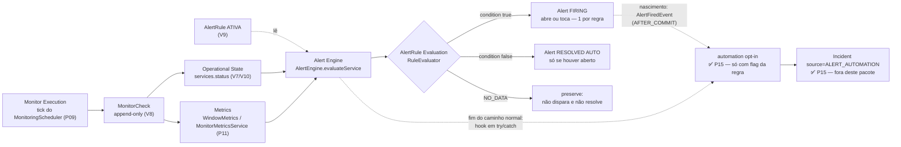

# Alert Engine — Sentinel

> **Prompt 13 de 18** — avaliação das regras de alerta e o resultado avaliado: o engine lê `alert_rules` + métricas a cada checagem do serviço, aplica a condição e mantém o ciclo de vida da entidade `Alert` (FIRING → RESOLVED), com a API somente-leitura correspondente e o painel de leitura no frontend. Este documento descreve **o que está construído**: tabela `alerts` (migration `V10`; o índice parcial de reconciliação `idx_alerts_auto_create_firing` veio na `V12`), o eixo `services.status_changed_at`, o pacote `com.sentinel.alerting` (engine, avaliador, lifecycle, gatilho), a extensão do pipeline do Prompt 10 (`MonitorExecutionTask` etapa 3), o sub-recurso `.../services/{serviceId}/alerts` (GET apenas) e o frontend `AlertsPanel`. As regras de CONFIGURAÇÃO são as do [alert-rules.md](alert-rules.md), o histórico de checagens e as fórmulas são os do [history-metrics.md](history-metrics.md), o status operacional é o do [operational-state.md](operational-state.md) e a base de autenticação (Bearer + CSRF) é a do [identity.md](identity.md).

**Uma `Alert` é o RESULTADO avaliado de uma `AlertRule`**: nasce quando a condição estoura (disparo) e morre quando a condição normaliza ou um pai é desligado (resolução). Notificações, ack, silenciamento e escalonamento **não existem** (Prompt 16+); o incidente existe desde o **Prompt 14** (ciclo manual — ver [incidents.md](incidents.md)) e desde o **Prompt 15** pode nascer **automaticamente** quando a regra tem a flag `autoCreateIncident` — sem o engine conhecer o pacote `incident` (evento neutro + hook, ver [alert-incident-automation.md](alert-incident-automation.md)).

## 1. Escopo implementado

| Item | Estado |
| --- | --- |
| Migration `V10__create_alerts_table.sql` (tabela `alerts` + `services.status_changed_at`) | Construído |
| Entidade `Alert` + `AlertRepository` (busca paginada, alerta aberto por regra, regra/pais abertos) | Construído |
| Pacote `com.sentinel.alerting`: `AlertEngine`, `RuleEvaluator`, `OperatorEvaluator`, `AlertLifecycleService`, `EvaluationResult`, `AlertEvaluationContext`, `WindowMetrics`/`MonitorWindowMetrics`, `AlertTrigger`/`MonitoringAlertTrigger` | Construído |
| Gatilho no fim de CADA checagem (etapa 3 do `MonitorExecutionTask`) — sem scheduler próprio | Construído |
| 4 tipos numéricos (`AVAILABILITY`, `SUCCESS_RATE`, `AVERAGE_LATENCY`, `TARGET_FAILURE_COUNT`) reutilizando as fórmulas do Prompt 11 | Construído |
| `SERVICE_STATUS` com os 4 resultados da revisão (HEALTHY/FIRING/NO_DATA/NO_DATA-sem-eixo) | Construído |
| Deduplicação em DUAS camadas (pré-check + índice parcial único) | Construído |
| Resolução `AUTO` / `RULE_DEACTIVATED` / `PARENT_INACTIVE` (ganchos nas rotas de ativação) | Construído |
| Isolamento por regra, por monitor e por etapa do pipeline (nenhuma falha aborta o resto) | Construído |
| `GET .../services/{serviceId}/alerts` + `GET .../alerts/{alertId}` (página/filtros/detalhe, somente leitura, `405` nos verbos de escrita) | Construído |
| Frontend: cliente + helpers (`lib/alerts.ts`) + `AlertsPanel` (listagem, filtros, paginação, somente leitura) | Construído |
| Notificações, ack, silenciamento, escalonamento, IA, `POST`/`PATCH`/`DELETE` de alerta | **Fora do escopo** (Prompt 16+) |
| Vínculo com incidente e ciclo de vida manual do incidente | **Fora do escopo** do Prompt 13 — **construído no Prompt 14** (ver [incidents.md](incidents.md)) |
| Evento de nascimento `AlertFiredEvent` + hook `AlertPostEvaluationHook` no fim do ciclo (interfaces neutras consumidas pela automação) | **Fora do escopo** do Prompt 13 — **construído no Prompt 15** (ver [alert-incident-automation.md](alert-incident-automation.md)) |

### 1.1 Nota sobre a numeração de critérios (melhor esforço)

A lista oficial de critérios do Prompt 13 **não está versionada neste repositório**. A tabela de mapeamento critério → teste da §12 foi reconstituída a partir do plano técnico aprovado e do vocabulário dos próprios testes; ela é **best-effort** e deve ser reconciliada com o prompt oficial quando disponível. Números citados neste documento seguem essa mesma convenção.

## 2. Conceito e fluxo

- **Quando roda**: ao FINAL de cada checagem de monitor que foi persistida com sucesso — `MonitorExecutionTask.run()` executa (1) `MonitorCheckRecorder.record`, (2) `OperationalStateEvaluator.evaluate` e (3) `AlertTrigger.trigger(monitor)`, cada etapa com fronteira de exceção própria. **Não existe scheduler de alertas**: o tick continua sendo o do `MonitoringScheduler` (Prompt 09) e o pacote `alert` permanece sem `@Scheduled`/`@Async` (travado por `MonitoringEngineBoundaryTest`).
- **Quem decide**: `MonitoringAlertTrigger` traduz o monitor no serviço dono e chama `AlertEngine.evaluateService(serviceId)` — o engine carrega o serviço, as regras ATIVAS e avalia cada uma em isolamento próprio (uma regra que falha nunca corta as demais).
- **Janela meia-aberta**: a avaliação recorta `agora − window.seconds` (incluso) até `agora` (excluso), SEM alinhamento à grade de buckets do Prompt 11 (a grade é formato da resposta HTTP, não semântica de avaliação). Consequência prática: o check gravado na própria execução está na borda e só conta no ciclo seguinte.
- **NO_DATA nunca resolve**: sem relevante na janela (ou sem eixo temporal, no `SERVICE_STATUS`) o veredito é `NO_DATA` — não dispara e **não encerra** o que está aberto. `ERROR` (falha de infra do avaliador) idem, e também nunca cria alerta.
- **Sem cascata**: desativar a regra resolve o alerta aberto (`RULE_DEACTIVATED`); desativar serviço/projeto resolve em massa (`PARENT_INACTIVE`) — os ganchos ficam nas rotas de `.../activation` do [alert-rules.md](alert-rules.md) e do [services.md](services.md), com rede de segurança no próprio ciclo do engine.
- **Reação ao resultado (Prompt 15)**: o ramo que **CRIA** um alerta publica `AlertFiredEvent` (só ids) dentro da própria transação — o consumidor roda no `AFTER_COMMIT`, depois do alerta commitado (o toque/deduplicação não publica); ao **FIM** do caminho normal, o engine notifica o `AlertPostEvaluationHook` dentro de `try/catch` (a reconciliação da automação varre os elegíveis do serviço; nos atalhos — serviço sumido/inativo — não há avaliação e portanto não há hook). Nenhum dos dois conhece `Incident`: quem reage mora em `com.sentinel.project.alert.automation` (ver [alert-incident-automation.md](alert-incident-automation.md)) e qualquer falha é logada sem derrubar o ciclo.



## 3. Modelo de dados

### 3.1 `Alert` (tabela `alerts`, `V10`)

| Coluna | Tipo | Observação |
| --- | --- | --- |
| `id` | `UUID` PK | Gerado pela aplicação (`@PrePersist`), mesmo padrão das demais |
| `service_id` | `UUID NOT NULL` → `services(id)` | `ON DELETE RESTRICT` |
| `alert_rule_id` | `UUID NOT NULL` → `alert_rules(id)` | `ON DELETE RESTRICT` — dono da condição |
| `monitor_id` | `UUID NULL` → `monitors(id)` | copiado da regra no disparo (`NULL` = Service-level) |
| `status` | `VARCHAR(10) NOT NULL` | `CHECK (FIRING, RESOLVED)` — máquina `FIRING → RESOLVED` apenas |
| `severity` | `VARCHAR(10) NOT NULL` | `CHECK SEV1..SEV4` — **é o snapshot** (não existe `rule_severity` separado: um único eixo, correção da revisão) |
| `resolution_reason` | `VARCHAR(20) NULL` | `CHECK (AUTO, RULE_DEACTIVATED, PARENT_INACTIVE)` |
| `started_at` | `TIMESTAMPTZ NOT NULL` | instante do disparo |
| `resolved_at` | `TIMESTAMPTZ NULL` | preenchido só na resolução |
| `last_evaluated_at` | `TIMESTAMPTZ NOT NULL` | último toque do ciclo (criação ou touch) |
| `trigger_value` | `NUMERIC(19,4) NULL` | valor que a condição via no disparo (`NULL` para `SERVICE_STATUS`) |
| `message` | `VARCHAR(500) NOT NULL` | `nome da regra: detalhe` do **FIRING** — nunca sobrescrita |
| `rule_type` / `rule_operator` / `rule_threshold_numeric` / `rule_threshold_status` / `rule_window` | snapshot | condição que valia NA ÉPOCA — editar a regra depois não reescreve o alerta |
| `created_at` / `updated_at` | `TIMESTAMPTZ NOT NULL` | |

Constraints e índices:

- **`alerts_lifecycle_check`**: `FIRING → resolved_at NULL E resolution_reason NULL`; `RESOLVED →` os dois `NOT NULL` — a "metade escrita" amarrada no banco; a transição em si é do `AlertLifecycleService`.
- **Índice parcial único `uq_alerts_open_rule` (`alert_rule_id`) WHERE `status = 'FIRING'`**: EXATAMENTE UM alerta aberto por regra — é a garantia de deduplicação sob concorrência (o pré-check evita o insert no caso comum; a corrida vira `DataIntegrityViolationException` reconhecida como benigna pelo engine).
- **`idx_alerts_service_status`**, **`idx_alerts_rule_status`**, **`idx_alerts_started_at_desc`**: listagem por serviço com filtro, lookup do alerta aberto e ordenação `startedAt DESC`.
- CHECKs de snapshot: `rule_type`, `rule_operator`, `rule_window` espelham os enums; `rule_threshold_numeric` só é `NULL` para `SERVICE_STATUS`; `rule_threshold_status` só existe em `SERVICE_STATUS`.
- `alerts_message_not_blank` (`trim(message) <> ''`).

### 3.2 `services.status_changed_at` (mesma `V10`)

Coluna anulável adicionada em `services`: **quando** o status atual começou a valer. Escritor único: `OperationalStateEvaluator` (já sob lock pessimista, e apenas quando o status MUDA — sem transição não há reescrita do eixo). É a pré-condição da regra `SERVICE_STATUS`: sem ela o engine saberia que o serviço está `DEGRADED`, mas não há QUANTO TEMPO — e "DEGRADED agora há 2 segundos" não pode virar alerta. `NULL` = nenhuma transição registrada (serviço recém-criado) → veredito `NO_DATA`. Backfill das linhas existentes usa `updated_at`.

## 4. Avaliação (`RuleEvaluator`)

### 4.1 Tipos numéricos

Janela `from = agora − window` até `agora` (meia-aberta), escopo **Service-level** ou **Monitor-level** (quando a regra tem `monitorId`), fórmulas 100% reaproveitadas do Prompt 11 via `WindowMetrics`/`MonitorWindowMetrics` → `MonitorMetricsService` (mesmo arredondamento HALF_UP, mesma noção de "relevante" da UI de métricas):

| Tipo | Valor avaliado | Operadores |
| --- | --- | --- |
| `AVAILABILITY` | % de sucesso entre os relevantes | `<`, `≤` |
| `SUCCESS_RATE` | % de sucesso puro | `<`, `≤` |
| `AVERAGE_LATENCY` | média de duração dos checks com resposta | `>`, `≥` |
| `TARGET_FAILURE_COUNT` | contagem de falhas de alvo | `>`, `≥`, `=` |

Resultado: **zero relevante** → `NO_DATA` (`no relevant checks over {janela}`); **valor nulo** (ex.: latência sem resposta) → `NO_DATA` (`no measurable value over {janela}`); senão `OperatorEvaluator.matches` decide `FIRING` (condição vale → dispara/toca) ou `HEALTHY` (condição não vale → resolve `AUTO` se houver alerta aberto).

Mensagem do disparo: `"{nome da regra}: {detalhe}"`, com detalhe no formato fixo `availability 0.00% against threshold 99.90% over 15 minutes` (e análogos `success rate`, `average latency … ms`, `target failure count …`).

### 4.2 `SERVICE_STATUS` (quatro resultados)

Comparação entre `Service.status` (eixo escrito pelo avaliador do Prompt 10) e o `thresholdStatus` da regra — **sem número**:

1. status **≠** threshold → `HEALTHY` (resolve alerta aberto);
2. status **=** threshold e `agora − statusChangedAt ≥ window` → `FIRING` (a condição persiste HÁ PELO MENOS a janela inteira — o anti-falso-positivo de "DEGRADED agora há 2 segundos");
3. status **=** threshold e `agora − statusChangedAt < window` → `NO_DATA` (começou agora; não dispara e **não resolve**);
4. `statusChangedAt = NULL` → `NO_DATA` (nenhuma transição registrada).

`triggerValue` fica `NULL` (o tipo não produz número); a mensagem do FIRING segue o formato `service status DEGRADED for 6 minutes (threshold DEGRADED, window 5 minutes)`.

## 5. Ciclo de vida (`AlertLifecycleService`)

ÚNICO código que cria, toca ou resolve `Alert` — cada método é sua própria transação:

- **`fire` (FIRING)**: pré-check `findByAlertRuleIdAndStatus(FIRING)` → se aberto, `touch` (`lastEvaluatedAt`/`triggerValue`, a mensagem NÃO muda); senão cria UM alerta com snapshot da regra + mensagem. A corrida entre dois ciclos é absorvida pelo índice parcial único (perdedor vira log de corrida benigna no engine).
- **`resolveOpenForRule` / `resolveOpenForService` / `resolveOpenForProject`**: resolução idempotente pelos três motivos — `AUTO` (o ciclo viu `HEALTHY`), `RULE_DEACTIVATED` (ganco da rota de ativação da regra + rede de segurança no engine), `PARENT_INACTIVE` (ganhos de `ServiceService`/`ProjectService` + rede de segurança).
- **Resolução nunca toca a mensagem**: `Alert.resolve` grava `resolvedAt` + `resolutionReason` e nada mais — a mensagem do FIRING é a evidência de por que o alerta abriu e permanece intacta em QUALQUER desfecho (o método valida argumentos ANTES de mutar; correção de revisão).
- **Reabertura é UM NOVO alerta**: a máquina de estados só permite `FIRING → RESOLVED`; voltar a disparar cria a segunda linha da mesma regra.

## 6. Endpoints

Base: `/api/v1/organizations/{organizationId}/projects/{projectId}/services/{serviceId}/alerts`

### 6.1 Matriz de acesso

| Operação | ADMIN | OPERATOR | VIEWER | Anônimo |
| --- | --- | --- | --- | --- |
| `GET` (lista/detalhe) | ✅ | ✅ | ✅ | `401` |
| `POST` / `PATCH` / `DELETE` | `405` | `405` | `405` | `401` |

Leitura liberada **para qualquer papel** e inclusive com projeto/serviço inativos — alerta é histórico e a UI precisa mostrá-lo depois do congelamento. Não existe `role` de mutação no payload (rota é somente leitura).

### 6.2 `GET .../alerts` → `200`

Página no formato Spring `Page` (`{content, totalElements, totalPages, number, size}`):

- `page` default `0` (negativo → `400 page: must not be negative`); `size` default `20`, faixa `1..100` (fora → `400 size: must be between 1 and 100`);
- ordenação FIXA `startedAt DESC, id DESC` (sem parâmetro `sort`);
- filtros opcionais `status` (`FIRING`/`RESOLVED`) e `severity` (`SEV1`..`SEV4`); valor fora do enum → `400` (`Invalid request parameter`), nunca `500`.

### 6.3 `GET .../alerts/{alertId}` → `200` | `404`

Detalhe completo (mesmos 23 campos da linha + `role`); `alertId` malformado ou de outro tenant/serviço → `404` genérico anti-enumeração.

### 6.4 `POST` / `PATCH` / `DELETE` → `405`

A rota não tem esses handlers: caem no contrato global de `405` com shape `{code, message, timestamp, path}` — verificado EMPIRICAMENTE pelos testes com CSRF válido nos cabeçalhos (sem CSRF o `403` viraria máscara do `405`).

## 7. Regras de domínio

1. **Avaliação é efeito colateral de checagem persistida**: sem `MonitorCheck` commitado não há ciclo (a etapa 2 do pipeline pula a etapa 3 se a gravação falhar).
2. **Isolamento em três níveis**: por REGRA (`RuleEvaluator` falha → `ERROR`/log, as demais seguem), por MONITOR (scheduler, Prompt 09) e por ETAPA (fronteira na task) — mais o gatilho `MonitoringAlertTrigger` com try/catch no corpo inteiro: falha de engine vira log e o pipeline (histórico, estado, liberação do in-flight) segue intacto.
3. **Deduplicação em duas camadas**: pré-check + índice parcial único — nunca dois alertas abertos para a mesma regra, nem sob concorrência.
4. **Mensagem é imutável depois do disparo**: resolução grava só motivo + instante.
5. **Severidade é snapshot único**: copiada da regra no disparo; não existe eixo de severidade duplicado.
6. **NO_DATA/ERROR não resolvem**; só `HEALTHY` resolve (`AUTO`).
7. **Pais desligados** → resolução fail-safe (`PARENT_INACTIVE`), sem afirmação sobre saúde; regra desligada → `RULE_DEACTIVATED`.
8. **Tenant-scoped em duas consultas** na API (`findByProjectIdAndId` → `findByServiceIdAndId` + lookup do alerta no serviço); o engine é interno (já dentro do serviço resolvido pelo monitor).

## 8. Contrato de erro

Shape padrão `{code, message, timestamp, path}`:

| Código | HTTP | Quando |
| --- | --- | --- |
| `VALIDATION_ERROR` | `400` | `page` negativo, `size` fora de `1..100`, `status`/`severity` fora do enum (query param tipado) |
| `NOT_FOUND` | `404` | alerta inexistente, de outro tenant/serviço, id malformado **no path** |
| `METHOD_NOT_ALLOWED` | `405` | `POST`/`PATCH`/`DELETE` na rota de alertas |
| — | `401` | sem token (ou refresh inválido) |

Nenhum caminho responde `500` por entrada inválida.

## 9. CSRF e autenticação

Bearer `Authorization: Bearer <accessToken>` em todas as rotas. As rotas de alerta são somente GET (sem CSRF); os testes de `405` enviam double-submit (`XSRF-TOKEN` + `X-XSRF-TOKEN`) para provar que o `405` é real. Handlers `@TenantScoped` (membership validada antes do handler → `404` genérico a não-membros).

## 10. Frontend (Prompt 13)

- **Cliente** (`frontend/src/lib/api.ts`): tipos (`AlertStatus`, `AlertResolutionReason`, `AlertResponse`, `AlertListParams`, `AlertPage`), `buildAlertsListParams` (ordem de query string estável, filtros omitidos fora da query) e `listAlerts`/`getAlert` (path de CINCO níveis, sem header de tenant).
- **Helpers puros** (`frontend/src/lib/alerts.ts`): rótulos (`ALERT_STATUS_LABELS`, `RESOLUTION_REASON_LABELS`, `ALERT_SEVERITY_OPTIONS`), `alertCondition` (condição formatada a partir do **snapshot** do alerta, reaproveitando o `thresholdSummary` ampliado do `alert-rules.ts` — formatação da condição existe UMA vez), `triggerValueLabel` (`SERVICE_STATUS` mostra status, não número), `formatAlertInstant`, `isFiring`, `alertsViewState` → `loading|error|empty|list` (decisão Única de renderização, critérios 103–106) e `severityBadgeClasses`.
- **Painel** (`frontend/src/components/AlertsPanel.tsx`): listagem somente-leitura com paginação, filtros de status e severidade, badges de status/severidade/motivo de resolução (sempre palavra + cor), escopo (Service-level × monitor, nome do monitor resolvido via lista de monitores do MESMO serviço), estados de vazio/carregando/erro com Retry derivados de `alertsViewState`. Montado no detalhe expandido do serviço (`ServicesPanel.tsx`) com `key={`alerts-${service.id}`}` — estado nasce limpo por serviço. **Nenhum controle mutável**: a API não tem escrita e o painel não tem botões que fingem ter.
- **Sem dados fake**: a lista vem SEMPRE de `listAlerts` (fonte única).

## 11. Estrutura de código (backend)

```
com.sentinel.alerting                    ← motor (FORA do domínio)
├── AlertEngine                (evaluateService: regras ativas + estado + apply)
├── AlertEvaluationContext     (serviceId, status, statusChangedAt, now)
├── RuleEvaluator              (4 numéricos + SERVICE_STATUS → EvaluationResult)
├── OperatorEvaluator          (único comparador dos operadores)
├── EvaluationResult           (FIRING/HEALTHY/NO_DATA/ERROR + valor + detalhe)
├── WindowMetrics              (interface) → MonitorWindowMetrics (delega ao Prompt 11)
├── AlertTrigger               (interface) → MonitoringAlertTrigger (try/catch total)
└── AlertLifecycleService      (fire/touch/resolve — único escritor de Alert)

com.sentinel.project.alert               ← domínio + contrato HTTP
├── model/       Alert, AlertStatus, AlertResolutionReason (+ AlertRule e enums do P12)
├── repository/  AlertRepository (search paginado, findByAlertRuleIdAndStatus,
│                findOpenRuleIds, findByServiceIdAndStatus, findByProjectIdAndStatus)
├── service/     AlertService (list/get — cadeia tenant-scoped)
└── web/         AlertController (@TenantScoped, GET apenas)
    └── dto/     AlertResponse
```

Observações de implementação:

- **Conflito de nomes do estereótipo**: `AlertLifecycleService` é `@org.springframework.stereotype.Service` com FQN (mesmo arranjo do `AlertRuleService`).
- **Wiring do pipeline**: `MonitoringDispatcher` injeta `AlertTrigger` e repassa à `MonitorExecutionTask` — sem `@Async`, sem transação grande: a etapa 3 roda na própria thread do pool.
- **`MonitorMetricsService.windowSummaryByService/Monitor`** são os MESMOS métodos da API de métricas (fonte única de fórmula), chamados aqui direto, sem cadeia de tenant (o engine já está dentro do serviço resolvido).

## 12. Testes

- **Backend**: 17 classes novas de teste + boundary/dispatcher ampliados (detalhamento e números finais no relatório do prompt; baseline era **583**):
  - unitários de domínio/evaluator (43): `AlertModelTest` (9), `AlertEvaluationResultTest` (5), `AvailabilityRuleEvaluatorTest` (6), `SuccessRateRuleEvaluatorTest` (4), `AverageLatencyRuleEvaluatorTest` (6), `TargetFailureCountRuleEvaluatorTest` (5), `ServiceStatusRuleEvaluatorTest` (8);
  - integração de ciclo (33): `AlertFiringTest` (6), `AlertDedupTest` (5), `AlertRecoveryTest` (6), `AlertNoDataTest` (3), `AlertRuleActiveTest` (4), `AlertParentInactiveTest` (4), `AlertFailureIsolationTest` (5);
  - contrato/infraestrutura: `AlertApiTest` (13), `AlertMigrationTest` (6), `AlertEngineE2ETest` (8);
  - `MonitoringEngineBoundaryTest` atualizado para o P13: entidade `Alert` única e mapeada em `alerts`/`V10`, engine único em `com.sentinel.alerting`, pacote `alert` sem `Engine`/`Scheduler`/`Firing` — e, à época, o bloqueio do **Prompt 14** (Incident/IncidentEvent/notificações) permanecia. O estado **atual** do teste (incidente construído no P14, automação opt-in no P15, notificações ainda bloqueadas) está no [incidents.md](incidents.md) §12 e no [alert-incident-automation.md](alert-incident-automation.md) §9.
- **Frontend**: **137 testes** (baseline 126 + 11 em `alerts.test.ts`), `tsc --noEmit`, `eslint` e `next build` exit 0.
- **E2E de pipeline** (`AlertEngineE2ETest`): tick → HTTP REAL em servidor local do JDK → gravação → estado → alerta, com relógio MUTÁVEL (avança entre ticks), `MonitorTargetValidator` permissivo `@Primary` e monitor criado pelo repositório — os dois invariantes de tempo (janela meia-aberta e `DueTracker`) ficam documentados na classe.

### 12.1 Mapeamento critérios → testes (best-effort)

**A numeração abaixo é reconstruída (ver §1.1)** — ranges citados nas Javadocs das classes:

| Critérios | Teste |
|---|---|
| 10–18 | `AlertModelTest` (9) |
| 19–23 | `AlertEvaluationResultTest` (5) |
| 24–29 | `AvailabilityRuleEvaluatorTest` (6) |
| 30–33 | `SuccessRateRuleEvaluatorTest` (4) |
| 34–39 | `AverageLatencyRuleEvaluatorTest` (6) |
| 40–44 | `TargetFailureCountRuleEvaluatorTest` (5) |
| 45–50 | `ServiceStatusRuleEvaluatorTest` (8 métodos) |
| 51–56 | `AlertFiringTest` (6) |
| 57–61 | `AlertDedupTest` (5) |
| 62–67 | `AlertRecoveryTest` (6) |
| 68–70 | `AlertNoDataTest` (3) |
| 71–74 | `AlertRuleActiveTest` (4) |
| 75–78 | `AlertParentInactiveTest` (4) |
| 79–83 | `AlertFailureIsolationTest` (5) |
| 84–96 | `AlertApiTest` (13) |
| 97–102 | `AlertMigrationTest` (6) |
| 103–112 | `frontend/src/lib/alerts.test.ts` (11, incl. 1 sem número) |
| 113–120 | `AlertEngineE2ETest` (8) |

## 13. Fronteira com o Prompt 14 (escopo do Prompt 13)

**NENHUMA** destas coisas foi construída **neste** prompt (a lista abaixo é o recorte do P13):

- entidades `Incident*`/`IncidentEvent*` ou criação automática de incidente a partir de alerta — **o ciclo manual entrou no Prompt 14** ([incidents.md](incidents.md)) e a **automação opt-in entrou no Prompt 15** ([alert-incident-automation.md](alert-incident-automation.md)); neste pacote a fronteira continua travada por `alertingPackageHasNoIncidentReferences` — o engine só conhece o evento neutro `AlertFiredEvent` e a interface `AlertPostEvaluationHook`;
- notificações (e-mail, Slack, webhook), templates e envio — **ainda fora** (Prompt 16+);
- acknowledge, escalonamento, silenciamento/supressão de alertas — **ainda fora**;
- qualquer `POST`/`PATCH`/`DELETE` **na coleção de alertas** (`405` é contrato; o vínculo de incidente é gravado pela rota do incidente, que escreve apenas `alerts.incident_id`);
- scheduler de avaliação próprio (o tick é do monitoring) e IA.

O que **é** permitido (e foi feito): avaliação das regras, entidade `Alert` com snapshot e ciclo de vida, deduplicação, resolução pelos três motivos, API somente-leitura, painel de leitura, migration `V10` e documentação.
