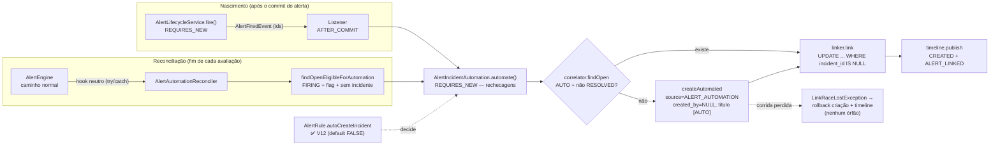

# Alert → Incident Automation — Sentinel

> **Prompt 15 de 18** — a opção opt-in por regra de abrir incidente **automaticamente** quando um alerta nasce: a flag `autoCreateIncident` na `AlertRule`, a origem `source` + ator nulo no `Incident`, a correlação "um incidente automático aberto por serviço" e os dois gatilhos (nascimento do alerta + reconciliação de pós-avaliação). Este documento descreve **o que está construído**: migration `V12` (flag + origem + índices), o sub-pacote `com.sentinel.project.alert.automation` (9 classes), o evento neutro `AlertFiredEvent`, o hook `AlertPostEvaluationHook` no fim do ciclo do engine, o campo `autoCreateIncident` nos DTOs de regra e os badges de origem no frontend. **Nenhuma rota nova foi criada**: a automação é configuração (Prompt 12) + reação interna (este prompt). O ciclo manual continua o do [incidents.md](incidents.md), a avaliação que produz os alertas é a do [alert-engine.md](alert-engine.md), a configuração das regras é a do [alert-rules.md](alert-rules.md) e a base de autenticação (Bearer + CSRF) é a do [identity.md](identity.md).

**Uma `Incident` automática só nasce com a flag ligada** (`alert_rules.auto_create_incident`, default `FALSE`): quem não pediu continua no comportamento exato do Prompt 14 — todo incidente é aberto por um humano. O Alert Engine continua **sem conhecer** o pacote `incident` (fronteira travada por `MonitoringEngineBoundaryTest.alertingPackageHasNoIncidentReferences`): ele notifica um hook de interface neutra, e quem escreve é o pacote `alert.automation`. Notificações, ack, escalonamento e on-call **não existem** (Prompt 16+) — ver §11.

## 1. Escopo implementado

| Item | Estado |
| --- | --- |
| Migration `V12__alert_incident_automation.sql` (flag `alert_rules.auto_create_incident`, `incidents.source`, `created_by_user_id` anulável, 2 índices — aditiva) | Construído |
| `IncidentSource` (`MANUAL` \| `ALERT_AUTOMATION`) + 2º construtor do `Incident` com origem explícita (ator `NULL` só na origem automatizada) | Construído |
| Campo `autoCreateIncident` nos DTOs `AlertRuleCreateRequest`/`AlertRuleUpdateRequest`/`AlertRuleResponse` + persistência no service (ausente → `false` no create; ausente/`null` → não altera no PATCH) | Construído |
| Evento neutro `AlertFiredEvent` publicado no **nascimento** do alerta (`AlertLifecycleService`, ramo que cria) | Construído |
| Hook `AlertPostEvaluationHook` + `AlertAutomationReconciler` no **fim do caminho normal** do `AlertEngine` (try/catch — nunca derruba o ciclo) | Construído |
| Sub-pacote `com.sentinel.project.alert.automation`: `AlertIncidentAutomation` (orquestrador, transação própria `REQUIRES_NEW` via `TransactionTemplate` + 1 retry de índice), `AlertIncidentAutomationListener` (`AFTER_COMMIT`), `AlertIncidentCorrelator`, `AlertIncidentLinker`, `AlertIncidentEventPublisher`, `AlertAutomationReconciler`, `LinkRaceLostException` | Construído |
| `IncidentService.createAutomated` + `findOpenAutomatedByServiceId` + `AlertRepository.findOpenEligibleForAutomation`/`linkIncident` | Construído |
| Correlação: DUAS regras opt-in do mesmo serviço compartilham UM incidente automático aberto; `RESOLVED` nunca é reutilizado; incidente `MANUAL` nunca é adotado; índice parcial único + 1 retry em transação nova como linha de defesa sob corrida; vínculo perdido reverte a criação | Construído |
| Frontend: checkbox "Create incident automatically" nos forms de regra, badge de origem na listagem e no detalhe de incidente, `created_by` vazio (`—`) no incidente automático | Construído |
| Novos endpoints, notificações, ack, escalonamento, on-call, reabertura, IA | **Fora do escopo** (Prompt 16+) |

## 2. Conceito e fluxo

- **Opt-in por regra**: `alert_rules.auto_create_incident BOOLEAN NOT NULL DEFAULT FALSE`. A flag é **configuração editável** como as demais (create/PATCH, `ADMIN`/`OPERATOR`); desligar é **prospectivo** — nunca desfaz vínculo ou incidente já existente.
- **Dois gatilhos, um só caminho de escrita**: (1) **nascimento** — o ramo do `AlertLifecycleService.fire()` que CRIA o alerta publica `AlertFiredEvent` (só ids) dentro da sua transação e o consumidor roda no `AFTER_COMMIT`; (2) **reconciliação** — ao fim de cada avaliação normal, o engine notifica o hook e o reconciler varre os alertas `FIRING` elegíveis do serviço (cobre quem ligou a flag DEPOIS do alerta já existir, e o caso do serviço ter ficado inativo). Os dois convergem em `AlertIncidentAutomation.automate(serviceId, alertId)`.
- **Rechecagem no escritor**: o `automate` desconfia do chamador — relê o alerta na SUA transação (`REQUIRES_NEW`) e só prossegue com status `FIRING`, `incident IS NULL`, flag ainda ligada e serviço+projeto ativos. O estado verdadeiro é o da transação que escreve.
- **Correlação**: antes de criar, procura o incidente automático **aberto** do serviço e o **reutiliza** (uma tempestade de N alertas vira UM incidente com N linhas de timeline, não N incidentes). `MANUAL` nunca é adotado; `RESOLVED` nunca é reutilizado.
- **O que fica registrado**: o incidente automático nasce na MESMA transação da sua timeline — `CREATED` (`"Incident created"`) e, se o vínculo vencer, `ALERT_LINKED` (`"Alert {alertId} linked"`), ator nulo, carimbos estritamente crescentes (gap de 1 ms, mesmo mecanismo do Prompt 14). O alerta ganha `alerts.incident_id` pelo `UPDATE ... WHERE incident_id IS NULL` — a mesma barreira condicional do vínculo manual.



## 3. Modelo de dados (`V12__alert_incident_automation.sql`, aditiva)

### 3.1 `alert_rules.auto_create_incident`

| Aspecto | Decisão |
| --- | --- |
| Coluna | `BOOLEAN NOT NULL DEFAULT FALSE` — comportamento do Prompt 12/13 **inalterado** para quem não pediu |
| Escopo | na **regra** (configuração), não no alerta — quem decide é a condição configurada |
| Semântica | **prospectiva**: vale para os próximos disparos; não reescreve histórico |

### 3.2 `incidents.source` + `created_by_user_id` anulável

- `source VARCHAR(20) NOT NULL DEFAULT 'MANUAL'` + `CHECK incidents_source_check (MANUAL, ALERT_AUTOMATION)` — vocabulário fechado; as linhas pré-V12 recebem `'MANUAL'` (todo incidente existente nasceu de um humano).
- `ALTER COLUMN created_by_user_id DROP NOT NULL` — a automação não tem usuário por trás. **A exigência de ator do caminho manual continua na aplicação**: `IncidentService.create` segue obtendo o ator do `TenantContext` e o construtor de 6 argumentos do `Incident` faz `requireNonNull(createdByUserId)` — nenhum DTO de incidente ganhou campo de autor. A FK permanece: um id preenchido continua obrigado a apontar usuário existente.
- `IncidentResponse.source` passou a ser serializado (`MANUAL` | `ALERT_AUTOMATION`).

### 3.3 Índices (travas e leitura)

| Índice | Predicado | Papel |
| --- | --- | --- |
| `uq_incidents_auto_open_per_service` (UNIQUE, `incidents(service_id)`) | `source = 'ALERT_AUTOMATION' AND status <> 'RESOLVED'` | **linha de defesa sob corrida**: dois ciclos simultâneos não abrem dois automáticos abertos; o pré-check do service é o caminho comum, o índice decide a disputa. Incidentes **manuais ficam fora do predicado** e nunca são afetados |
| `idx_alerts_auto_create_firing` (`alerts(service_id, status)`) | `status = 'FIRING'` | cobre `findOpenEligibleForAutomation` (a reconciliação) — **predicado em CAIXA ALTA**, o MESMO case armazenado por `@Enumerated(STRING)` (um `'firing'` criaria um índice que nunca casa; guardado por `AlertIncidentAutomationTest.v12IndexPredicatesMatchTheStoredStatusCase` via `pg_indexes`) |

O vínculo **não mudou**: continua invertido em `alerts.incident_id` (V11), cardinalidade N alertas : 1 incidente, `UPDATE ... WHERE incident_id IS NULL` sem índice único novo.

## 4. Elegibilidade — ordem das rechecagens (no escritor)

`AlertIncidentAutomation.automate` — **sem `@Transactional` no método**: o orquestrador abre a SUA transação com `TransactionTemplate` em `PROPAGATION_REQUIRES_NEW` (a transação do chamador fica suspensa e não pode contaminar a escrita; e o retry de índice do P1-2 precisa de outra transação limpa, algo que `@Transactional` no próprio método não daria) — desconfia de todo estado herdado do chamador e confere, nesta ordem:

1. **alerta existe** no serviço (sumiu → sai em `debug`, sem exceção);
2. **status `FIRING`** — `RESOLVED` nunca cria (o alerta pode ter normalizado entre o evento e a escrita);
3. **`incident IS NULL`** — já vinculado é no-op idempotente, **sem evento novo**;
4. **flag ainda ligada** na regra do alerta — desligar entre o disparo e a escrita mata a automação (`rule == null` cai aqui também);
5. **serviço + projeto ATIVOS** — nada nasce em estado congelado (mesmo contrato do `PARENT_INACTIVE` do Prompt 13; a janela de corrida "regra desativada → resolve → flag" é coberta pelo teste `inactiveParentsGateTheAutomation`, que devolve o alerta a `FIRING` para reconstruir o caso).

Só então: correlação (§5) → criação (se preciso) → vínculo → timeline.

**Isolamento de falhas** — três redes, nenhuma propaga:

- **nascimento**: o listener `AFTER_COMMIT` engole `RuntimeException` em `log.error` — o alerta commitado já existe e não pode ser desfeito por um consumidor;
- **reconciliação**: o engine chama o hook dentro de `try/catch` (nunca derruba o ciclo de avaliação) e o reconciler tem `try/catch` **por alerta** (um falhou, o ciclo seguinte decide);
- **escrita atômica**: criação + vínculo + timeline correm na MESMA transação `REQUIRES_NEW` do `automate` — ou o incidente nasce inteiro com seus eventos, ou não nasce nada (a transação do alerta nunca participa).

**Corrida extrema** (`created && !linked`): um vínculo humano venceu entre a rechecagem e o `UPDATE`. Em vez de deixar um incidente órfão que "o próximo ciclo associa" (o ciclo seguinte pode vir minutos depois, com o alerta já pertencendo ao incidente humano), o orquestrador lança `LinkRaceLostException`: o rollback da transação inteira **desfaz a criação e a sua timeline numa única operação** — sem escrita dupla de "apagar" — e o alerta permanece no vínculo humano que venceu. O caller (`AFTER_COMMIT` / reconciler) captura `RuntimeException` e loga; nenhum órfão sobrevive ao commit.

**Corrida pelo índice**: se dois criadores lerem "vazio" ao mesmo tempo, o índice parcial único `uq_incidents_auto_open_per_service` derruba o perdedor com `DataIntegrityViolationException` — que **aborta a transação corrente** no Postgres (`current transaction is aborted`; por isso o perdedor não pode nem tentar "ler de novo" na mesma transação). O `automate` engole essa violação (o vencedor já commitou quando o perdedor a recebe), re-tenta **uma** vez em transação nova: a releitura enxerga o incidente do vencedor e o caminho vira "reutiliza + vincula". Uma tentativa extra basta; se repetir, a exceção sobe para o caller logar — nunca um loop.

## 5. Correlação (`AlertIncidentCorrelator` → `findOpenAutomatedByServiceId`)

`incidentRepository.findByServiceIdAndSourceAndStatusNot(serviceId, ALERT_AUTOMATION, RESOLVED)` — leitura `readOnly` que devolve **no máximo uma linha** (o índice parcial único garante a unicidade):

| Situação | Decisão |
| --- | --- |
| Já existe automático aberto do serviço | **reutiliza** — o novo alerta é só mais um `ALERT_LINKED` na timeline dele |
| Dois disparos da MESMA regra | idempotência: o segundo encontra o vínculo/aberto e não duplica |
| Automático anterior `RESOLVED` | **nunca reutilizado** — o próximo disparo nasce um novo (como um humano faria) |
| Só existe incidente `MANUAL` aberto | **nunca adotado** — a automação não sequestra triagem humana; abre o seu |
| Nenhum | cria via `IncidentService.createAutomated` |

**Criação** (`createAutomated` — sempre linha nova, nunca toca em existente): `source = ALERT_AUTOMATION`, `created_by_user_id = NULL`, `title = "[AUTO] {nome da regra} — {severidade}"` (sanitizado, ≤ 200), `description` = mensagem do alerta sanitizada (vazia → `NULL`), `severity` = severidade **do alerta**, `startedAt` = `alert.startedAt` (a linha do tempo nasce no início da condição, não na hora da escrita). O service **não** repete a checagem de pais ativos — quem garante é a rechecagem 5 do orquestrador, na mesma transação.

## 6. Contrato de API — sem rotas novas

A flag entra nos DTOs de regra como qualquer outro campo de configuração:

- **`POST .../alert-rules`** → `autoCreateIncident?: boolean` no body; ausente (`null`) = `false` = comportamento do Prompt 12 (`Boolean.TRUE.equals` no service). Tipo errado → `400 VALIDATION_ERROR` (Jackson, como os demais campos).
- **`PATCH .../alert-rules/{ruleId}`** → `autoCreateIncident?: boolean`; **ausente ou `null` explícito não altera** (mesma semântica dos campos parciais); presente liga/desliga os **próximos** disparos.
- **`GET` (lista/detalhe)** → `autoCreateIncident: boolean` na resposta (sempre presente, `boolean` primitivo).
- **RBAC inalterado**: `ADMIN`/`OPERATOR` mutam, `VIEWER` lê; pais inativos `409` na mutação; a automação em si **não expõe endpoint nenhum** — não há CSRF/role novo porque não há rota nova. `405` nos verbos proibidos não mudou.
- **`GET .../incidents` / `.../incidents/{incidentId}`** → passam a devolver `source` (`MANUAL` | `ALERT_AUTOMATION`) — campo novo de leitura, aditivo.

## 7. Frontend

- **`lib/api.ts`**: `IncidentSource`, `source` em `IncidentResponse`, `createdByUserId: string | null`, `autoCreateIncident` em `AlertRuleResponse`/`AlertRuleCreateRequest`/`AlertRuleUpdateRequest`; os body builders omitem `autoCreateIncident` quando `undefined` (o PATCH continua parcial de verdade).
- **`lib/alert-rules.ts`**: `AUTO_CREATE_INCIDENT_LABEL` ("Create incident automatically") + `AUTO_CREATE_INCIDENT_HINT`; o form nasce com `autoCreateIncident: false` e `buildCreateAlertRuleRequest`/`buildUpdateAlertRuleRequest` **sempre** levam o booleano adiante (o form sempre tem valor — decisão explícita para não depender de default do servidor); `formValuesFromRule` devolve a flag persistida.
- **`lib/incidents.ts`**: `INCIDENT_SOURCE_LABELS` (`MANUAL` → "Manual", `ALERT_AUTOMATION` → "Auto-created"), `incidentSourceBadgeClasses` (badges **visivelmente distintos** por origem), `incidentAuthorLabel` (`null` → `"—"`, o autor do automático não existe).
- **`AlertRulesPanel.tsx`**: checkbox nos forms de criação **e** edição (gate de `VIEWER` inalterado).
- **`IncidentsPanel.tsx`** (célula de Status) e **`IncidentDetail.tsx`** (linha de badges): badge de origem; a linha de autor usa `incidentAuthorLabel`.

## 8. Estrutura de código (backend)

```
com.sentinel.project.alert.automation
├── AlertIncidentAutomation            orquestrador: rechecagens + correlação +
│                                      criação + vínculo + timeline — transação
│                                      própria (REQUIRES_NEW via TransactionTemplate)
│                                      + 1 retry de índice em transação nova
├── LinkRaceLostException              criação + timeline revertidas quando o
│                                      vínculo humano perde a corrida (P1-1) —
│                                      o caller captura e loga
├── AlertIncidentAutomationListener    @TransactionalEventListener(AFTER_COMMIT)
│                                      do AlertFiredEvent — try/catch, loga e segue
├── AlertAutomationReconciler          implements AlertPostEvaluationHook — varre
│                                      elegíveis do serviço, try/catch por alerta
├── AlertIncidentCorrelator            delegates findOpenAutomatedByServiceId
├── AlertIncidentLinker                link → linkIncident (1 linha = venceu)
├── AlertIncidentEventPublisher        CREATED + ALERT_LINKED (gap 1 ms, ator nulo)
├── AlertPostEvaluationHook            interface neutra (o engine só conhece isto)
└── event/AlertFiredEvent              record (alertId, serviceId) — só ids

com.sentinel.alerting (mudanças pontuais)
├── AlertLifecycleService              ramo de CRIAÇÃO publica AlertFiredEvent
│                                      após saveAndFlush (o toque não publica)
└── AlertEngine                        7º construtor: AlertPostEvaluationHook,
                                       chamado no fim do caminho normal em try/catch

com.sentinel.project.incident
├── IncidentService                    + createAutomated (source explícita) e
│                                      + findOpenAutomatedByServiceId (readOnly)
└── Incident                           + 2º construtor (source + ator NULL só
                                       quando ALERT_AUTOMATION)
```

Fronteira: nenhuma linha de `com.sentinel.alerting` cita "incident" (só a interface `AlertPostEvaluationHook` e o registro `AlertFiredEvent`, ambos neutros); o pacote `automation` não tem `@Scheduled`, `@Async`, endpoint nem leitura de métrica — ele é notificado, nunca sonda.

## 9. Testes

**Backend — 802 no total** (`mvn clean test`, exit 0; +26 sobre o baseline P14 de 776):

- `AlertIncidentAutomationTest` (**18**) — contrato de ponta a ponta contra contexto real (Postgres de teste, relógio congelado pelo `FixedMetricsClockConfig`):

  | Critério | Teste |
  | --- | --- |
  | flag ligada: alerta nasce → incidente `ALERT_AUTOMATION`, ator nulo, título `[AUTO]`, timeline `CREATED + ALERT_LINKED`; ciclos extras não duplicam | `flagOn_birthCreatesAutoIncidentLinkedAndOnTimeline` |
  | flag desligada: alerta dispara e nada nasce (nem depois de ciclos extras) | `flagOff_alertFiresButNothingIsBorn` |
  | DUAS regras opt-in do mesmo serviço compartilham UM incidente aberto | `twoOptInRulesShareOneOpenAutoIncident` |
  | `RESOLVED` nunca é reutilizado — o próximo disparo nasce um novo | `resolvedAutoIncidentIsNotReused_nextDisparityOpensNew` |
  | incidente `MANUAL` aberto nunca é adotado pela automação | `manualIncidentIsNeverAdopted` |
  | ligar a flag DEPOIS do disparo: o próximo ciclo reconcilia e cria | `flagTurnedOnAfterFiringIsReconciledNextCycle` |
  | desligar depois do vínculo não desfaz nada (prospectivo) | `flagTurnedOffAfterLinkingChangesNothing` |
  | alerta já vinculado manualmente → no-op idempotente | `alreadyManuallyLinkedAlertIsNoOp` |
  | serviço/projeto inativos bloqueiam a escrita na própria automação (rechecagem 5) | `inactiveParentsGateTheAutomation` |
  | índice parcial único barra o segundo automático aberto e deixa manuais coexistirem | `partialUniqueIndexBlocksSecondOpenAutoIncidentButNotManuals` |
  | predicados dos índices V12 no MESMO case armazenado (`'FIRING'` via `pg_indexes`) | `v12IndexPredicatesMatchTheStoredStatusCase` |
  | flag entra no create/patch/response; ausente vira `false` | `flagRoundTripsThroughCreatePatchAndResponse` |
  | `VIEWER` continua `403` com a flag no payload | `flagDoesNotBypassRbac` |
  | `linkIncident` persiste a FK (a regra de vínculo 1 alerta ≤ 1 incidente continua valendo) | `alertRepositoryRemembersTheLinkedIncident` |
  | **`Alert RESOLVED` ≠ `Incident RESOLVED`**: recuperação do Prompt 13 resolve o ALERTA, o incidente segue `OPEN` e o próximo disparo reutiliza o MESMO incidente (timeline com 2 `ALERT_LINKED`) | `alertRecoveryNeverResolvesItsIncident_nextFireRejoinsTheSameOpenIncident` |
  | a escrita sobrevive ao rollback do chamador (`TransactionTemplate` + `setRollbackOnly` fora) — prova `REQUIRES_NEW` | `automationWriteSurvivesTheCallerTransactionRollback` |
  | serviço errado no par `(serviceId, alertId)` → no-op silencioso sem escrita em lugar nenhum; o par certo escreve | `mismatchedServiceIdIsANoOpAndTheRightPairWrites` |
  | `createAutomated` rejeita título em branco no service (`400 VALIDATION_ERROR`, antes de qualquer escrita) | `createAutomatedRejectsBlankTitleBeforeAnyWrite` |

- `AlertIncidentConcurrencyTest` (**3**) — gatilhos determinísticos por latch (`FlakyAutomationConfig` com beans `@Primary` que sobrescrevem correlator/linker):

  | Cenário | Teste |
  | --- | --- |
  | dois criadores leem "vazio" juntos → índice derruba um → 1 retry em transação nova → 1 incidente, 2 alertas, timeline `CREATED + 2×ALERT_LINKED` (P1-2) | `twoEligibleAlertsRacingTheCorrelationIndexEndInOneIncidentWithBothAlerts` |
  | vínculo humano vence durante o automático → `LinkRaceLostException` → rollback: só o manual sobrevive, 0 eventos órfãos (P1-1) | `manualLinkWinningTheRaceLeavesNoOrphanIncident` |
  | falha no correlator é isolada no listener e reconciliada no ciclo seguinte (P2-3) | `correlationFailureIsIsolatedAndReconcilesOnTheNextCycle` |

- `IncidentApiTest` (**31**, +1): `createIgnoresSourceAndAlwaysRespondsManual` — o POST aceita `source`/`createdByUserId` no body (Jackson ignora o desconhecido), responde `MANUAL` com o ator do token (P2-5).
- Novos de apoio: `FlakyAutomationConfig` (gates determinísticos por latch para as corridas) e `AlertIncidentConcurrencyTest`.
- Atualizados: `MonitoringEngineBoundaryTest` (V12 é a última migration, não existe V13, exceção do hook é tratada), `AlertMigrationTest`/`AlertRuleMigrationTest` (catálogo `V1..V12`), `AlertFailureIsolationTest` (7º parâmetro do engine), `IncidentModelTest` (+4: origem, ator nulo, validações).
- Garantias de fronteira (grep): `com.sentinel.alerting` sem literal `incident`/`Incident` além dos arquivos neutros nomeados; `alert.automation` sem `@Scheduled`/`@Async`/`@RestController`; `project.alert` (config) sem token `evaluat*`/`firing*`.

**Frontend — 175 no total** (`npm run test`, exit 0; +5 sobre o baseline P14 de 170):

- `alert-rules.test.ts` (+3): flag nasce `false` no form e o builder a leva; `autoCreateIncident` informado vai ao body de create e de PATCH (ausente continua omitido); fixture `autoCreateIncident: false` nas respostas simuladas.
- `incidents.test.ts` (+2): `incidentAuthorLabel` (`—` quando nulo) e badge de origem distinto por `MANUAL` × `ALERT_AUTOMATION`; fixtures ganharam `source`; listas de campos proibidos de escopo ganharam `source` (server-owned da resposta).
- `type-check` 0, `lint` 0, `next build` 0.

## 10. Decisões fixadas

1. **Opt-in default OFF** — o Prompt 12/13 não muda de comportamento para quem não pediu; a migration só adiciona.
2. **Sem rota nova** — automação é configuração + reação interna; nenhum CSRF/role/endpoint novo para manter.
3. **Interface neutra no engine** — `AlertEngine` só conhece `AlertPostEvaluationHook`; quem sabe o que é `Incident` mora **fora** de `com.sentinel.alerting` (fronteira do Prompt 13 preservada).
4. **Evento só no nascimento** — "virou alerta" acontece uma vez só; o toque (deduplicação) não publica, e a reconciliação cobre o resto sem evento.
5. **`AFTER_COMMIT` síncrono + `REQUIRES_NEW`** — o consumidor enxerga o alerta commitado e a escrita da automação é atômica e isolada (design provado em teste real, sem outbox/scheduler).
6. **`REQUIRES_NEW` no escritor via `TransactionTemplate`** — um incidente criado nunca pode ser desfeito pelo rollback de terceiros (um chamador que desiste com `setRollbackOnly` não leva a escrita junto), e o `clearAutomatically` do `linkIncident` força releitura honesta. O método **não** tem `@Transactional`: a transação precisa nascer dentro do `automate`, porque o retry do índice (P1-2) exige uma segunda transação limpa — a violação de índice aborta a corrente e a tentativa seguinte não pode herdar nada dela.
7. **Correlação por serviço com origem** — reutiliza automático aberto, ignora manual, nunca reusa `RESOLVED`; o índice parcial único decidiu a corrida com 1 retry em transação nova; o vínculo perdido reverte a criação (`LinkRaceLostException`) em vez de deixar órfão.
8. **Ator `NULL` só automatizado** — a exigência de humano na rota manual permanece na aplicação, não na coluna (a V12 não consegue expressar "NULL iff AUTOMATION" num CHECK simples sem coluna derivada — a regra vive no construtor e no service).
9. **Título `[AUTO]` + severidade/mensagem do alerta** — o incidente é legível na lista ao lado dos manuais e a timeline sincroniza com `alert.startedAt`.
10. **Falha vira log, nunca exceção** — nascer alerta é o contrato do engine; a automação é um convidado (a `LinkRaceLostException` é a única exceção proposital, e o caller captura e loga).
11. **`fallbackExecution = false` (default) no listener** — o `AlertFiredEvent` só é publicado DENTRO da transação do nascimento (nunca fora de uma); sem transação ativa o listener **não** roda (o evento não tem onde se pendurar), e a reconciliação do ciclo seguinte cobre qualquer pulo.

## 11. Fronteira com o Prompt 16 (fora do escopo)

```mermaid
graph LR
    FLAG["AlertRule.autoCreateIncident<br/>✅ V12"] -. decide .-> AUTO["automation (P15)"]
    AUTO -->|nascimento + reconciliação| INC["Incident source=ALERT_AUTOMATION<br/>✅ P15 — ator nulo, título [AUTO]"]
    INC -.x. NEXT["notificações (e-mail/Slack/webhook), ack,<br/>silenciamento, escalonamento, atribuição,<br/>on-call, pós-mortem, reabertura<br/>⛔ NOT IMPLEMENTED (P16+)"]
    ALERT["Alert"] -. "RESOLVED não resolve<br/>o incidente (P2-1)" .-> INC
    ALERT -.x. AI["IA / correlação semântica<br/>⛔ sem LLM, sem scoring"]
```

- **Fronteira do que a automação escreve** — ela só **cria** e **vincula**: `Alert RESOLVED` ≠ `Incident RESOLVED` (a recuperação do Prompt 13 fecha o alerta e o incidente automático segue `OPEN`; o próximo disparo se junta ao mesmo incidente aberto). Nenhum `status`/`resolve`/`ack` de alerta ou incidente passa por aqui.

- **Não há notificação, ack, silenciamento, escalonamento, atribuição, on-call, pós-mortem ou reabertura** — nenhuma tabela, endpoint, campo ou enum para eles (o incidente continua seguindo a máquina de estados do Prompt 14).
- **Não há scheduler nem `@Scheduled`** — os gatilhos são eventos do próprio ciclo de avaliação (nascimento) e o fim de cada avaliação (reconciliação); o único relógio é o `Clock` do monitoring.
- **Não há IA** — a correlação é exata por `service_id` + origem + status; nada de embedding, score ou sugestão.
- **Não há escrita fora da transação da automação** — o Alert Engine continua sem endpoint de escrita e sem referência ao pacote `incident` (travado por `alertingPackageHasNoIncidentReferences`).
- **Não há mudança no vínculo manual** — `PUT`/`DELETE .../incidents/{incidentId}/alerts/{alertId}` do Prompt 14 seguem iguais (a automação usa o MESMO `UPDATE ... WHERE incident_id IS NULL` do repositório).
