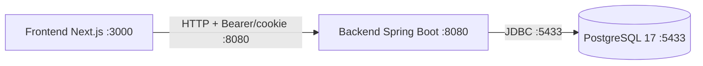

# Fundação da arquitetura — Sentinel

> Prompt 01 de 18 (atualizado nos **Prompt 02 — Identity** e **Prompt 03 — Identity stateless**). Este documento descreve **decisões e fronteiras planejadas**; apenas o que estiver indicado como "construído" existe hoje no código.

## 1. Decisões arquiteturais

| Decisão | Escolha | Justificativa |
| --- | --- | --- |
| Estilo do backend | **Monólito modular** (pacote único `com.sentinel` com fronteiras por domínio) | Time pequeno, domínio ainda em descoberta; evita custo de rede/deploy prematuro de microserviços, mantendo separação lógica para extrair serviços no futuro se houver necessidade real. |
| Frontend separado | **SPA Next.js ↔ API REST** em processos/portas distintos (3000 ↔ 8080) | Separação de ciclos de deploy e responsabilidades (UI vs domínio); comunicação HTTP JSON com CORS restrito ao localhost. |
| Banco de dados | **PostgreSQL 17** (único banco) | Robustez, conformidade com o padrão do projeto; multi-tenancy futuro via schema/dados, não via múltiplos bancos. |
| Infraestrutura via Docker | **Somente PostgreSQL** no Compose (apps rodam localmente) | Docker serve aqui como infra de dependência, não como runtime de app — reduz complexidade no Prompt 01. Backend mapeado fora da porta 5432 do host (usa **5433**). |
| Evolução de schema | **Flyway** (`classpath:db/migration`, `ddl-auto=validate`) | Migrations versionadas, reviewáveis e repetíveis; JPA nunca gera schema em runtime. |
| Evolução incremental | Fundação com health, erros padronizados, CORS, async e perfis dev/test/prod | Permite crescer por prompts (identity → organizations → …) sem reescrever a base nem introduzir microserviços prematuros. |

## 2. Fronteiras modulares planejadas (NÃO implementadas)

As fronteiras abaixo **não existem como código nem como pastas vazias** — são apenas o mapa previsto:

- **identity** — ⚠️ **parcialmente construída nos Prompt 02 e 03**: usuários, credenciais (BCrypt) e autenticação *stateless* (`register`/`login`/`refresh`/`logout`/`me`, access token JWT + refresh token em cookie, CSRF, CORS). Ainda **faltam**: papéis e permissões (RBAC).
- **organizations** — tenants da plataforma: organizações, membros, papéis por organização e troca de contexto de tenant.
- **projects** — agrupamento lógico dentro de uma organização: projetos, ambientes e vinculação de serviços.
- **services** — catálogo dos serviços monitorados: cadastro, metadados, tags e associação a projetos.
- **monitoring** — coleta e estado de saúde dos serviços: checks, métricas, janelas de observação e sinais de falha.
- **alerting** — regras e decisões de alerta: condições, thresholds, supressões e disparo de notificações futuras.
- **incidents** — ciclo de vida de incidentes: abertura, triagem, atualização, resolução e histórico.
- **audit** — trilha de auditoria imutável de ações relevantes (quem fez o quê, quando, em qual tenant).

## 3. Diagrama da fundação construída

O que existe hoje no backend:

- `GET /api/v1/health` — health técnico do serviço (também materializa o cookie `XSRF-TOKEN`).
- `GET /actuator/health` — health do Actuator (sem detalhes).
- Tratamento global de erros com shape `{code, message, timestamp, path}` (+ 404 padronizado para rota desconhecida).
- **Prompt 02**: `POST /api/v1/auth/register`, `POST /api/v1/auth/login`, `GET /api/v1/auth/me` — BCrypt, tabela `users` (`V2`).
- **Prompt 03**: autenticação *stateless* — access token JWT HS256 (15 min, claims `sub`/`iat`/`exp`) validado pelo `oauth2ResourceServer`, refresh token opaco em cookie `HttpOnly + SameSite=Strict + Path=/api/v1/auth` (7 dias, só o SHA-256 persistido) com rotação atômica, revogação em caso de reuso e logout idempotente; CSRF double-submit (`XSRF-TOKEN`/`X-XSRF-TOKEN`); tabela `refresh_tokens` (`V3`).
- CORS liberado para `http://localhost:3000` com credenciais — **fonte única**: `SecurityConfig.corsConfigurationSource`, origens agora configuráveis via `app.cors.allowed-origins` (o antigo `WebMvcConfig` foi removido no Prompt 02).
- Bean assíncrono (`taskExecutor`) como base futura de processamento assíncrono.
- Flyway: `V1__init_schema.sql` (fundação) + `V2__create_users_table.sql` (identity) + `V3__create_refresh_tokens_table.sql` (refresh tokens).

## 4. Configuração por ambientes

Perfil ativo por `SPRING_PROFILES_ACTIVE` (default `dev`):

| Perfil | Arquivo | Características |
| --- | --- | --- |
| `dev` | `application-dev.yml` | `logging.com.sentinel=DEBUG`, `spring.jpa.show-sql=true` |
| `test` | `application-test.yml` | `logging=INFO`, `show-sql=false`, **Flyway habilitado** (testes usam Testcontainers com PostgreSQL real) |
| `prod` | `application-prod.yml` | `logging=INFO`, `show-sql=false`, `flyway.validate-on-migrate=true`, **`JWT_SECRET` e `DATABASE_PASSWORD` obrigatórias** (fail-fast), `jwt.cookie.secure=true` |

Base comum (`application.yml`): porta `${SERVER_PORT:8080}`, datasource `jdbc:postgresql://localhost:5433/sentinel`, `ddl-auto=validate`, `open-in-view=false`, actuator expondo apenas `health` e `info` com `show-details: never`, bloco `jwt.*` e `app.cors.allowed-origins`.

Segredos nunca ficam no código: usa-se `.env` (gitignored) a partir de `.env.example` (placeholders). O `jwt.secret` não é logado; em `dev`/`test` vazio o backend gera um segredo efêmero no startup (WARNING no log — reiniciar invalida os tokens emitidos).

## 5. Integração Frontend ↔ Backend

- O frontend consome a API através de `NEXT_PUBLIC_API_URL` (default `http://localhost:8080`).
- Técnicas de smoke: `GET /api/v1/health` (também devolve o cookie `XSRF-TOKEN` que o frontend usa no double-submit).
- **Backend (Prompt 03)**: `register`, `login`, `refresh`, `logout` públicos com CSRF; `me` exige `Authorization: Bearer <accessToken>`. O refresh viaja em cookie `HttpOnly + Path=/api/v1/auth`.
- **Frontend (Prompt 03)**: adaptado ao contrato stateless — access token em memória com header `Authorization: Bearer`, refresh token em cookie `HttpOnly` (requisições com `credentials: "include"`), CSRF via header `X-XSRF-TOKEN` e bootstrap de sessão via `POST /refresh`.
- CORS no backend permite a lista de origens de `app.cors.allowed-origins` (default `http://localhost:3000`) com `GET, POST, PUT, DELETE, OPTIONS`, `X-XSRF-TOKEN` e `allowCredentials=true`, configurado unicamente no `SecurityConfig`.

## 6. Fora do escopo desta fundação

RBAC, multi-tenancy, entidades de domínio (Organization, Membership, Project, Service, Monitor, Alert, Incident), scheduler, dashboards e notificações **não existem** e serão endereçados nos prompts futuros. (Auth entrou no Prompt 02 — sessão transitória — e foi migrada para JWT/refresh no Prompt 03, com o frontend adaptado ao mesmo contrato — ver [identity.md](identity.md).)
