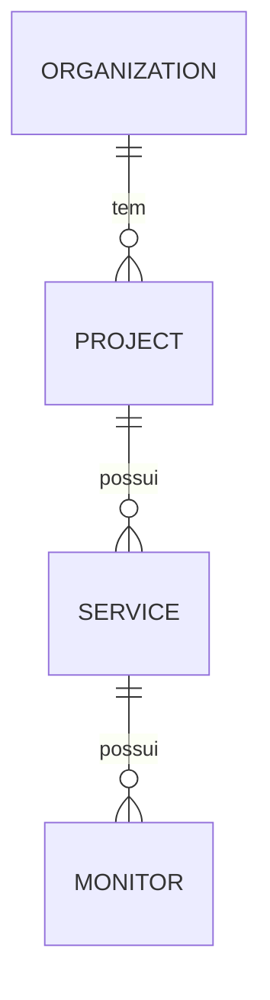
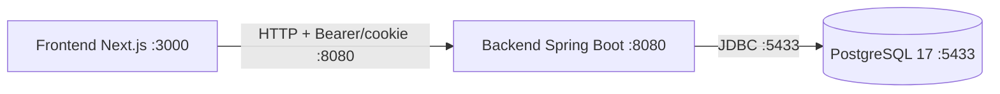

# Fundação da arquitetura — Sentinel

> Prompt 01 de 18 (atualizado nos **Prompt 02 — Identity**, **Prompt 03 — Identity stateless**, **Prompt 04 — Multi-tenancy**, **Prompt 05 — Tenant Security**, **Prompt 06 — Projects**, **Prompt 07 — Services**, **Prompt 08 — Monitors** e **Prompt 09 — Monitoring Engine**). Este documento descreve **decisões e fronteiras planejadas**; apenas o que estiver indicado como "construído" existe hoje no código.

## 1. Decisões arquiteturais

| Decisão | Escolha | Justificativa |
| --- | --- | --- |
| Estilo do backend | **Monólito modular** (pacote único `com.sentinel` com fronteiras por domínio) | Time pequeno, domínio ainda em descoberta; evita custo de rede/deploy prematuro de microserviços, mantendo separação lógica para extrair serviços no futuro se houver necessidade real. |
| Frontend separado | **SPA Next.js ↔ API REST** em processos/portas distintos (3000 ↔ 8080) | Separação de ciclos de deploy e responsabilidades (UI vs domínio); comunicação HTTP JSON com CORS restrito ao localhost. |
| Banco de dados | **PostgreSQL 17** (único banco) | Robustez, conformidade com o padrão do projeto; multi-tenancy via dados compartilhados (coluna/relação de organização), não via múltiplos bancos ou schemas. |
| Infraestrutura via Docker | **Somente PostgreSQL** no Compose (apps rodam localmente) | Docker serve aqui como infra de dependência, não como runtime de app — reduz complexidade no Prompt 01. Backend mapeado fora da porta 5432 do host (usa **5433**). |
| Evolução de schema | **Flyway** (`classpath:db/migration`, `ddl-auto=validate`) | Migrations versionadas, reviewáveis e repetíveis; JPA nunca gera schema em runtime. |
| Evolução incremental | Fundação com health, erros padronizados, CORS, async e perfis dev/test/prod | Permite crescer por prompts (identity → organizations → …) sem reescrever a base nem introduzir microserviços prematuros. |

## 2. Fronteiras modulares (construídas × planejadas)

As fronteiras **identity**, **organizations**, **projects**, **services**, **monitors** e a **execução do monitoring** já existem como código. As demais **não existem como código nem como pastas vazias** — são apenas o mapa previsto:

- **identity** — ⚠️ **parcialmente construída nos Prompt 02 e 03**: usuários, credenciais (BCrypt) e autenticação *stateless* (`register`/`login`/`refresh`/`logout`/`me`, access token JWT + refresh token em cookie, CSRF, CORS). Ainda **faltam**: permissões por recurso além dos papéis de organização.
- **organizations** — ✅ **construída no Prompt 04**: tenants da plataforma — `Organization`, `Membership`, papéis por organização (`ADMIN`/`OPERATOR`/`VIEWER`), gestão de membros e resolução de contexto de tenant (`TenantContext` + `TenantInterceptor` + `@TenantScoped`). Contrato em [organizations.md](organizations.md).
- **projects** — ✅ **construída no Prompt 06**: agrupamento lógico dentro de uma organização — tabela `projects` (migration `V5`), pacote `com.sentinel.project` (entidade, repositório, DTOs, service e controller), unicidade de nome por organização em duas camadas, ativação/desativação idempotente. Herda o contexto de tenant já resolvido (não recria filtro, interceptor nem regra de segurança). Contrato em [projects.md](projects.md). **Ambientes** continuam **planejados**.
- **services** — ✅ **construída no Prompt 07**: catálogo dos serviços de um projeto — tabela `services` (migration `V6`), entidades `Service`/`ServiceStatus` no **mesmo** pacote `com.sentinel.project` (sub-recurso, não pacote novo), unicidade de nome **por projeto** em duas camadas, ativação/desativação idempotente e dois eixos independentes (`active` = catálogo, `status` = observação, inalterável por endpoint). A autorização encadeia Organization → Project → Service em duas consultas tenant-scoped (nunca `findById` avulso). Contrato em [services.md](services.md). **Coleta de dados de saúde, alertas e incidentes** continuam **planejados**.
- **monitors** — ✅ **construída no Prompt 08**: quarto nível da hierarquia (Organization → Project → Service → Monitor) — tabela `monitors` (migration `V7`), sub-pacote `com.sentinel.project.monitor` (entidade, repositório, DTOs, service e controller) + guarda SSRF em `com.sentinel.project.security`, unicidade de nome **por serviço** em duas camadas, ativação/desativação idempotente, alvo privado recusado **antes de persistir** e autorização encadeada em **três consultas** tenant-scoped. Contrato em [monitors.md](monitors.md). **Resultados e status operacional** continuam **planejados**.
- **monitoring** — ⚠️ **execução construída no Prompt 09** (coleta e estado de saúde dos serviços): pacote `com.sentinel.monitoring` — scheduler com tick curto, seleção de elegíveis no banco, pool dedicado com guarda de in-flight e backpressure, execução HTTP real com revalidação SSRF por conexão (mesma `SsrfGuard` do Prompt 08, fonte única) e classificação `MonitorOutcome` × `FailureCategory` em **resultado transitório** (log + contadores, sem persistência, sem migration, sem tipo `MonitorCheck`). Contrato em [monitoring-engine.md](monitoring-engine.md). **Persistência de resultados, séries temporais, métricas e status operacional** continuam **planejados** (Prompt 10+).
- **alerting** — regras e decisões de alerta: condições, thresholds, supressões e disparo de notificações futuras.
- **incidents** — ciclo de vida de incidentes: abertura, triagem, atualização, resolução e histórico.
- **audit** — trilha de auditoria imutável de ações relevantes (quem fez o quê, quando, em qual tenant).

Fronteiras construídas e o caminho da requisição autenticada (o contexto de tenant é resolvido **uma** vez e só é lido nos services):

```mermaid
graph TB
    FE[Frontend Next.js] -->|Bearer + CSRF| BE[SecurityConfig<br/>JWT + CSRF + CORS]
    BE -->|/auth/** sem tenant| ID[identity<br/>✅ Prompt 02/03]
    BE -->|demais rotas| INTER[TenantInterceptor<br/>só em handlers @TenantScoped]
    INTER -->|popula| TC[TenantContext<br/>organizationId + role]
    INTER --> ORG[organization<br/>✅ Prompt 04/05]
    INTER --> PRJ[project<br/>✅ Prompt 06]
    INTER --> SVC[services<br/>✅ Prompt 07]
    INTER --> MONIT[monitors<br/>✅ Prompt 08]
    ORG -->|papéis ADMIN/OPERATOR/VIEWER| TC
    PRJ -->|lê papel semântico| TC
    SVC -->|lê papel semântico| TC
    MONIT -->|lê papel semântico| TC
    PRJ -->|1 -- * serviços| SVC
    SVC -->|1 -- * monitores| MONIT
    SVC -.->|executa checagens| MON[monitoring<br/>✅ Prompt 09 (execução)]
    MON -.resultado transitório (sem persistência).-> ALT[alerting]
    MON -.planejado.-> INC[incidents]
```

Hierarquia de dados do tenant (a cardinalidade é a regra do Prompt 08: um serviço tem de zero a N monitores e cada monitor pertence a exatamente um serviço):



Cardinalidade lida no diagrama: `PROJECT ||--o{ SERVICE` = **Project 1 → \* Service** (zero a N serviços por projeto; cada serviço, exatamente um projeto) e `SERVICE ||--o{ MONITOR` = **Service 1 → \* Monitor** (zero a N monitores por serviço; cada monitor, exatamente um serviço).

- `organizations.id` → `projects.organization_id` (`ON DELETE CASCADE`);
- `projects.id` → `services.project_id` (**`ON DELETE RESTRICT`** — a linha de serviço é histórico do projeto, diferente do `CASCADE` dos dois níveis acima);
- `services.id` → `monitors.service_id` (**`ON DELETE RESTRICT`** — a linha de monitor é a configuração declarativa do serviço);
- a unicidade de serviços é **`UNIQUE (project_id, name_normalized)`**: por projeto, não global; a de monitores é **`UNIQUE (service_id, name_normalized)`**: por serviço, não global (inclusive sobre linhas inativas).

## 3. Diagrama da fundação construída



O que existe hoje no backend:

- `GET /api/v1/health` — health técnico do serviço (também materializa o cookie `XSRF-TOKEN`).
- `GET /actuator/health` — health do Actuator (sem detalhes).
- Tratamento global de erros com shape `{code, message, timestamp, path}` (+ 404 padronizado para rota desconhecida; **405** para método não permitido em rota existente, Prompt 04; **400** genérico para corpo malformado e parâmetro de tipo inválido, Prompt 05).
- **Prompt 02**: `POST /api/v1/auth/register`, `POST /api/v1/auth/login`, `GET /api/v1/auth/me` — BCrypt, tabela `users` (`V2`).
- **Prompt 03**: autenticação *stateless* — access token JWT HS256 (15 min, claims `sub`/`iat`/`exp`) validado pelo `oauth2ResourceServer`, refresh token opaco em cookie `HttpOnly + SameSite=Strict + Path=/api/v1/auth` (7 dias, só o SHA-256 persistido) com rotação atômica, revogação em caso de reuso e logout idempotente; CSRF double-submit (`XSRF-TOKEN`/`X-XSRF-TOKEN`); tabela `refresh_tokens` (`V3`).
- **Prompt 04**: multi-tenancy — `POST`/`GET /api/v1/organizations`, `GET /api/v1/organizations/{organizationId}` e gestão de membros em `/api/v1/organizations/{organizationId}/members` (`GET`/`POST`/`PATCH`/`DELETE`); `TenantContext` (ThreadLocal) populado pelo `TenantInterceptor` em handlers `@TenantScoped` (path `organizationId` ou header `X-Organization-Id`) e sempre limpo no fim da requisição; papéis `ADMIN`/`OPERATOR`/`VIEWER`, regra do último ADMIN sob lock pessimista, isolamento cross-tenant com 404 genérico; tabelas `organizations` e `memberships` (`V4`).
- **Prompt 05**: tenant security sem mudança de contrato — a autoridade é consultada no servidor **por requisição** (papel nunca em JWT: promoção/rebaixamento/remoção valem sem refresh), a matriz de ataques IDOR (`GET`/`POST`/`PATCH`/`DELETE` cross-tenant, `membershipId` de outro tenant ou aleatório, path × header divergente) responde o mesmo `404` genérico sem efeito colateral, a regra do último ADMIN é coberta sob concorrência (`PATCH × PATCH`, `PATCH × DELETE` e dois ADMINs em corrida), corpo/parâmetro inválido vira `400` genérico, origens CORS são validadas no startup e os headers de segurança padrão ficam verificados. **Sem migrations novas.**
- **Prompt 06**: primeiro recurso de domínio do tenant — `POST`/`GET /api/v1/organizations/{organizationId}/projects`, `GET`/`PATCH .../projects/{projectId}` e `PATCH .../projects/{projectId}/status` (leitura para qualquer papel, mutação para `ADMIN`/`OPERATOR` via `TenantContext.role()`), unicidade de nome por organização em **duas camadas** (pré-check → `409` + `UNIQUE (organization_id, name_normalized)` traduzido no mesmo `409`, nunca `500`), listagem paginada com filtros `active`/`name`, ordenação por allowlist (`createdAt`/`name`/`id`) com desempate por `id`, `DELETE` → `405`, tabela `projects` (`V5`) — contrato em [projects.md](projects.md).
- **Prompt 07**: segundo nível da hierarquia (Organization → Project → Service) — `POST`/`GET .../projects/{projectId}/services`, `GET`/`PATCH .../services/{serviceId}` e `PATCH .../services/{serviceId}/activation` (mesma matriz de papéis do Prompt 06), autorização encadeada em **duas consultas** (`findByOrganizationIdAndId` + `findByProjectIdAndId`, nunca `findById` avulso), unicidade de nome **por projeto** em duas camadas (`409 SERVICE_NAME_DUPLICATE` inclusive sob concorrência), listagem com filtros combináveis `active`/`status`/`name`, projeto inativo → leitura `200` × mutação `409 PROJECT_INACTIVE`, `status` como eixo de servidor **sem endpoint de alteração**, `DELETE` → `405`, tabela `services` (`V6`) — contrato em [services.md](services.md).
- **Prompt 08**: terceiro nível da hierarquia (Organization → Project → Service → Monitor) — `POST`/`GET .../services/{serviceId}/monitors`, `GET`/`PATCH .../monitors/{monitorId}` e `PATCH .../monitors/{monitorId}/activation` (mesma matriz de papéis dos Prompts 06/07), autorização encadeada em **três consultas** (`findByOrganizationIdAndId` + `findByProjectIdAndId` + `findByServiceIdAndId`, nunca `findById` avulso), unicidade de nome **por serviço** em duas camadas (`409 MONITOR_NAME_DUPLICATE` inclusive sob concorrência), listagem com filtros combináveis `active`/`method`/`name`, serviço inativo → leitura `200` × mutação `409 PROJECT_INACTIVE`/`409 SERVICE_INACTIVE` com desativação **fail-safe**, `type=HTTP` como eixo de servidor **sem endpoint de alteração**, alvo privado/loopback recusado **antes de persistir** (`SsrfGuard` → `400 MONITOR_TARGET_NOT_ALLOWED`, revalidado também na reativação `false → true`), `DELETE` → `405`, tabela `monitors` (`V7`) — contrato em [monitors.md](monitors.md).
- **Prompt 09**: execução das checagens HTTP — **sem endpoint novo e sem migration** —, pacote `com.sentinel.monitoring`: `@Scheduled` condicional (`sentinel.monitoring.enabled`, ligado por default e desligado no perfil `test`), tick curto (elegibilidade no banco → poda do `DueTracker` → **isDue → tryDispatch → commit somente em aceite**), pool dedicado `sentinel-monitoring-*` com guarda de in-flight (nunca em paralelo) e saturação contada à parte, revalidação do alvo **por conexão** pela mesma `SsrfGuard` do Prompt 08 (TOCTOU/DNS rebinding), transporte `java.net.http` **sem seguir redirects** e com corpo descartado, classificação `MonitorOutcome` (`SUCCESS`/`TARGET_FAILURE`/`SENTINEL_INTERNAL_FAILURE`) × `FailureCategory` (`DNS`/`CONNECT`/`TIMEOUT`/`TLS`/`HTTP_ERROR`/`SSRF_REVALIDATION`/`INTERNAL`) em **resultado transitório em memória** (log + contadores; fronteira sem `MonitorCheck`, sem `@Entity` no pacote e sem migration de história — travada por `MonitoringEngineBoundaryTest`) — contrato em [monitoring-engine.md](monitoring-engine.md).
- CORS liberado para `http://localhost:3000` com credenciais — **fonte única**: `SecurityConfig.corsConfigurationSource`, origens configuráveis via `app.cors.allowed-origins` (o antigo `WebMvcConfig` foi removido no Prompt 02); desde o Prompt 04 os métodos incluem `PATCH` e os headers incluem `X-Organization-Id`; desde o **Prompt 05** a lista é **validada no startup** (curinga com `allowCredentials=true` derruba a subida) e as respostas trazem `X-Content-Type-Options: nosniff` e `X-Frame-Options: DENY` (defaults do Spring Security).
- Bean assíncrono (`taskExecutor`) como base futura de processamento assíncrono.
- Flyway: `V1__init_schema.sql` (fundação) + `V2__create_users_table.sql` (identity) + `V3__create_refresh_tokens_table.sql` (refresh tokens) + `V4__create_organizations_and_memberships.sql` (multi-tenancy) + `V5__create_projects_table.sql` (projetos, Prompt 06) + `V6__create_services_table.sql` (serviços, Prompt 07) + `V7__create_monitors_table.sql` (monitores, Prompt 08) — **os Prompts 05 e 09 não acrescentam migrations**; os Prompts 07 e 08 acrescentam exatamente uma cada.

## 4. Configuração por ambientes

Perfil ativo por `SPRING_PROFILES_ACTIVE` (default `dev`):

| Perfil | Arquivo | Características |
| --- | --- | --- |
| `dev` | `application-dev.yml` | `logging.com.sentinel=DEBUG`, `spring.jpa.show-sql=true` |
| `test` | `application-test.yml` | `logging=INFO`, `show-sql=false`, **Flyway habilitado** (testes usam Testcontainers com PostgreSQL real) |
| `prod` | `application-prod.yml` | `logging=INFO`, `show-sql=false`, `flyway.validate-on-migrate=true`, **`JWT_SECRET` e `DATABASE_PASSWORD` obrigatórias** (fail-fast), `jwt.cookie.secure=true` |

Base comum (`application.yml`): porta `${SERVER_PORT:8080}`, datasource `jdbc:postgresql://localhost:5433/sentinel`, `ddl-auto=validate`, `open-in-view=false`, actuator expondo apenas `health` e `info` com `show-details: never`, bloco `jwt.*`, `app.cors.allowed-origins` e o bloco `sentinel.monitoring.*` (`enabled=true`, `scheduler-delay-ms=10000`, `worker-count=4`, `queue-capacity=200` — defaults idênticos aos da classe; no perfil `test` o `enabled=false` impede qualquer tick agendado nos testes existentes).

Segredos nunca ficam no código: usa-se `.env` (gitignored) a partir de `.env.example` (placeholders). O `jwt.secret` não é logado; em `dev`/`test` vazio o backend gera um segredo efêmero no startup (WARNING no log — reiniciar invalida os tokens emitidos).

## 5. Integração Frontend ↔ Backend

- O frontend consome a API através de `NEXT_PUBLIC_API_URL` (default `http://localhost:8080`).
- Técnicas de smoke: `GET /api/v1/health` (também devolve o cookie `XSRF-TOKEN` que o frontend usa no double-submit).
- **Backend (Prompt 03)**: `register`, `login`, `refresh`, `logout` públicos com CSRF; `me` exige `Authorization: Bearer <accessToken>`. O refresh viaja em cookie `HttpOnly + Path=/api/v1/auth`.
- **Frontend (Prompt 03)**: adaptado ao contrato stateless — access token em memória com header `Authorization: Bearer`, refresh token em cookie `HttpOnly` (requisições com `credentials: "include"`), CSRF via header `X-XSRF-TOKEN` e bootstrap de sessão via `POST /refresh`.
- **Backend (Prompt 04)**: `/api/v1/organizations` autenticado por Bearer (+ CSRF nos métodos não-safe); o detalhe e todos os endpoints de membros são `@TenantScoped` — o `TenantInterceptor` valida a membership **antes** do handler e devolve 404 genérico a não-membros; `/members` exige `ADMIN` no service (papel lido do `TenantContext`, nunca de JWT).
- **Backend (Prompt 06)**: os endpoints de projetos herdam exatamente a mesma cadeia — Bearer, CSRF nos métodos não-safe, `@TenantScoped` no path `{organizationId}` e papel lido do `TenantContext`; a listagem devolve `Page` no formato `{content, totalElements, totalPages, number, size}` (mesma forma que o cliente de projetos já consome).
- **Backend (Prompt 07)**: os endpoints de serviços ficam **dentro** da rota do projeto (`.../projects/{projectId}/services`) e herdam a mesma cadeia — Bearer, CSRF nos métodos não-safe, `@TenantScoped` e papel do `TenantContext`; `projectId` e `serviceId` são parseados manualmente no controller (UUID inválido → o mesmo `404` genérico, nunca `400`/`500`); a listagem devolve o **mesmo** formato de `Page` do Prompt 06, agora com o filtro adicional `status`.
- **Backend (Prompt 08)**: os endpoints de monitores ficam **dentro** da rota do serviço (`.../services/{serviceId}/monitors`) e herdam a mesma cadeia — Bearer, CSRF nos métodos não-safe, `@TenantScoped` e papel do `TenantContext`; `projectId`, `serviceId` e `monitorId` são parseados manualmente no controller (UUID inválido → o mesmo `404` genérico, nunca `400`/`500`); a listagem devolve o **mesmo** formato de `Page` do Prompt 06, agora com os filtros `active`/`method`/`name` e `method` tipado como enum (valor fora de `GET`/`HEAD` → `400` `"Invalid request parameter"`, nunca `500`); o corpo de criação passa por `@Valid` (o `PATCH` valida no service, para distinguir ausente de em branco) e a rota de ativação exige `Boolean` não-nulo.
- **Frontend (Prompt 04)**: a home lista/cria/seleciona organizações (org ativa persistida em `localStorage` sob `sentinel.activeOrganizationId`) e gerencia membros (adicionar, alterar papel, remover) quando o papel do usuário é `ADMIN`; a seção de organizações só carrega depois que a sessão está confirmada (callback `onAuthStateChange` do `AuthStatus`), evitando corrida com o bootstrap do refresh.
- CORS no backend permite a lista de origens de `app.cors.allowed-origins` (default `http://localhost:3000`) com `GET, POST, PUT, PATCH, DELETE, OPTIONS`, `Content-Type`, `Authorization`, `X-XSRF-TOKEN`, `X-Organization-Id`, `Accept` e `allowCredentials=true`, configurado unicamente no `SecurityConfig`.

## 6. Fora do escopo desta fundação

Entidades de domínio Alert e Incident, **persistência** de resultados de checagem (séries temporais e status operacional dos monitores), dashboards, notificações, trilha de auditoria e permissões por recurso **não existem** e serão endereçados nos prompts futuros. (Auth entrou no Prompt 02 — sessão transitória — e foi migrada para JWT/refresh no Prompt 03, com o frontend adaptado ao mesmo contrato — ver [identity.md](identity.md); multi-tenancy entrou no Prompt 04 — ver [organizations.md](organizations.md); o primeiro recurso de domínio (projetos) entrou no Prompt 06 — ver [projects.md](projects.md); os serviços de um projeto entraram no Prompt 07 — ver [services.md](services.md); a configuração de monitoramento de um serviço entrou no Prompt 08 — ver [monitors.md](monitors.md); a **execução** das checagens entrou no Prompt 09, com resultado transitório em memória — ver [monitoring-engine.md](monitoring-engine.md).)
