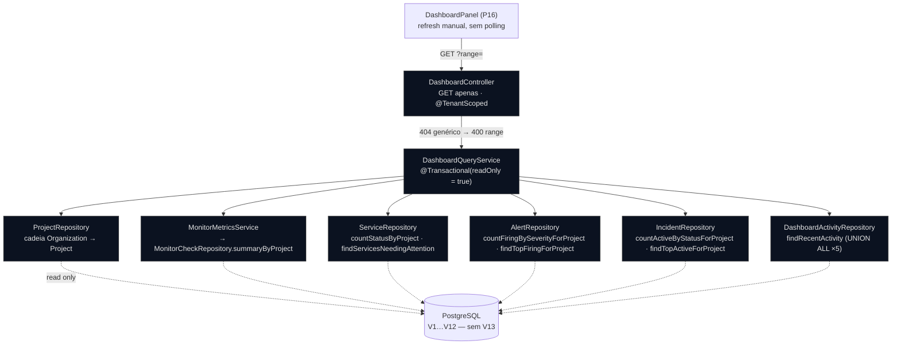

# Project Dashboard — Sentinel

> **Prompt 16 de 18** — dashboard operacional integrado do projeto: UMA resposta `GET` read-only que **compõe** — em uma única janela — a saúde dos serviços, a disponibilidade das checagens, os alertas em FIRING, os incidentes ativos, os serviços que pedem atenção e a atividade recente, tudo lido das fontes de verdade já construídas (Prompts 07, 10, 11, 13, 14 e 15). Este documento descreve **o que está construído**: pacote `com.sentinel.project.dashboard` (controller + query service + DTOs + repositório da união), as 8 consultas novas nos repositórios de domínio, a rota `GET .../projects/{projectId}/dashboard?range=`, o frontend `DashboardPanel` e as travas de fronteira `DashboardBoundaryTest`. **Nenhuma migration, nenhum scheduler, nenhuma escrita, nenhuma dependência nova** — o painel é composição, não um domínio.



## 1. Escopo implementado

| Item | Estado |
| --- | --- |
| Rota `GET /api/v1/organizations/{organizationId}/projects/{projectId}/dashboard?range=` (`@TenantScoped`, GET-only, `405` nos verbos de escrita) | Construído |
| Pacote `com.sentinel.project.dashboard`: `web/DashboardController`, `service/DashboardQueryService` (`@Transactional(readOnly = true)`), `dto/*` (11 tipos: 9 records + 2 enums) e `repository/DashboardActivityRepository` | Construído |
| 8 consultas novas de leitura nos repositórios existentes (2 em `ServiceRepository`, 1 em `MonitorCheckRepository`, 2 em `AlertRepository`, 2 em `IncidentRepository`, 1 no repositório da união) + 7 projeções nativas novas (a de resumo reusa `MetricsSummaryProjection` do Prompt 11) | Construído |
| `MonitorMetricsService.projectWindowSummary` — mesma janela e MESMAS fórmulas do Prompt 11 aplicadas ao projeto inteiro | Construído |
| Frontend: `getDashboard` + tipos em `lib/api.ts`, helpers puros em `lib/dashboard.ts`, `DashboardPanel` no detalhe expandido do projeto (`app/page.tsx`) | Construído |
| `DashboardApiTest` (28 testes) e `DashboardBoundaryTest` (7 testes) | Construído |
| `docs/dashboard.md` (este documento) | Construído |
| Migration nova, tabela própria, cache, job/scheduler, polling/WebSocket/SSE | **Fora do escopo** (§9) |
| Notificação, ack, silenciamento, escalonamento, on-call, trilha de auditoria | **Fora do escopo** (§9) |
| Escrita de qualquer tipo (criar/editar/alertar/incidentar a partir do painel) | **Fora do escopo** (§9) |

## 2. Conceito e fluxo

- **Composição, não domínio novo**: o painel não tem tabela, entidade, migration nem ciclo de vida próprio. Cada seção reaproveita a fonte de verdade do seu domínio e o `DashboardQueryService` apenas junta as peças numa resposta só.
- **Uma resposta, uma janela**: `range` (`1h`/`6h`/`24h`/`7d`/`30d`, default `24h`) define a janela meia-aberta `[windowFrom, windowTo)` usada por disponibilidade E atividade. Os demais contadores **não** têm janela (saúde = catálogo inteiro; alertas = estado FIRING; incidentes = estado ativo) — a UI diz isso no rodapé.
- **Ordenação de checagens**: a cadeia Organization → Project roda **primeiro** (404 genérico anti-enumeração, mesmo lookup de todos os endpoints `@TenantScoped`) e só então o `range` é validado (400) — recurso inexistente nunca é diagnosticado por parâmetro. A membership é provada pelo path (mesmo `TenantInterceptor` das demais rotas); **nenhum gate de papel novo** foi criado: qualquer papel (`ADMIN`/`OPERATOR`/`VIEWER`) lê.
- **Zero data não é erro**: projeto sem serviços, checks, alertas, incidentes ou atividade responde `200` com contagens zeradas, taxas `null` e listas vazias; a UI mostra o estado vazio.
- **Sem refresh automático**: o frontend busca no montar e recarrega apenas na troca de faixa ou no botão *Refresh* — sem polling, sem WebSocket, sem SSE, sem cache compartilhado.

## 3. Contrato do endpoint

### 3.1 `GET .../projects/{projectId}/dashboard` → `200` | `400` | `404`

| Caso | Resposta |
| --- | --- |
| Leitura com qualquer papel (`ADMIN`/`OPERATOR`/`VIEWER`) | `200` + `DashboardResponse` |
| Sem `range` (ou `?range=` vazio) | `200` com `rangeKey = "24h"` (default do server) |
| `range` fora de `1h\|6h\|24h\|7d\|30d` | `400` `VALIDATION_ERROR` — `range: must be one of 1h, 6h, 24h, 7d, 30d` |
| Sem token / token inválido | `401` `UNAUTHORIZED` |
| Projeto malformado, inexistente ou de outro tenant | `404` `NOT_FOUND` — `Resource not found` (mesmo 404 genérico; **precede** o `400` de range) |
| `POST`/`PUT`/`PATCH`/`DELETE` na rota | `405` `METHOD_NOT_ALLOWED` — `Method POST not allowed` |

### 3.2 Shape (10 chaves de topo, sempre presentes)

```json
{
  "projectId": "9b2c1f6e-4d5a-4e8f-8a1b-2c3d4e5f6a7b",
  "rangeKey": "24h",
  "windowFrom": "2026-02-28T12:00:00Z",
  "windowTo": "2026-03-01T12:00:00Z",
  "health": { "totalServices": 3, "operational": 2, "degraded": 1, "unavailable": 0, "unknown": 0 },
  "availability": {
    "availabilityPercent": 80.00, "totalChecks": 25, "relevantChecks": 20,
    "successRatePercent": 95.00, "avgLatencyMs": 124.50, "minLatencyMs": 42, "maxLatencyMs": 900
  },
  "alerts": {
    "firingTotal": 2, "sev1": 0, "sev2": 1, "sev3": 1, "sev4": 0,
    "activeAlerts": [
      { "alertId": "…", "serviceId": "…", "serviceName": "Checkout API",
        "ruleId": "…", "ruleName": "Latency p95", "severity": "SEV2",
        "firedAt": "2026-03-01T11:02:00Z", "incidentId": null }
    ]
  },
  "incidents": {
    "activeTotal": 1, "open": 1, "investigating": 0, "identified": 0,
    "activeIncidents": [
      { "incidentId": "…", "serviceId": "…", "serviceName": "Checkout API",
        "title": "Checkout degraded", "severity": "SEV2", "status": "OPEN",
        "source": "ALERT_AUTOMATION", "startedAt": "2026-03-01T11:03:00Z",
        "associatedAlertsCount": 1 }
    ]
  },
  "servicesNeedingAttention": [
    { "serviceId": "…", "serviceName": "Checkout API", "status": "DEGRADED",
      "highestSeverity": "SEV2", "hasActiveIncident": true,
      "statusChangedAt": "2026-03-01T10:40:00Z" }
  ],
  "recentActivity": [
    { "type": "ALERT_FIRED", "timestamp": "2026-03-01T11:02:00Z",
      "serviceId": "…", "serviceName": "Checkout API", "severity": "SEV2",
      "title": "Latency above 500ms", "resourceId": "…", "resourceType": "ALERT" }
  ]
}
```

- `availabilityPercent` / `successRatePercent` / `avgLatencyMs` / `minLatencyMs` / `maxLatencyMs` são **`null`** quando o denominador é zero (janela sem dado) — nunca `0`.
- `activeAlerts` ≤ 10, `activeIncidents` ≤ 10, `servicesNeedingAttention` ≤ 20, `recentActivity` ≤ 20 (limites aplicados **no banco**).
- Listas são sempre arrays (vazias quando não há linhas); `incidentId` de um alerta sem vínculo é `null`.
- `recentActivity[].type` ∈ `ALERT_FIRED`, `ALERT_RESOLVED`, `INCIDENT_CREATED`, `INCIDENT_STATUS_CHANGED`, `INCIDENT_LINKED`, `INCIDENT_RESOLVED`; `resourceType` ∈ `ALERT`, `INCIDENT`.

### 3.3 Seções e predicados

| Seção | Fonte | Predicado / janela |
| --- | --- | --- |
| `health` | `services.status` (V6) | **Todos** os serviços do projeto (ativos e inativos); sem janela |
| `availability` | `monitor_checks` (V8) via fórmulas do Prompt 11 | Janela `[from, to)`; agregação **global** (numeradores/denominadores somados no banco) |
| `alerts` | `alerts.status = 'FIRING'` (V10) | Estado atual; lista ordenada SEV1 → SEV4, `started_at DESC`, `id DESC` |
| `incidents` | `incidents.status <> 'RESOLVED'` (V11) | Estado atual; lista na mesma ordem de severidade; `associatedAlertsCount` = subquery correlacionada |
| `servicesNeedingAttention` | `services` + `alerts` + `incidents` | `UNAVAILABLE`/`DEGRADED` **OU** alerta FIRING **OU** incidente ativo; ordenado por estado → severidade (`LEAST` das duas subqueries) → incidente ativo → nome → id |
| `recentActivity` | `alerts` ∪ `incident_events` (UNIÃO de 5 ramos) | Janela `[from, to)`; `timestamp DESC`, `resourceType`, `resourceId`; LIMIT 20 |

**Regras de cálculo (herdadas do Prompt 11, nunca recalculadas no cliente):**

- `availability = (SUCCESS + DEGRADED) / (SUCCESS + DEGRADED + TARGET_FAILURE) × 100` — `SENTINEL_INTERNAL_FAILURE` fica **fora** do denominador;
- `successRate = SUCCESS / (SUCCESS + DEGRADED + TARGET_FAILURE) × 100`;
- latência só sobre `SUCCESS` + `DEGRADED`;
- denominador zero → `null`; arredondamento `HALF_UP` com 2 casas **no servidor**;
- proibido média de porcentagens: a taxa do projeto é a dos checks somados do projeto.

## 4. Plano de consulta e anti-N+1

Nove round-trips **fixos** por request — nenhum deles escala com o número de serviços, alertas ou incidentes (nenhum loop dispara consulta):

| # | Consulta | Onde | Forma |
| --- | --- | --- | --- |
| 1 | Projeto (cadeia do tenant) | `ProjectRepository.findByOrganizationIdAndId` | 1 lookup que prova a membership |
| 2 | Janela + resumo do projeto | `MonitorCheckRepository.summaryByProject` (via `MonitorMetricsService.projectWindowSummary`) | `GROUP BY` |
| 3 | Saúde | `ServiceRepository.countStatusByProject` | `GROUP BY` |
| 4 | Alertas por severidade | `AlertRepository.countFiringBySeverityForProject` | `GROUP BY` |
| 5 | Top 10 alertas | `AlertRepository.findTopFiringForProject` | `LIMIT` no banco |
| 6 | Incidentes por status | `IncidentRepository.countActiveByStatusForProject` | `GROUP BY` |
| 7 | Top 10 incidentes | `IncidentRepository.findTopActiveForProject` | `LIMIT` + subquery correlacionada de `associatedAlertsCount` |
| 8 | Serviços que pedem atenção | `ServiceRepository.findServicesNeedingAttention` | filtro + ordenação + `LIMIT` resolvidos em SQL |
| 9 | Atividade recente | `DashboardActivityRepository.findRecentActivity` | `UNION ALL` de 5 ramos + `LIMIT` |

Os nomes das constantes de corte (`MAX_ACTIVE_ALERTS = 10`, `MAX_ACTIVE_INCIDENTS = 10`, `MAX_ATTENTION_SERVICES = 20`, `MAX_ACTIVITY_ITEMS = 20`) vivem no `DashboardQueryService`; a UI só formata o que veio pronto.

## 5. Frontend (Prompt 16)

- **`lib/api.ts`** — tipos do contrato (`DashboardResponse` + seções, `DashboardRange` = alias de `MetricsRange`) e `getDashboard(organizationId, projectId, range?)`, que reaproveita `buildMetricsRangeParams` (mesmo vocabulário de faixa do Prompt 11) e o `apiFetch` comum (Bearer + `401` → `SESSION_EXPIRED_EVENT`).
- **`lib/dashboard.ts`** — helpers puros, ambiente `node`: rótulos completos por enum (`DASHBOARD_ACTIVITY_LABELS`, `DASHBOARD_HEALTH_TILES`, `DASHBOARD_INCIDENT_TILES`, `DASHBOARD_SERVICE_STATUS_LABELS`), reutilização das fontes únicas já existentes (`SEVERITY_LABELS` de `alert-rules.ts`, `INCIDENT_STATUS_LABELS` de `incidents.ts`, formatação `null` → `"—"` de `metrics.ts`), `dashboardKpis`, `hasDashboardData`, `formatWindow`, `formatActivityTime`, `pluralizeCount`, `activityTitle`, `rangeLabel` e `isDashboardRange`.
- **`components/DashboardPanel.tsx`** (`"use client"`) — card dentro do detalhe expandido do projeto, com seletor de faixa, *Refresh* manual, estados `loading`/`error`/`ready` (erro com *Retry*), estado vazio próprio e quatro blocos (KPIs, saúde, alertas, incidentes) + duas tabelas (atenção, atividade) + rodapé com a janela exata. `key` próprio por projeto para o estado nascer limpo na troca.
- **`app/page.tsx`** — `<DashboardPanel>` é montado imediatamente antes de `<ServicesPanel>` dentro do `isExpanded`, usando `orgId` e `project.id` já presentes no escopo.

> **Limite de teste**: a renderização do `DashboardPanel` não é coberta por testes de componente — o projeto não tem `jsdom`/`testing-library` como dependência e o plano proibia instalar pacotes. O que é coberto são os helpers puros (`dashboard.test.ts`) e o contrato de rede (`getDashboard`) — mesma lacuna já documentada em `monitors.test.ts`.

## 6. Estrutura de código (backend)

```text
com.sentinel.project.dashboard
├── web
│   └── DashboardController.java        # GET + @TenantScoped + parseId → 404
├── service
│   └── DashboardQueryService.java      # @Transactional(readOnly = true), 9 consultas, cortes MAX_*
├── dto
│   ├── DashboardResponse.java          # 10 seções
│   ├── HealthSummary / AvailabilitySummary / AlertsSummary / IncidentsSummary
│   ├── ActiveAlertItem / ActiveIncidentItem / ServiceAttentionItem / ActivityItem
│   └── ActivityType / ActivityResourceType
└── repository
    ├── DashboardActivityRepository.java  # extends Repository (marcador), 1 UNION ALL nativo
    └── ActivityRowProjection.java

# consultas novas nos repositórios de domínio (seção marcada "Prompt 16")
com.sentinel.project.repository.ServiceRepository        # countStatusByProject, findServicesNeedingAttention
com.sentinel.project.monitor.repository.MonitorCheckRepository  # summaryByProject
com.sentinel.project.alert.repository.AlertRepository    # countFiringBySeverityForProject, findTopFiringForProject
com.sentinel.project.incident.repository.IncidentRepository     # countActiveByStatusForProject, findTopActiveForProject
com.sentinel.project.monitor.service.MonitorMetricsService      # projectWindowSummary (reusa Window/toSummary)
com.sentinel.project.monitor.dto.ProjectWindowSummary           # range + janela + MetricsSummary
```

**Decisões registradas** (desvios pontuais do plano, todos deliberados):

1. `projectWindowSummary` morou no `MonitorMetricsService` (donas das fórmulas/janela) em vez de duplicar `Window` no query service.
2. A união de atividade morou em `com.sentinel.project.dashboard.repository.DashboardActivityRepository` (marcador `Repository` read-only) em vez de em `IncidentEventRepository` — mantém o repositório de domínio sem SQL do painel e torna a fronteira auditável.
3. `DashboardRange` é **alias** de `MetricsRange` e o builder de query é reaproveitado: um vocabulário só de faixas.
4. `health` conta serviços **inativos** também (é o retrato do catálogo); a atividade usa a MESMA janela da disponibilidade.

## 7. Fronteira travada (`DashboardBoundaryTest`)

| Asserção | Garantia |
| --- | --- |
| Nenhuma classe em `com.sentinel.project.dashboard` é `@Entity` | não há schema do painel |
| Scan de fonte do pacote sem `@Modifying`, `save/persist`, SQL de escrita, `new Incident(`/`new Alert(`, `@Scheduled`/`@Async`/`@EventListener`, `setStatus(` e sem referência a `AlertLifecycleService`/`AlertEngine`/`MonitoringScheduler` | composição pura, sem escrita nem orquestrador |
| `DashboardQueryService` declara `@Transactional(readOnly = true)` | transação somente-leitura |
| `DashboardActivityRepository extends Repository<…>`, sem `JpaRepository`/`CrudRepository`/`saveAll`/`deleteById` | marcador read-only, sem CRUD herdado |
| `DashboardController` só declara `@GetMapping` (+ `@TenantScoped` e 404 genérico) | superfície GET-only |
| Trecho "Prompt 16" dos 4 repositórios de domínio sem `@Modifying` e sem `INSERT`/`UPDATE`/`DELETE` | consultas novas são de leitura |
| Catálogo de migrations exatamente `V1…V12` (nenhuma `V13`) | **`Prompt 16: no migration required`** |

## 8. Testes

**Backend — `DashboardApiTest` (28 testes, Spring Boot + MockMvc + Testcontainers `postgres:17-alpine`)**: anônimo → `401`; `POST` → `405`; `404` (malformado, inexistente, de outro tenant, e **precedência 404 > 400**); `400` de range; leitura com `ADMIN`/`OPERATOR`/`VIEWER`; contrato exato das 10 chaves de topo e do shape de cada seção (sem vazamento de domínio); janelas `1h` × `24h`; saúde por status com soma exata; zero data (`200` + zeros + `null` + listas vazias); agregação global (`80.00`); `SENTINEL_INTERNAL_FAILURE` fora do denominador; latência só `SUCCESS`; `GROUP BY` de severidade; top 10 ordenado; alertas resolvidos/de outro projeto fora; status ativos de incidente; `associatedAlertsCount` via `PUT .../incidents/{id}/alerts/{id}`; predicado/ordenação/`LIMIT` da atenção; 6 tipos de atividade em `DESC`; janela da atividade; `LIMIT` de atividade; invariantes; 50 serviços; pais inativos (monitor desligado mantém o alerta, serviço desligado fecha alertas por `PARENT_INACTIVE`); isolamento de projeto/tenant; `?range=` vazio → `24h`; listas sempre arrays.

**Backend — `DashboardBoundaryTest` (7 testes)**: fronteiras da §7 (source scan do pacote, marcador de repositório, controller GET-only, trechos "Prompt 16" read-only, catálogo `V1…V12`).

**Frontend — `dashboard.test.ts` (24 testes, vitest em ambiente `node`)**: path de três níveis + `?range=`; ausência de `method` (GET puro); `Authorization` presente e `X-Organization-Id` ausente (org já está no path); `404`/`400`/`401` (com `SESSION_EXPIRED_EVENT`); rótulos completos por enum; `null` → `"—"`; janela meia-aberta; UTC determinístico; plural; estado vazio; `getDashboard` + helpers.

**Validação executada**: `mvn -o test` → **837 testes, 0 falhas** (baseline 802 + 35 novos); `npm run lint`, `npm run type-check`, `npm run test` (**199 testes** — baseline 175 + 24 novos) e `npm run build` (Next 16.3.6) todos limpos.

## 9. Fronteira com o Prompt 17 (fora do escopo)

```mermaid
graph LR
    UI["DashboardPanel<br/>✅ P16 (leitura)"] -->|GET| API["GET .../dashboard?range="]
    API --> QS["DashboardQueryService<br/>readOnly · 9 consultas"]
    QS -. lê .-> SVC["services ✅ P07"]
    QS -. lê .-> CHK["monitor_checks ✅ P10/P11"]
    QS -. lê .-> ALRT["alerts ✅ P13"]
    QS -. lê .-> INC["incidents + incident_events ✅ P14/P15"]
    QS -.x WR["escrita / tabela própria / cache / job<br/>⛔ NOT IMPLEMENTED (P17+)"]
    UI -.x LIVE["polling · WebSocket · SSE · auto-refresh<br/>⛔ NOT IMPLEMENTED (P17+)"]
    UI -.x NOTIF["notificações · ack · silêncio · escalonamento · on-call · audit log<br/>⛔ NOT IMPLEMENTED (P17+)"]
```

- **Nenhuma escrita a partir do painel**: não existem `POST`/`PATCH`/`DELETE`, nem ação de "reconhecer"/"resolver" dentro do `DashboardPanel` — quem muda estado continua sendo as rotas dos domínios (Prompts 07/12/13/14), com `405` garantido na rota do painel.
- **Nenhuma tabela, coluna, enum ou migration própria**: `Prompt 16: no migration required` — o catálogo termina na `V12` (travado por `DashboardBoundaryTest.panelRequiresNoNewMigration`).
- **Nenhum cache nem infraestrutura de atualização**: sem `@Cacheable`, sem `@Scheduled`, sem `@Async`, sem WebSocket/SSE/polling; a frescura é do clique do usuário.
- **Nenhuma notificação, ack, silenciamento, escalonamento, on-call, trilha de auditoria, recuperação de senha, MFA ou IA** — nenhuma tabela, endpoint, campo ou enum para eles neste prompt.
- **Nenhum dado sintético**: o painel só devolve o que os domínios já gravaram; não existe "demo data", nem agregado pré-calculado em background, nem métrica derivada fora das fórmulas do Prompt 11.
