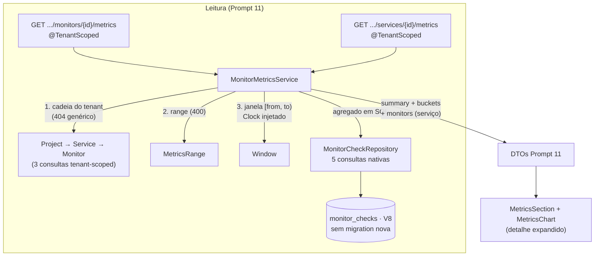

# History & Metrics — Sentinel

> **Prompt 11 de 18** — métricas históricas agregadas por monitor e por serviço. Este documento descreve **o que está construído**: os endpoints `GET .../monitors/{monitorId}/metrics` e `GET .../services/{serviceId}/metrics`, a janela meia-aberta em buckets completos, as fórmulas de disponibilidade/taxa com arredondamento HALF_UP e a UI de métricas no detalhe expandido (seletor de faixa, resumo, gráfico SVG e breakdown). A base de dados das linhas é a do [operational-state.md](operational-state.md) (Prompt 10 — tabela `monitor_checks`, `V8`); a execução que produz essas linhas é a do [monitoring-engine.md](monitoring-engine.md) (Prompt 09).

## 1. Escopo implementado

| Item | Estado |
| --- | --- |
| `MetricsRange` (`1h`/`6h`/`24h`/`7d`/`30d`, grades fixas de bucket) | Construído |
| `GET .../monitors/{monitorId}/metrics?range=` (resumo + grade de buckets) | Construído |
| `GET .../services/{serviceId}/metrics?range=` (resumo + grade + breakdown por monitor) | Construído |
| `MonitorMetricsService` — cadeia do tenant, janela `[from, to)`, fórmulas HALF_UP, `Clock` injetado | Construído |
| Consultas nativas em `MonitorCheckRepository` (resumo, série com grade completa, breakdown) | Construído |
| DTOs: `MetricsSummary`, `MetricsBucket`, `MonitorMetricsResponse`, `ServiceMetricsBreakdown`, `ServiceMetricsResponse` | Construído |
| Frontend: `getMonitorMetrics`/`getServiceMetrics` + `MetricsSection`/`MetricsChart` + helpers em `src/lib/metrics.ts` | Construído |
| Retenção/expurgo, tabelas pré-agregadas, uptime temporal, alertas e notificações | **Fora do escopo** (Prompt 12+) |

## 2. Modelo de janela e grades de bucket

### 2.1 Faixas (`MetricsRange`)

| Faixa | `rangeSeconds` | `bucketSeconds` | `bucketCount` |
| --- | --- | --- | --- |
| `1h` | 3600 | 300 (5 min) | 12 |
| `6h` | 21600 | 900 (15 min) | 24 |
| `24h` (default) | 86400 | 3600 (1 h) | 24 |
| `7d` | 604800 | 21600 (6 h) | 28 |
| `30d` | 2592000 | 86400 (1 dia) | 30 |

- O servidor é dono da grade: o cliente só escolhe a faixa, nunca a granularidade (máximo 30 buckets por resposta, custo previsível, eixo determinístico).
- `range` ausente ou em branco → default `24h`; valor fora do contrato → **400** `VALIDATION_ERROR` com a mensagem `range: must be one of 1h, 6h, 24h, 7d, 30d`.

### 2.2 Janela meia-aberta em buckets completos

- `to = floor(agora / bucketSeconds) × bucketSeconds` — fim do último bucket **completo** (o bucket em curso fica de fora: nenhum bucket muda de forma no meio do carregamento);
- `from = to − rangeSeconds`; janela **meia-aberta `[from, to)`** — um check cujo `startedAt` cai exatamente em `to` pertence ao período seguinte;
- a grade da série é gerada no banco (`generate_series` de epochs) e **sempre completa**: todos os `bucketCount` elementos vêm na resposta, mesmo sem check (contagens zeradas e taxas `null`) — um buraco no gráfico é distinguível de resposta incompleta;
- o recorte usa o **`Clock` injetado** (o mesmo do motor de monitoramento; `SystemClock` em produção, relógio controlado nos testes) — nunca `Instant.now()` direto.

### 2.3 Fórmulas (backend é a fonte de verdade)

- `relevantes = success + degraded + targetFailure`;
- `availability = relevantes == 0 ? null : (success + degraded) × 100 / relevantes`;
- `successRate = relevantes == 0 ? null : success × 100 / relevantes`;
- `totalChecks = success + degraded + targetFailure + sentinelInternalFailure`;
- `avgLatencyMs`/`minLatencyMs`/`maxLatencyMs` = tempo de resposta do check **somente nos outcomes `SUCCESS`/`DEGRADED_SIGNAL`** (filtro `FILTER` no SQL) — `TARGET_FAILURE` e `SENTINEL_INTERNAL_FAILURE` ficam **fora** (falha não é latência de resposta); sem nenhum `SUCCESS`/`DEGRADED` no recorte → os três `null`, **nunca 0**; a média sai com 2 casas (HALF_UP) e min/max são inteiros em ms;
- arredondamento **HALF_UP com 2 casas**; denominador zero → `null`, **nunca 0**, nunca NaN;
- **`SENTINEL_INTERNAL_FAILURE` fica fora dos denominadores** (falha do Sentinel não é evidência sobre o alvo), mas conta em `totalChecks`;
- cada bucket calcula as próprias taxas sobre as próprias contagens — a soma dos buckets NÃO é igual à taxa global (o resumo é calculado à parte).

Exemplo: 8 `SUCCESS` (100 ms) + 1 `DEGRADED_SIGNAL` (200 ms) + 1 `TARGET_FAILURE` (300 ms) → `availability = 90.00`, `successRate = 80.00` e latência sobre os 9 saudáveis (`avgLatencyMs = 111.11`, `minLatencyMs = 100`, `maxLatencyMs = 200`); janela só com falhas (internas ou de alvo) → taxas **e** latência `null`.

## 3. Arquitetura



Decisões centrais:

- **Leitura pura, sem materialização**: nada de tabelas pré-agregadas, `findAll` ou job de agregação — as agregações rodam no banco sobre o índice `(monitor_id, started_at DESC)` da `V8` (a grade do `generate_series` é parametrizada pelos epochs da janela). **Nenhuma migration nova** (nada de `V9`); se a carga futura exigir índice dedicado, é evolução de outro prompt.
- **Ordenação de erros**: a cadeia do tenant roda **PRIMEIRO** (404 genérico, anti-enumeração) e só depois o `range` é validado (400) — recurso inexistente nunca é diagnosticado por parâmetro.
- **Somente GET**: a rota existe só com `GET`; `POST`/`PATCH` caem no contrato global de **405**. IDs malformados → mesmo **404** genérico (`parseId` manual nos controllers).
- **RBAC**: leitura para **qualquer papel** (VIEWER inclusive) e com os pais inativos; herda a cadeia `@TenantScoped` (Bearer, sem CSRF — método safe) dos endpoints de leitura dos Prompts 06–10.
- **`Service.status` intocado**: este prompt só LÊ — quem escreve status continua sendo exclusivamente o `OperationalStateEvaluator` do Prompt 10.
- **Serviço = união dos monitores**: agrega os checks de TODOS os monitores do serviço, inclusive inativos (histórico não é apagado ao desligar um monitor). O `breakdown` só inclui monitores com pelo menos um check na janela, ordenado por nome, e a soma das linhas fecha exatamente com o `summary` do serviço. Isto **não é uptime temporal** do serviço.

## 4. Contrato da API

### 4.1 `GET /api/v1/organizations/{organizationId}/projects/{projectId}/services/{serviceId}/monitors/{monitorId}/metrics`

Query: `range=1h|6h|24h|7d|30d` (opcional).

```json
{
  "monitorId": "7d4e2b1a-9c3f-4d6e-8b2a-5f1e0c9d8a7b",
  "range": "24h",
  "from": "2026-02-28T12:00:00Z",
  "to": "2026-03-01T12:00:00Z",
  "bucketSeconds": 3600,
  "summary": {
    "totalChecks": 10,
    "success": 8,
    "degraded": 1,
    "targetFailure": 1,
    "sentinelInternalFailure": 0,
    "availability": 90.00,
    "successRate": 80.00,
    "avgLatencyMs": 111.11,
    "minLatencyMs": 100,
    "maxLatencyMs": 200
  },
  "buckets": [
    {
      "bucketStart": "2026-02-28T12:00:00Z",
      "totalChecks": 0,
      "success": 0,
      "degraded": 0,
      "targetFailure": 0,
      "sentinelInternalFailure": 0,
      "availability": null,
      "successRate": null,
      "avgLatencyMs": null,
      "minLatencyMs": null,
      "maxLatencyMs": null
    }
  ]
}
```

- `buckets` tem sempre `bucketCount` elementos em ordem crescente de `bucketStart`; `from`/`to` são a janela EXATA usada no cálculo.
- Só agregado: **nunca** linhas de check cruas, configuração do monitor, URL ou corpo de resposta (a lista crua continua sendo `GET .../checks`).

### 4.2 `GET /api/v1/organizations/{organizationId}/projects/{projectId}/services/{serviceId}/metrics`

Mesma query. O payload é o do monitor **mais** os campos `serviceId` e a lista `monitors` (breakdown, planos e espelhados):

```json
{
  "serviceId": "...",
  "range": "24h",
  "from": "...",
  "to": "...",
  "bucketSeconds": 3600,
  "summary": { "...": "..." },
  "buckets": ["..."],
  "monitors": [
    {
      "monitorId": "...",
      "monitorName": "Alpha",
      "totalChecks": 6,
      "success": 6,
      "degraded": 0,
      "targetFailure": 0,
      "sentinelInternalFailure": 0,
      "availability": 100.00,
      "successRate": 100.00,
      "avgLatencyMs": 60.00,
      "minLatencyMs": 60,
      "maxLatencyMs": 60
    }
  ]
}
```

### 4.3 Erros

| Caso | Resposta |
| --- | --- |
| Cadeia malformada (UUID inválido) ou cross-tenant/cross-service | **404** `{"code":"NOT_FOUND","message":"Resource not found"}` (genérico, anti-enumeração — mesma forma de `timestamp`/`path`) |
| `range` desconhecido (APÓS a cadeia ser provada) | **400** `VALIDATION_ERROR` — `range: must be one of 1h, 6h, 24h, 7d, 30d` |
| Sem sessão | **401** |
| `POST`/`PUT`/`PATCH`/`DELETE` na rota | **405** |

## 5. Frontend

- **`src/lib/api.ts`**: tipos `MetricsRange`, `MetricsCounts`/`MetricsSummary`, `MetricsBucket`, `MonitorMetricsResponse`, `ServiceMetricsBreakdown`, `ServiceMetricsResponse` + `buildMetricsRangeParams` (helper puro de query) + `getMonitorMetrics`/`getServiceMetrics` (paths de cinco e quatro níveis).
- **`src/lib/metrics.ts`** (puro): `METRICS_RANGE_OPTIONS` (espelha o contrato), `formatPercent`/`formatAvgMillis` (**`null` → "—", nunca 0**), `formatBucketLabel` (UTC determinístico, sem depender do timezone local), `bucketHasData`/`hasAnyMetricsData`.
- **`MetricsSection.tsx`**: seção de métricas compartilhada pelos dois painéis — props são IDs primitivas (não uma função `load`), então os `useEffect` têm deps estáveis e não há refetch por identidade de função; estado nasce limpo por `key` (`metrics-{id}`) ao trocar de monitor/serviço. Estados de vazio/carregando/erro com Retry, seletor de faixa (`1h`…`30d`), resumo (availability, success rate, avg latency, checks + contagens brutas), janela `[from, to)` e — no escopo de serviço — a tabela de breakdown.
- **`MetricsChart.tsx`**: gráfico SVG inline **puro** (nenhuma dependência nova): eixo Y fixo 0–100% (grade 0/50/100), barras por bucket, bucket sem check → espaço vazio, bucket com check mas taxa `null` → traço cinza na base, rótulos do eixo em UTC; `role="img"` + `aria-label` resume a série (faixa, janela, quantos buckets têm checks).
- Integração: `MetricsSection` entra no detalhe expandido do serviço (`ServicesPanel.tsx`, acima do `MonitorsPanel`) e no detalhe expandido do monitor (`MonitorsPanel.tsx`, acima de "Last checks").

## 6. Testes

Backend (`mvn clean test` — 459 testes no total, 29 novos neste prompt):

- `MonitorMetricsServiceTest` (11) — janela meia-aberta (limites `from`/`to` exclusos/inclusos), fórmulas (90.00/80.00, HALF_UP 66.67/33.33), grade vazia com `null`s, só falhas internas → taxas **e** latência `null`, latência filtrada só sobre `SUCCESS`/`DEGRADED` (`111.11`/`min` `100`/`max` `200` com falhas de 300/400 ms excluídas; linha só com `TARGET_FAILURE` → latência `null`), grades exatas por faixa (1h/6h/7d/30d), `400` para faixa inválida, cadeia de `404` (cross-service/cross-tenant), serviço agregando monitores inativos com breakdown ordenado, resposta de 2500 checks → 24 buckets.
- `MonitorMetricsApiTest` (9) — contrato JSON (chaves exatas, `availability: null`, BigDecimal no fio `75.00`), default/faixa em branco/faixas extremas, mensagem exata do `400`, grid vazio, leitura com papel VIEWER e pais inativos, `404` de cadeia malformada/cross-service/cross-tenant, `401`, `405`.
- `ServiceMetricsApiTest` (9) — três camadas (summary/buckets/breakdown ordenado), default e `1h` com seed na janela, `400`, grid vazio, VIEWER + pais inativos, cadeia `404` (serviço de OUTRO projeto e malformado), `401`, `405`.
- Relógio: `FixedMetricsClockConfig` congela o `Clock` em `2026-03-01T12:34:56Z` (fora de fronteiras de bucket) via bean `@Primary` — mesmas janelas em qualquer máquina/timezone.

Frontend (`npm test` — 95 testes no total, 16 novos): `src/lib/metrics.test.ts` — formatação (`"—"` para `null`), rótulo UTC determinístico, opções de faixa, série vazia, `buildMetricsRangeParams` e o path/`?range=` das duas funções de fetch. A renderização da UI (`MetricsSection`/`MetricsChart`) **não** é coberta: exigiria jsdom/testing-library, que não é dependência do projeto (mesma lacuna documentada nos Prompts 07–10).

## 7. Fora do escopo (prompts futuros)

- Retenção/expurgo de `monitor_checks` (hoje cresce sem limite — decisão explícita de escopo).
- Tabelas/materialização de séries temporais e índices dedicados (hoje, agregação on-demand no índice da `V8`).
- Uptime temporal do serviço como entidade própria, SLOs e error budgets.
- Alertas, notificações e incidentes (consumidores naturais destas métricas).
- Métricas de aplicação (Micrometer) do próprio backend.
