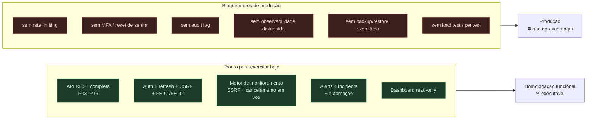

# Homologation Readiness — Sentinel

> **Prompt 17 de 18** — o que a **homologação pode exercitar hoje**, com que evidência, e o que ainda **impede** tratar o sistema como pronto para produção. Este documento **não** aprova produção e **não** substitui teste de carga, pentest ou revisão de segurança: ele delimita o terreno com base no que está no código e no que foi verificado por execução. Nenhuma migration, dependência ou contrato novo.



## 1. Escopo deste documento

| É | Não é |
| --- | --- |
| Estado da base **verificado por execução** (comando + exit code) | Aprovação de produção |
| Matriz do que a homologação **pode exercitar** | Substituto de testes de carga, pen-test ou revisão de segurança |
| Lista do que **falta**, com o motivo pelo qual é bloqueador | Plano de implementação do Prompt 18 |

## 2. Base verificada (execução real, não intenção)

| Verificação | Comando | Resultado |
| --- | --- | --- |
| Compilação backend (main + test) | `mvn -q test-compile -DskipTests` | **exit 0** |
| Testes backend | `mvn clean test` | **exit 0 — 865 testes, 0 falhas, 0 erros, 0 ignorados** (85 relatórios Surefire somando 865/0/0/0, execução 2026-10-08 23:16–23:24; era 862 no Prompt 17, +3 do critério #73 em `AlertMassResolutionBatchTest`; baseline do Prompt 16 = 837) |
| Testes frontend | `npm run test` (em `frontend/`) | **exit 0 — 207 testes em 10 arquivos, todos passando** (execução 2026-10-07 05:56; baseline 199) |
| Lint frontend | `npm run lint` (em `frontend/`) | **exit 0**, sem achados |
| Type-check frontend | `npm run type-check` (em `frontend/`) | **exit 0** |
| Build frontend | `npm run build` (Next 16.3.6) | **exit 0** |
| Catálogo de migrations | `backend/src/main/resources/db/migration` | `V1`…`V12`, **nenhuma `V13`**, inalterado neste prompt |
| Integridade em runtime | `spring.jpa.hibernate.ddl-auto: validate` + `flyway.validate-on-migrate: true` | aplicado em `application.yml` |
| Dependências | `pom.xml` / `package.json` | **inalterados** neste prompt |

**Reconciliação de contagem** (por que 837 + 25 = 862 e 199 + 8 = 207): a divisão arquivo-a-arquivo está em `security-hardening.md` §8. O salto **862 → 865** é do critério #73 (+3 testes em `project/AlertMassResolutionBatchTest`, listados em `performance.md` §10).

## 3. O que a homologação pode exercitar hoje

| Área | Superfície | Evidência |
| --- | --- | --- |
| **Auth** | registro, login, refresh com cookie `HttpOnly`/`SameSite=Strict`, rotação, revogação por reuso, logout | `docs/identity.md`, `RefreshTokenIntegrationTest` (inclui corrida 4×refresh → `1×200` + `3×401`) |
| **Multi-tenancy** | Organization → Project → Service → Monitor → AlertRule, `404` genérico anti-enumeração em 4–5 níveis, RBAC por papel | `docs/organizations.md`, `*IdorTest`, `StaleAuthorizationTest` |
| **Monitores** | CRUD + guarda SSRF no cadastro **e** na execução, formas não-canônicas bloqueadas | `docs/monitors.md`, `SsrfGuardNonCanonicalTargetTest` (6) |
| **Coleta** | tick agendado, pool dedicado, fila saturada sem erro, classificação de falha, cancelamento em voo | `docs/monitoring-engine.md`, `MonitoringDispatcherTest` |
| **Métricas** | janelas `1h/6h/24h/7d/30d`, buckets completos, fórmulas com denominador de relevantes | `docs/history-metrics.md` |
| **Alertas** | regras, avaliação por checagem, dedup em duas camadas, ciclo `FIRING → RESOLVED` | `docs/alert-engine.md` |
| **Incidents** | ciclo manual, timeline append-only, associação N:1, `@Version` → `409` | `docs/incidents.md` |
| **Automação** | `autoCreateIncident`, correlação com teto de tentativas, best-effort | `docs/alert-incident-automation.md` |
| **Dashboard** | `GET .../dashboard?range=`, GET-only, `405` em escrita | `docs/dashboard.md` |
| **Frontend** | `apiFetch` com timeout 15 s, `X-XSRF-TOKEN`, guarda de duplo submit em login/registro | `security-hardening.md` §6 |
| **Erros** | `400/401/403/404/405/409/500` no shape padrão, catch-all sem vazamento | `GlobalExceptionHandlerTest` |

## 4. Bloqueadores de produção

Nada abaixo foi implementado neste prompt — a coluna "Por que bloqueia" é o motivo pelo qual não pode ser tratado como detalhe.

| # | Bloqueador | Por que bloqueia | Estado |
| --- | --- | --- | --- |
| 1 | **Rate limiting** (login, refresh, endpoints de escrita) | sem teto, força bruta e esgotamento de conta são possíveis | não existe (sem dependência nem filtro) |
| 2 | **MFA** | comprometimento de credencial única = acesso completo ao tenant | não existe (declarado ausente desde o Prompt 01) |
| 3 | **Reset/verificação de senha** | sem recuperação, conta perdida é perdida; sem verificação, e-mail não é provado | não existe |
| 4 | **Trilha de auditoria** | `incident_events` é timeline de domínio, **não** audit log (sem `REVOKE DELETE`, sem retenção, sem "quem alterou a regra") | não existe |
| 5 | **Observabilidade** (logs estruturados → coletor, métricas de aplicação, tracing) | em incidente real não há como reconstruir o que aconteceu | não existe (sem OpenTelemetry/Micrometer custom, só `health`/`info`) |
| 6 | **Backup + restore exercitados** | sem restore testado, backup não é plano de recuperação | não exercitado neste repo |
| 7 | **Load test / capacity** | nenhum número de throughput ou degradação sob carga | não executado |
| 8 | **Pen-test / revisão de segurança independente** | a guarda SSRF foi fechada com testes próprios, não por auditoria externa | não executado |
| 9 | **CSP / HSTS / `Referrer-Policy`** | só `X-Content-Type-Options` e `X-Frame-Options` estão declarados | não verificado por teste |
| 10 | **Rotação de `JWT_SECRET` sem downtime** | segredo único: troca invalida todos os tokens emitidos | não existe mecanismo |
| 11 | **CI** (build/teste automático em PR) | sem execução remota no GitHub, nada impede merge que quebra | workflow [ci.yml](../.github/workflows/ci.yml) **preparado localmente**; **não ativado** (repo sem remote — [continuous-integration.md](continuous-integration.md)) |
| 12 | **Rate de erro/alerta operacional do próprio Sentinel** | sem SLO, error budget ou alerta do sistema | não definido |

## 5. Decisões de operação que **já estão** no código

Registrado porque a homologação pergunta "e se…?":

| Situação | Comportamento atual |
| --- | --- |
| `JWT_SECRET` vazia em dev/test | segredo HS256 **efêmero** gerado no startup com `WARNING`; reiniciar invalida tokens |
| `JWT_SECRET` vazia em **prod** | **fail-fast** (`:?` em `application-prod.yml`) — o startup aborta |
| `DATABASE_PASSWORD` vazia em prod | **fail-fast** idem |
| Cookie em prod | `secure: true` fixo, `SameSite=Strict` |
| CORS com wildcard + credenciais | **fail-fast** no startup (`SecurityConfigOriginsTest`) |
| `ddl-auto` | `validate` — divergência entre entidade e schema derruba o startup, nunca altera tabela |
| Flyway | `validate-on-migrate` — checksum divergente derruba o startup |
| Fila de monitoramento saturada | monitor segue "due"; **nunca** vira erro de alvo |
| Falha de rede no destino | `TARGET_FAILURE`/`TIMEOUT` classificado, ciclo continua |
| Actuator | expõe `health,info`, `show-details: never` |

## 6. Riscos conhecidos da própria base

| Risco | Onde está declarado |
| --- | --- |
| Helper de teste `openAlertsOf` com `Page<Alert>` sem `LIMIT`/`COUNT` (o caminho produtivo paginou em lote de 100 no critério #73) | `performance.md` §8 |
| `connectTimeout(10s)` fixo × `Monitor.timeoutMillis` até 30 s | `performance.md` §8 |
| Subquery correlacionada do painel (custo por linha, aceito) | `performance.md` §6 |
| Revalidação por redirect inexistente (não há redirect) | `security-hardening.md` §3.4 |
| Dívidas `RES-03/06/08` sem plano recuperável | `resilience.md` §1 |
| `.opencode/PROJECT_MEMORY.md` desatualizado (`837`/`199`/"P17 não") | fora do escopo deste prompt (arquivo não versionado e não listado como alvo) |

## 7. Comandos que a homologação deve conseguir executar

```bash
# backend
cd backend && mvn -q test-compile -DskipTests     # exit 0
cd backend && mvn test                            # 865, 0 falhas

# frontend
cd frontend && npm ci
cd frontend && npm run lint                       # exit 0
cd frontend && npm run type-check                 # exit 0
cd frontend && npm run test                       # 207
cd frontend && npm run build                      # exit 0

# banco local
docker compose up -d                              # PostgreSQL 17 na 5433
```

## 8. Limite do documento

Este texto **não** declara o sistema pronto para produção: a §4 existe justamente para que "862 testes verdes" não seja lido como "seguro para operar". As pendências da §4 são as que precisam de decisão de escopo antes de qualquer janela de produção, e o Prompt 18 é quem deve tratá-las — nada delas foi antecipado aqui.

## 9. P18 — Homologação Final (execução real, 2026-10-09)

> Registro do **Prompt 18**: homologação final executada de ponta a ponta contra infraestrutura **local real** (Docker `postgres:17` na porta **5433**, backend jar na porta **8080**, frontend dev na porta **3000**, `MONITORING_SCHEDULER_DELAY_MS=5000` para enxergar ticks). As seções §1–§8 acima permanecem como registro histórico do Prompt 17; nada nelas foi reescrito. Escopo documental: as mudanças desta entrega são documentos apenas ([production-checklist.md](production-checklist.md) novo, este registro e o ajuste de enum em [alert-rules.md](alert-rules.md)) — sem código, migrations, dependências ou configuração.

### 9.1 Resultados da homologação

| Área | Evidência executada | Resultado |
| --- | --- | --- |
| Baseline backend | `mvn clean test` | **865/0/0/0** (85 relatórios Surefire), BUILD SUCCESS — inalterado em relação ao baseline do P17 pós-#73 |
| Baseline frontend | `npm run test` / `lint` / `type-check` / `build` | **207** testes passando; lint, type-check e build **exit 0** |
| **E2E A–H (fluxo completo)** | identidade (registro/login/refresh com rotação + detecção de reuso/logout com revogação); organização → projeto → serviço → monitor com checagens HTTP reais contra alvo público (`https://example.com`); falha induzida (`http://example.com:81`); estado `DEGRADED`/`UNAVAILABLE`; alerta `TARGET_FAILURE_COUNT` `FIRING` com dedup; incidente automático `ALERT_AUTOMATION` com timeline; dashboard coerente; recuperação **AUTO** do alerta; resolve manual do incidente | **executado com evidência** — ciclo de vida completo verificado em runtime, não só em teste unitário |
| Isolamento cross-tenant | 21+ cross-reads A↔B | **404 genérico** em todos — aprovado |
| RBAC | papéis `ADMIN`/`OPERATOR`/`VIEWER` | matriz conforme contrato — aprovado |
| Guarda SSRF | 34 casos negativos | **400 `MONITOR_TARGET_NOT_ALLOWED`**; revalidação em update; **sem flag de bypass** em produção; controle positivo público → `201` — aprovado |
| Banco | Flyway no startup | **12/12** migrations `success`, **13 tabelas**, índice parcial `uq_alerts_open_rule` presente, **sem `V13`** |
| Smoke de latência (local) | carga conc 10, endpoints da API | `/api/v1/organizations` **p95 ~31 ms**; `/api/v1/health` **p95 ~10 ms** — **não é SLA** (ambiente local, volume pequeno) |
| Resiliência observacional | log da sessão de homologação | **`ERROR=0`** durante o fluxo — nenhum erro não tratado observado |

### 9.2 Estado atualizado dos itens NOT VERIFIED do P17

Numeração 1–12 espelha a tabela de bloqueadores da §4; o item 13 é o `EXPLAIN ANALYZE` declarado não executado em `performance.md` §9.

| # | Item (§4 / performance.md) | Estado após P18 | Justificativa |
| --- | --- | --- | --- |
| 1 | Rate limiting | **NOT VERIFIED** (inexistente) | nenhum filtro/teto no código — sem o que exercitar |
| 2 | MFA | **NOT VERIFIED** (inexistente) | nunca implementado |
| 3 | Reset/verificação de senha | **NOT VERIFIED** (inexistente) | nunca implementado |
| 4 | Audit log | **NOT VERIFIED** (inexistente) | `incident_events` é timeline de domínio, não auditoria |
| 5 | Observabilidade (OTel/tracing/métricas de app) | **NOT VERIFIED** (inexistente) | só `health`/`info`; sem coletor |
| 6 | Backup + restore exercitados | **NOT VERIFIED** (não exercitado) | backup padrão documentado em `production-checklist.md` §5, mas **restore não foi executado** neste projeto |
| 7 | Load / capacity | **PARCIALMENTE MEDIDO** | smoke local conc 10: p95 ~31 ms (`/api/v1/organizations`) e ~10 ms (`/api/v1/health`) — **sem SLA**, sem carga sustentada nem volume real |
| 8 | Pen-test / revisão independente | **NOT VERIFIED** (não executado) | guarda SSRF validada apenas por testes próprios |
| 9 | CSP / HSTS / `Referrer-Policy` | **MEDIDO E CONFIRMADO AUSENTE** (gap medido, antes "não verificado por teste") | as respostas trazem apenas `X-Content-Type-Options` e `X-Frame-Options`; CSP/HSTS/`Referrer-Policy` **não são emitidos** pela aplicação — mitigação via reverse proxy (`production-checklist.md` §9/§14) |
| 10 | Rotação de `JWT_SECRET` sem downtime | **NOT VERIFIED** (inexistente) | segredo único; troca invalida todos os tokens |
| 11 | CI (GitHub Actions) | **NOT VERIFIED** (não executada) | [.github/workflows/ci.yml](../.github/workflows/ci.yml) **preparado localmente** (validado com actionlint — [continuous-integration.md](continuous-integration.md) §10), mas o repo **não tem remote**: **nenhuma execução no GitHub** |
| 12 | SLO / alerta interno do Sentinel | **NOT VERIFIED** (não definido) | sem meta, error budget nem probe interno |
| 13 | `EXPLAIN ANALYZE` em volume real (`performance.md` §9) | **PARCIALMENTE MEDIDO** | planos observados em volume **pequeno** da homologação; sem dados reais/produção, o plano pode mudar — revisão em volume grande permanece pendente |

### 9.3 Frontend em browser (E2E e a11y)

**NOT VERIFIED** — Playwright (E2E de navegador) e jsdom/Testing Library (renderização DOM) **não existem** no repositório; a UI nunca foi exercitada em navegador real nesta homologação. Os 207 testes de frontend são unidades/helpers puros. Itens de acessibilidade (a11y) não medidos.

### 9.4 Veredito de homologação

**APTO COM RESSALVAS.**

- **Sem P0/P1/P2 novos**: nada na homologação final apontou defeito novo de severidade alta — baselines íntegras, E2E A–H completo com evidência, isolamento/RBAC/SSRF aprovados, banco 12/12, resiliência observacional `ERROR=0`.
- **Ressalvas** (condições para produção, não defeitos da homologação):
  1. os 13 itens da §9.2 — sobretudo rate limiting, MFA, audit log, observabilidade, CSP/HSTS (agora **medido ausente**), CI, restore não exercitado e SLO indefinido;
  2. UI em browser e a11y **NOT VERIFIED** (§9.3);
  3. smoke de latência **local e sem SLA** (§9.1) — não substitui teste de carga;
  4. provedor de hospedagem **não escolhido** (decisão do responsável — checklist operacional em [production-checklist.md](production-checklist.md)).

## 10. Etapa Pós-Roadmap 01 (Frontend E2E e Acessibilidade)

> Registro da **Etapa Pós-Roadmap 01**: melhoria pós-roadmap cujo objetivo era tratar os findings P2 da homologação — sobretudo a ressalva 2 da §9.4 / §9.3 ("UI em browser e a11y **NOT VERIFIED**"). As seções §1–§9 permanecem **intactas** como registro histórico do Prompt 17/18; nada nelas foi reescrito. Escopo da etapa: correções de acessibilidade no frontend, suíte E2E Playwright e documentação — ver [frontend-e2e.md](frontend-e2e.md) para execução operacional da suíte.

### 10.1 Correções de acessibilidade aplicadas

| Finding | Correção | Evidência |
| --- | --- | --- |
| **A11Y-01** — foco invisível por teclado | anel `focus-visible` no lugar do `focus:border-(--accent) focus:outline-none` | **68** ocorrências corrigidas; protegido por 2 testes E2E (`focus-visible.spec.ts`) |
| **A11Y-02** — alvos de toque abaixo de 44 px | `min-h-[44px]` em elementos interativos | **137** ocorrências; medido em browser por `touch-targets.spec.ts` (3 testes) |
| **A11Y-03** — animação ignorando preferência | bloco `@media (prefers-reduced-motion: reduce)` em `globals.css` | transições → ~0,01 ms e `scroll-behavior` → `auto` verificados em browser (`reduced-motion.spec.ts`, 2 testes) |
| **Contraste** | tokens de cor ajustados | `--muted` → `#cbd5e1`, `--destructive` → `#f87171` (light + dark) |
| **Status de carregamento** | anunciadores acessíveis nos loadings | `role="status"` em **12** loadings |

### 10.2 E2E de navegador (Playwright)

| Item | Evidência |
| --- | --- |
| Dependência | `@playwright/test@1.64.0` (devDependency) + config em `frontend/playwright.config.ts` (`testDir ./e2e`, `baseURL :3000`, `channel: "chrome"`, `retries: 1`, `workers: 2`) |
| Suíte | **8 specs / 14 testes** em `frontend/e2e/` (auth, a11y, orgs, projects); scripts `test:e2e`, `test:e2e:headed`, `test:e2e:ui` |
| Execução | **14/14** em execução única; **42/42** estável com `npx playwright test --retries=0 --repeat-each=3` |
| Dados | usuários descartáveis via `/register` (`e2e-…@test.local`), senha fixture `SentinelE2e123`; CSRF/CORS/auth **não** desabilitados |
| Evidência visual | 8 screenshots desktop/mobile versionados em `frontend/e2e/screenshots/` |
| Documentação | [frontend-e2e.md](frontend-e2e.md) — pré-requisitos, execução, estrutura, limitações |

### 10.3 Findings restantes (ressalvas aceitas — P2)

| Finding | Decisão |
| --- | --- |
| Checkboxes com `h-4 w-4` abaixo de 44 px | **aceito** — 2 ocorrências, exceção justificada no escopo da etapa (fora do alvo de correção do A11Y-02, que tratou os `min-h-[44px]`) |
| `channel: "chrome"` na config E2E | **aceito** — reprodutibilidade (usa o Chrome do sistema) vs. não baixar browser empacotado; versão do browser não fixada pelo Playwright |
| Screenshots versionados no repositório | **aceito** — 8 PNGs como artefato de revisão da etapa, regeneráveis via `node e2e/capture-screenshots.mjs` |
| Bug pré-existente em `page.tsx` (`MembersPanel`/`ProjectsPanel` com `key={activeOrg.id}`) | **fora do escopo** — não introduzido pela etapa; candidato a issue |

### 10.4 Gate da etapa

| Verificação | Resultado |
| --- | --- |
| Backend (`mvn clean test`) | **865/0/0 — BUILD SUCCESS** (inalterado) |
| Frontend lint / type-check / `npm run test` / build | **exit 0** — **207** testes, lint/type-check/build limpos |
| Playwright E2E | **14/14**; estabilidade **42/42** (`--repeat-each=3`) |

**APROVADO COM RESSALVAS** — os achados são exatamente os P2 da §10.3; nenhum P0/P1 novo.

### 10.5 Status atualizado dos itens da §9.3

| Item (§9.3) | Antes (P18) | Agora |
| --- | --- | --- |
| Acessibilidade (a11y) | **NOT VERIFIED** | **VERIFICADO** — A11Y-01/02/03 + contraste + `role="status"` corrigidos e cobertos por asserções E2E em browser real |
| E2E de navegador | **NOT VERIFIED** (Playwright inexistente) | **PARCIALMENTE VERIFICADO** — fluxos de auth (registro/login/logout), organização, projeto e a11y rodam em Chrome real contra backend real; **limitações**: só as rotas `/`, `/login`, `/register` (+ painéis na home), dependência de servidores de pé (`3000`/`8080`), sem CI e `channel: "chrome"` (detalhe em [frontend-e2e.md](frontend-e2e.md) §7) |

> A ressalva 2 da §9.4 ("UI em browser e a11y NOT VERIFIED") é **atualizada por esta §10**; as demais ressalvas da §9.4 permanecem válidas.
