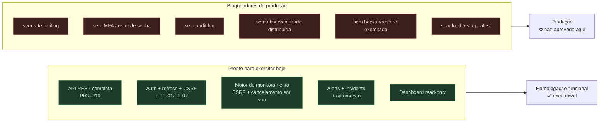

# Homologation Readiness — Sentinel

> **Prompt 17 de 18** — o que a **homologação pode exercitar hoje**, com que evidência, e o que ainda **impede** tratar o sistema como pronto para produção. Este documento **não** aprova produção e **não** substitui teste de carga, pentest ou revisão de segurança: ele delimita o terreno com base no que está no código e no que foi verificado por execução. Nenhuma migration, dependência ou contrato novo.



## 1. Escopo deste documento

| É | Não é |
| --- | --- |
| Estado da base **verificado por execução** (comando + exit code) | Aprovação de produção |
| Matriz do que a homologação **pode exercitar** | Substituto de testes de carga, pen-test ou revisão de segurança |
| Lista do que **falta**, com o motivo pelo qual é bloqueador | Plano de implementação do Prompt 18 |

## 2. Base verificada (execução real, não intenção)

| Verificação | Comando | Resultado |
| --- | --- | --- |
| Compilação backend (main + test) | `mvn -q test-compile -DskipTests` | **exit 0** |
| Testes backend | `mvn test` | **exit 0 — 862 testes, 0 falhas, 0 erros, 0 ignorados** (84 relatórios Surefire somando 862/0/0/0, execução 2026-10-07 05:57–06:03; baseline do Prompt 16 = 837) |
| Testes frontend | `npm run test` (em `frontend/`) | **exit 0 — 207 testes em 10 arquivos, todos passando** (execução 2026-10-07 05:56; baseline 199) |
| Lint frontend | `npm run lint` (em `frontend/`) | **exit 0**, sem achados |
| Type-check frontend | `npm run type-check` (em `frontend/`) | **exit 0** |
| Build frontend | `npm run build` (Next 16.3.6) | **exit 0** |
| Catálogo de migrations | `backend/src/main/resources/db/migration` | `V1`…`V12`, **nenhuma `V13`**, inalterado neste prompt |
| Integridade em runtime | `spring.jpa.hibernate.ddl-auto: validate` + `flyway.validate-on-migrate: true` | aplicado em `application.yml` |
| Dependências | `pom.xml` / `package.json` | **inalterados** neste prompt |

**Reconciliação de contagem** (por que 837 + 25 = 862 e 199 + 8 = 207): a divisão arquivo-a-arquivo está em `security-hardening.md` §8.

## 3. O que a homologação pode exercitar hoje

| Área | Superfície | Evidência |
| --- | --- | --- |
| **Auth** | registro, login, refresh com cookie `HttpOnly`/`SameSite=Strict`, rotação, revogação por reuso, logout | `docs/identity.md`, `RefreshTokenIntegrationTest` (inclui corrida 4×refresh → `1×200` + `3×401`) |
| **Multi-tenancy** | Organization → Project → Service → Monitor → AlertRule, `404` genérico anti-enumeração em 4–5 níveis, RBAC por papel | `docs/organizations.md`, `*IdorTest`, `StaleAuthorizationTest` |
| **Monitores** | CRUD + guarda SSRF no cadastro **e** na execução, formas não-canônicas bloqueadas | `docs/monitors.md`, `SsrfGuardNonCanonicalTargetTest` (6) |
| **Coleta** | tick agendado, pool dedicado, fila saturada sem erro, classificação de falha, cancelamento em voo | `docs/monitoring-engine.md`, `MonitoringDispatcherTest` |
| **Métricas** | janelas `1h/6h/24h/7d/30d`, buckets completos, fórmulas com denominador de relevantes | `docs/history-metrics.md` |
| **Alertas** | regras, avaliação por checagem, dedup em duas camadas, ciclo `FIRING → RESOLVED` | `docs/alert-engine.md` |
| **Incidents** | ciclo manual, timeline append-only, associação N:1, `@Version` → `409` | `docs/incidents.md` |
| **Automação** | `autoCreateIncident`, correlação com teto de tentativas, best-effort | `docs/alert-incident-automation.md` |
| **Dashboard** | `GET .../dashboard?range=`, GET-only, `405` em escrita | `docs/dashboard.md` |
| **Frontend** | `apiFetch` com timeout 15 s, `X-XSRF-TOKEN`, guarda de duplo submit em login/registro | `security-hardening.md` §6 |
| **Erros** | `400/401/403/404/405/409/500` no shape padrão, catch-all sem vazamento | `GlobalExceptionHandlerTest` |

## 4. Bloqueadores de produção

Nada abaixo foi implementado neste prompt — a coluna "Por que bloqueia" é o motivo pelo qual não pode ser tratado como detalhe.

| # | Bloqueador | Por que bloqueia | Estado |
| --- | --- | --- | --- |
| 1 | **Rate limiting** (login, refresh, endpoints de escrita) | sem teto, força bruta e esgotamento de conta são possíveis | não existe (sem dependência nem filtro) |
| 2 | **MFA** | comprometimento de credencial única = acesso completo ao tenant | não existe (declarado ausente desde o Prompt 01) |
| 3 | **Reset/verificação de senha** | sem recuperação, conta perdida é perdida; sem verificação, e-mail não é provado | não existe |
| 4 | **Trilha de auditoria** | `incident_events` é timeline de domínio, **não** audit log (sem `REVOKE DELETE`, sem retenção, sem "quem alterou a regra") | não existe |
| 5 | **Observabilidade** (logs estruturados → coletor, métricas de aplicação, tracing) | em incidente real não há como reconstruir o que aconteceu | não existe (sem OpenTelemetry/Micrometer custom, só `health`/`info`) |
| 6 | **Backup + restore exercitados** | sem restore testado, backup não é plano de recuperação | não exercitado neste repo |
| 7 | **Load test / capacity** | nenhum número de throughput ou degradação sob carga | não executado |
| 8 | **Pen-test / revisão de segurança independente** | a guarda SSRF foi fechada com testes próprios, não por auditoria externa | não executado |
| 9 | **CSP / HSTS / `Referrer-Policy`** | só `X-Content-Type-Options` e `X-Frame-Options` estão declarados | não verificado por teste |
| 10 | **Rotação de `JWT_SECRET` sem downtime** | segredo único: troca invalida todos os tokens emitidos | não existe mecanismo |
| 11 | **CI** (build/teste automático em PR) | `.github/` não tem workflow — nada impede merge que quebra | não existe |
| 12 | **Rate de erro/alerta operacional do próprio Sentinel** | sem SLO, error budget ou alerta do sistema | não definido |

## 5. Decisões de operação que **já estão** no código

Registrado porque a homologação pergunta "e se…?":

| Situação | Comportamento atual |
| --- | --- |
| `JWT_SECRET` vazia em dev/test | segredo HS256 **efêmero** gerado no startup com `WARNING`; reiniciar invalida tokens |
| `JWT_SECRET` vazia em **prod** | **fail-fast** (`:?` em `application-prod.yml`) — o startup aborta |
| `DATABASE_PASSWORD` vazia em prod | **fail-fast** idem |
| Cookie em prod | `secure: true` fixo, `SameSite=Strict` |
| CORS com wildcard + credenciais | **fail-fast** no startup (`SecurityConfigOriginsTest`) |
| `ddl-auto` | `validate` — divergência entre entidade e schema derruba o startup, nunca altera tabela |
| Flyway | `validate-on-migrate` — checksum divergente derruba o startup |
| Fila de monitoramento saturada | monitor segue "due"; **nunca** vira erro de alvo |
| Falha de rede no destino | `TARGET_FAILURE`/`TIMEOUT` classificado, ciclo continua |
| Actuator | expõe `health,info`, `show-details: never` |

## 6. Riscos conhecidos da própria base

| Risco | Onde está declarado |
| --- | --- |
| Assinaturas `Page<Alert>` sem `LIMIT`/`COUNT` hoje | `performance.md` §8 |
| `connectTimeout(10s)` fixo × `Monitor.timeoutMillis` até 30 s | `performance.md` §8 |
| Subquery correlacionada do painel (custo por linha, aceito) | `performance.md` §6 |
| Revalidação por redirect inexistente (não há redirect) | `security-hardening.md` §3.4 |
| Dívidas `RES-03/06/08` sem plano recuperável | `resilience.md` §1 |
| `.opencode/PROJECT_MEMORY.md` desatualizado (`837`/`199`/"P17 não") | fora do escopo deste prompt (arquivo não versionado e não listado como alvo) |

## 7. Comandos que a homologação deve conseguir executar

```bash
# backend
cd backend && mvn -q test-compile -DskipTests     # exit 0
cd backend && mvn test                            # 862, 0 falhas

# frontend
cd frontend && npm ci
cd frontend && npm run lint                       # exit 0
cd frontend && npm run type-check                 # exit 0
cd frontend && npm run test                       # 207
cd frontend && npm run build                      # exit 0

# banco local
docker compose up -d                              # PostgreSQL 17 na 5433
```

## 8. Limite do documento

Este texto **não** declara o sistema pronto para produção: a §4 existe justamente para que "862 testes verdes" não seja lido como "seguro para operar". As pendências da §4 são as que precisam de decisão de escopo antes de qualquer janela de produção, e o Prompt 18 é quem deve tratá-las — nada delas foi antecipado aqui.
