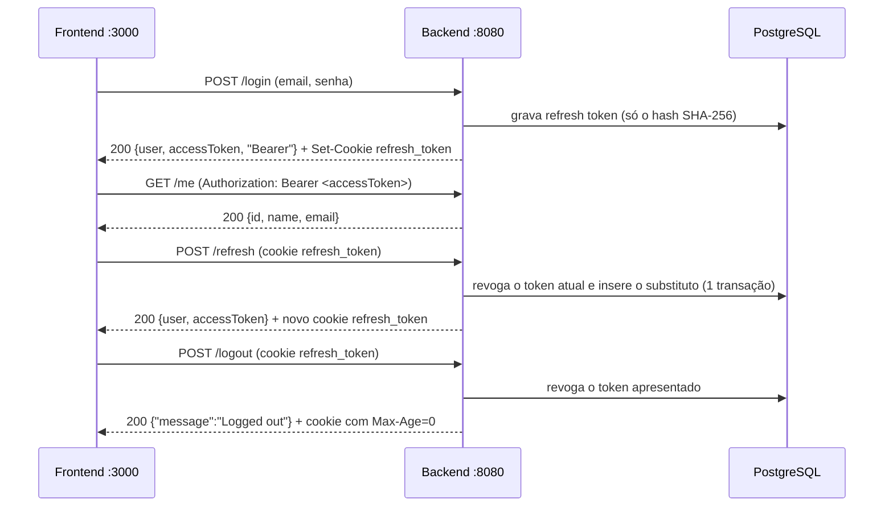

# Identity — Sentinel

> **Prompt 03 de 18** (escopo de auth; ajustado no **Prompt 04**). Este documento descreve **o que está construído**: autenticação *stateless* (access token JWT HS256 + refresh token opaco em cookie `HttpOnly` com rotação e revogação), CSRF em double-submit e CORS configurável. Multi-tenancy e organizações entraram no **Prompt 04** — ver [organizations.md](organizations.md); autorização por recurso (além dos papéis de organização), MFA e reset de senha continuam fora do escopo.

## 1. Escopo implementado

| Item | Estado |
| --- | --- |
| Migration `V2__create_users_table.sql` (tabela `users`) | Construído (Prompt 02) |
| Migration `V3__create_refresh_tokens_table.sql` (tabela `refresh_tokens`) | Construído |
| `POST /api/v1/auth/register` (BCrypt, sem token) | Construído |
| `POST /api/v1/auth/login` → access token + cookie refresh | Construído |
| `POST /api/v1/auth/refresh` → rotação de refresh + novo access token | Construído |
| `POST /api/v1/auth/logout` → revogação + limpeza de cookie (idempotente) | Construído |
| `GET /api/v1/auth/me` (Bearer) | Construído |
| CSRF double-submit (`XSRF-TOKEN` / `X-XSRF-TOKEN`) | Construído |
| CORS configurável por `app.cors.allowed-origins` | Construído |
| 404 padronizado para rota desconhecida (sem autenticar) | Construído |
| Organization / Membership / papéis por organização (`Role`) | Construído no **Prompt 04** → [organizations.md](organizations.md) |
| MFA / reset de senha / verificação de e-mail / dashboard | **Fora do escopo** |

## 2. Modelo de autenticação

Não existe sessão server-side (`JSESSIONID` removido). O estado vive nos dois tokens:



### 2.1 Access token (JWT HS256)

| Campo | Valor |
| --- | --- |
| Claims | **apenas** `sub` (UUID do usuário), `iat`, `exp` |
| Assinatura | HS256 com `jwt.secret` |
| TTL | `jwt.access-ttl-seconds` (default **900 s = 15 min**) |
| Transporte | header `Authorization: Bearer <token>` |
| Clock skew aceito | **60 s** (validador padrão do Spring Security) |

- O converter `UserJwtAuthenticationConverter` resolve `sub` → entidade `User` ativa. Claim inválido, usuário inexistente ou inativo viram **401** (`InvalidBearerTokenException`).
- O access token **não é persistido**: não existe "revogar access token"; a segurança imediata vem do TTL curto e da rotação/revogação do refresh.
- ⚠️ **Limitação conhecida**: as claims têm resolução de 1 s e HS256 é determinístico — dois access tokens emitidos no mesmo segundo para o mesmo usuário são **idênticos byte a byte**. Não é usado como identificador de sessão.

### 2.2 Refresh token (opaco)

| Campo | Valor |
| --- | --- |
| Valor bruto | 32 bytes de `SecureRandom` → Base64URL sem padding (~43 chars) |
| Persistido | **apenas** `sha256Hex(valor)` em `refresh_tokens.token_hash` (64 chars, `VARCHAR(64)`) |
| TTL | `jwt.refresh-ttl-days` (default **7 dias**) |
| Cookie | `refresh_token`, `HttpOnly`, `SameSite=Strict`, `Path=/api/v1/auth`, `Max-Age=604800`, `Secure` conforme configuração |

Se o banco vazar, nenhum refresh token é reutilizável — o valor bruto só existe no cookie.

**Rotação (transação única, atômica):** um `UPDATE ... WHERE token_hash = ? AND revoked = false AND expires_at > now` decide a corrida pelo número de linhas afetadas. Quem afeta 1 linha emite o substituto; quem afeta 0 relê o registro e recebe 401.

**Reuso:** apresentar um token **já revogado** revoga **todos** os tokens ativos do usuário (sinal clássico de token vazado) e devolve `401 REFRESH_TOKEN_REVOKED`. Esse revogamento em massa é executado com `@Transactional(noRollbackFor = ApiException.class)` — sem isso a própria exceção 401 desfaria a transação e o atacante manteria a sessão.

**Logout:** idempotente por contrato. Revoga somente o token apresentado (não derruba os demais aparelhos) e sempre limpa o cookie com `Max-Age=0` usando o mesmo nome/path/atributos.

## 3. Endpoints

Base: `http://localhost:8080`

### `POST /api/v1/auth/register` → `201`

```json
{ "name": "Ada Lovelace", "email": "ada@example.com", "password": "secret123" }
```

```json
{ "user": { "id": "uuid", "name": "Ada Lovelace", "email": "ada@example.com" } }
```

- **Não emite token** — o login é o único ponto que autentica.
- Email normalizado (`trim` + `toLowerCase`) e único no banco.
- Política de senha: **mín. 8 caracteres, ≥1 letra e ≥1 dígito** (`INVALID_PASSWORD`, 400). `@Size` nos DTOs define apenas o teto (255/255/128).

### `POST /api/v1/auth/login` → `200`

```json
{ "user": { "id": "uuid", "name": "Ada Lovelace", "email": "ada@example.com" },
  "accessToken": "eyJ...", "tokenType": "Bearer" }
```

- `Set-Cookie: refresh_token=...; Max-Age=604800; Path=/api/v1/auth; HttpOnly; SameSite=Strict`.
- Falha (senha errada, usuário inexistente ou inativo) → **sempre** `401 INVALID_CREDENTIALS` com a mesma mensagem — sem enumeração de contas.

### `POST /api/v1/auth/refresh` → `200`

- Sem body: lê o refresh **do cookie** e rotaciona.
- Resposta idêntica ao login (`{user, accessToken, tokenType}`) + cookie novo.
- O refresh token **nunca aparece no corpo JSON**.
- Falhas → `401` com `REFRESH_TOKEN_INVALID` \| `REFRESH_TOKEN_EXPIRED` \| `REFRESH_TOKEN_REVOKED`.

### `POST /api/v1/auth/logout` → `200`

```json
{ "message": "Logged out" }
```

- Idempotente: sem cookie, cookie inválido ou já revogado → sempre `200` + limpeza do cookie.

### `GET /api/v1/auth/me` → `200` | `401`

- Com `Authorization: Bearer <accessToken>` válido → `200` `{ "id", "name", "email" }`.
- Sem header, token malformado, assinado por outra chave, expirado, `sub` desconhecido ou usuário desativado → `401 UNAUTHORIZED`.
- Nenhum campo de senha/hash é retornado (`@JsonIgnore` + DTO explícito).

## 4. CSRF (double-submit)

- Habilitado com `http.csrf(csrf -> csrf.spa())`: cookie legível pelo JS `XSRF-TOKEN` + header `X-XSRF-TOKEN`.
- `CsrfTokenCookieAdvice` materializa o cookie em **toda requisição MVC** (inclusive `GET /api/v1/health`, que é o endpoint que o frontend usa para obter o token antes do primeiro POST).
- Todo método não-safe sem o header, ou com header ≠ cookie, recebe **403** no shape padrão `{"code":"FORBIDDEN",...}` — no Prompt 03 isso era só `POST`; o Prompt 04 passou a usar também `PATCH` e `DELETE` (gestão de membros), com a mesma regra.
- Em testes o fluxo é o real: `GET /health` → ler o cookie da resposta → enviar cookie + header. **Nenhum teste usa `.with(csrf())`.**

## 5. CORS

- Fonte única: `SecurityConfig.corsConfigurationSource`, consumido pelo filter chain (cobre preflight).
- Origens: `app.cors.allowed-origins` (env `CORS_ALLOWED_ORIGINS`), lista separada por vírgula, default `http://localhost:3000`.
- `allowCredentials(true)` + origem exata (nunca `*` — rejeitado pelo Spring e permitiria ler cookies de qualquer site).
- Headers permitidos: `Content-Type`, `Authorization`, `X-XSRF-TOKEN`, `X-Organization-Id`, `Accept`; métodos `GET, POST, PUT, PATCH, DELETE, OPTIONS`; preflight 3600 s. (`PATCH` e `X-Organization-Id` entraram no **Prompt 04** — `PATCH` no papel de membro e o header na resolução de tenant.)
- Origem não permitida → `403 Invalid CORS request` sem `Access-Control-Allow-Origin`.
- O preflight responde `Access-Control-Allow-Headers` com os headers **pedidos que estão na lista branca** (o Spring normaliza para minúsculas).

## 6. Contrato de erro

Shape padrão (Prompt 01):

```json
{ "code": "EMAIL_ALREADY_EXISTS", "message": "...", "timestamp": "...", "path": "/api/v1/auth/register" }
```

| Código | HTTP | Quando |
| --- | --- | --- |
| `VALIDATION_ERROR` | 400 | Payload inválido (email em branco/`@Email`, name em branco, etc.) |
| `INVALID_PASSWORD` | 400 | Senha fora da política (8+, letra + dígito) |
| `INVALID_CREDENTIALS` | 401 | Login com senha errada, usuário inexistente ou inativo |
| `UNAUTHORIZED` | 401 | Rota protegida sem/inválido Bearer (entry point) |
| `FORBIDDEN` | 403 | CSRF ausente/inválido ou acesso proibido (access denied handler) |
| `REFRESH_TOKEN_INVALID` | 401 | Cookie ausente ou hash inexistente |
| `REFRESH_TOKEN_EXPIRED` | 401 | `expires_at` no passado |
| `REFRESH_TOKEN_REVOKED` | 401 | Token rotacionado/revoado (reuso) ou corrida perdida |
| `EMAIL_ALREADY_EXISTS` | 409 | Email já cadastrado |
| `NOT_FOUND` | 404 | Rota desconhecida (`NoResourceFoundException`/`NoHandlerFoundException`) |
| `INTERNAL_ERROR` | 500 | Erros inesperados |

Mensagens de credenciais são **idênticas** para todos os casos de login inválido: `"Invalid email or password"`.

## 7. Configuração

| Propriedade | Env | Default | Observação |
| --- | --- | --- | --- |
| `jwt.secret` | `JWT_SECRET` | vazio | **≥ 32 chars**. Vazio em dev → segredo efêmero gerado no startup (WARNING; reiniciar invalida tokens emitidos). Em `prod` é **obrigatória** — startup falha sem ela. |
| `jwt.access-ttl-seconds` | `JWT_ACCESS_TTL_SECONDS` | `900` | |
| `jwt.refresh-ttl-days` | `JWT_REFRESH_TTL_DAYS` | `7` | |
| `jwt.cookie.name` | `JWT_COOKIE_NAME` | `refresh_token` | |
| `jwt.cookie.path` | `JWT_COOKIE_PATH` | `/api/v1/auth` | |
| `jwt.cookie.secure` | `JWT_COOKIE_SECURE` | `false` | **prod força `true`** |
| `jwt.cookie.same-site` | `JWT_COOKIE_SAME_SITE` | `Strict` | |
| `app.cors.allowed-origins` | `CORS_ALLOWED_ORIGINS` | `http://localhost:3000` | Lista separada por vírgula |

O segredo **nunca** é logado nem serializado.

## 8. Estrutura de código (backend)

```
com.sentinel
├── JwtProperties.java                 # @ConfigurationProperties("jwt")
├── JwtConfiguration.java              # resolve/valida o segredo (fail-fast em prod)
├── SecurityConfig.java                # filter chain, CSRF, CORS, converter, 401/403
├── identity
│   ├── auth
│   │   ├── AuthController.java        # /register /login /refresh /logout /me + cookie
│   │   ├── AccessTokenService.java    # emite JWT HS256 (sub, iat, exp)
│   │   ├── UserJwtAuthenticationConverter.java  # Jwt → User (bean em SecurityConfig)
│   │   ├── CsrfTokenCookieAdvice.java# materializa XSRF-TOKEN em toda request MVC
│   │   ├── RegisterRequest.java       # DTOs de entrada (@Valid)
│   │   ├── LoginRequest.java
│   │   ├── UserResponse.java          # DTOs de saída (sem senha/hash)
│   │   └── AuthResponse.java          # {user, accessToken, tokenType}
│   ├── token
│   │   ├── RefreshToken.java          # entidade (só hash) — user EAGER
│   │   ├── RefreshTokenRepository.java# UPDATEs condicionais (rotação/reuso)
│   │   └── RefreshTokenService.java   # issue / rotate / revoke / sha256Hex
│   └── user
│       ├── User.java                  # entidade `users` + UserDetails
│       ├── UserRepository.java
│       └── UserService.java           # register (política/BCrypt/409) + authenticate (401)
├── error/GlobalExceptionHandler.java  # + handlers 404 e 405 (405 veio no Prompt 04)
└── config/                            # async
```

> O pacote `organization/` (Tenant Context, organizações e membros) entrou no **Prompt 04** e está documentado em [organizations.md](organizations.md).

- `RefreshToken.user` é **`EAGER` de propósito**: todo leitor (rotação, reuso, logout) precisa do dono depois que a sessão JPA já fechou; um proxy `LAZY` explodiria em `LazyInitializationException` ao montar o `AuthResponse`.
- `UserJwtAuthenticationConverter` **não** é `@Component`: `@WebMvcTest` varre toda classe que implementa `Converter` e puxaria `UserRepository` para um contexto sem JPA. O bean é declarado em `SecurityConfig`.
- Ciclo evitado: `AuthController` chama `UserService.authenticate` diretamente (`PasswordEncoder.matches`), **não** `AuthenticationManager`.
- `User implements UserDetails`: `active=false` → `isEnabled()=false` → login rejeitado como credencial inválida.

## 9. Frontend (adaptado ao contrato do Prompt 03)

> O frontend **foi adaptado** a este contrato stateless: access token em memória + header `Authorization: Bearer`, refresh token em cookie `HttpOnly` (o JS nunca o lê), CSRF por header `X-XSRF-TOKEN` e bootstrap de sessão via `POST /refresh`.

| Rota | Comportamento |
| --- | --- |
| `/` | Home — `AuthStatus` faz o bootstrap (`POST /refresh` quando não há token em memória, depois `GET /me`) e `HealthStatus` |
| `/register` | Formulário → `POST /register` → redireciona para `/login` |
| `/login` | Formulário → `POST /login` → guarda o access token em memória → redireciona para `/` |

`src/lib/api.ts` centraliza `register/login/me/refreshSession/logout/checkHealth` com `credentials: "include"`. O access token vive em variável de módulo (memória) e é injetado como `Authorization: Bearer` pelo `apiFetch`; cada método não-safe (`POST/PUT/DELETE/PATCH`) recebe o header `X-XSRF-TOKEN` lido do cookie `XSRF-TOKEN`, materializado via `GET /api/v1/health` quando ausente. Em `401` o cliente limpa o token e volta ao estado anônimo.

## 10. Testes

- `mvn test` — **100 testes, 0 falhas** (contagem confirmada pela execução no Prompt 04; eram 54 antes dele):
  - `AuthIntegrationTest` (32): register (8), CSRF/materialização do cookie e 403, login stateless, `/me`, Bearer negativos (malformado, chave errada, `sub` desconhecido, expirado, usuário desativado), CORS/preflight/origem estrangeira (incluindo o preflight com `PATCH` + `X-Organization-Id` do Prompt 04), 404.
  - `RefreshTokenIntegrationTest` (11): hash SHA-256 de 64 chars no banco, ausência do token no corpo JSON, rotação, reuso → revogação em massa, token forjado/expirado/ausente, logout idempotente, fluxo completo, atributos do cookie.
  - `UserRepositoryTest` (5), `GlobalExceptionHandlerTest` (6 — a 6ª cobre o `405 METHOD_NOT_ALLOWED` do Prompt 04), `HealthControllerTest` (1), `SentinelApplicationTests` (1).
  - `OrganizationIntegrationTest` (12), `MembershipIntegrationTest` (24), `MultiTenantScenarioTest` (8) — multi-tenancy do Prompt 04, detalhados em [organizations.md](organizations.md).
- Cada classe `@SpringBootTest` tem seu próprio `PostgreSQLContainer` → contexto próprio (o `ServiceConnectionContextCustomizer` usa igualdade por identidade do container).
- Frontend: adaptado ao contrato stateless (access token em memória, CSRF via `X-XSRF-TOKEN`, bootstrap via `POST /refresh`). Validação: `npm run lint && npm run type-check && npm run build` — executado com exit 0.

## 11. Fora do escopo (prompts futuros)

- Permissões por recurso além dos papéis de organização (`ADMIN`/`OPERATOR`/`VIEWER`, Prompt 04), recuperação de senha, verificação de email, MFA.
- Dashboard.
- Job de expurgo dos refresh tokens revogados/expirados.
