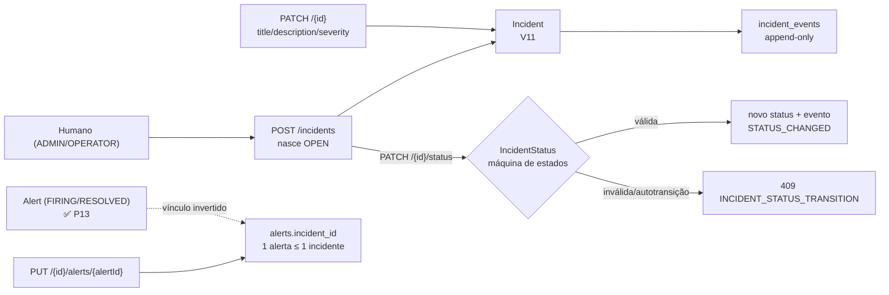

# Incidents — Sentinel

> **Prompt 14 de 18** — o ciclo de vida MANUAL de incidente de um serviço e a sua timeline append-only: o humano abre, tria, edita, move de status, resolve e associa alertas; a API registra cada mudança como um fato histórico imutável. Este documento descreve **o que está construído**: tabelas `incidents` e `incident_events` + coluna `alerts.incident_id` (migration `V11`; a `V12` acrescentou `incidents.source`, o ator anulável e os índices de correlação), sub-pacote `com.sentinel.project.incident`, o sub-recurso `.../services/{serviceId}/incidents` (9 handlers) e o painel `IncidentsPanel` no frontend. A configuração de regras é a do [alert-rules.md](alert-rules.md), a avaliação que produz os alertas é a do [alert-engine.md](alert-engine.md), a abertura automática é a do [alert-incident-automation.md](alert-incident-automation.md), a hierarquia de serviço é a do [services.md](services.md) e a base de autenticação (Bearer + CSRF) é a do [identity.md](identity.md).

**Um `Incident` MANUAL é aberto POR UM HUMANO** — o caminho manual (`POST .../incidents`) continua atribuindo o autor autenticado do `TenantContext` e nenhuma linha deste módulo cria `Incident` a partir de `Alert`. Desde o **Prompt 15** existe, porém, a **automação opt-in** por regra (`alert_rules.auto_create_incident`, ver [alert-incident-automation.md](alert-incident-automation.md)): com a flag ligada, o nascimento de um alerta cria um incidente com `source = ALERT_AUTOMATION` e `created_by_user_id = NULL` — um **segundo caminho de escrita**, fora destes handlers, sem rota própria. O vínculo continua **invertido** — mora em `alerts.incident_id`, um alerta pertence a **no máximo um** incidente e um incidente pode reunir vários. O Alert Engine não conhece este módulo (fronteira travada por `MonitoringEngineBoundaryTest`).

## 1. Escopo implementado

| Item | Estado |
| --- | --- |
| Migration `V11__create_incidents_tables.sql` (tabelas `incidents`/`incident_events` + `alerts.incident_id`, aditiva) | Construído |
| Entidades `Incident`, `IncidentEvent` + `IncidentRepository`, `IncidentEventRepository` | Construído |
| Máquina de estados `IncidentStatus` (4 estados, 6 transições, `RESOLVED` terminal, sem Spring/JPA) | Construído |
| Sub-pacote `com.sentinel.project.incident` (`model`, `repository`, `web/dto`, `service`, `web`) | Construído |
| 9 handlers `@TenantScoped` em `IncidentController` (create/list/get/update/status/events/alerts/link/unlink) | Construído |
| Timeline append-only com carimbos estritamente crescentes dentro de um mesmo request | Construído |
| Associação Incident ↔ Alert por `PUT`/`DELETE` de `.../alerts/{alertId}` (idempotente, cardinalidade 1 alerta ≤ 1 incidente) | Construído |
| RBAC `ADMIN`/`OPERATOR` mutam, `VIEWER` lê; leitura livre inclusive com pais inativos | Construído |
| `404` genérico anti-enumeração na cadeia Project → Service → Incident → Alert | Construído |
| Concorrência: `@Version` no `Incident` → `409`; `UPDATE ... WHERE incident_id IS NULL` + releitura/classificação no alerta (índice `idx_alerts_incident` não-único, só para listagem) | Construído |
| Frontend: cliente (9 funções) + helpers (`lib/incidents.ts`) + `IncidentsPanel`/`IncidentDetail` | Construído |
| Remoção de incidente (`DELETE /{incidentId}`) | **Fora do escopo** (a rota devolve `405`) |
| Notificações, ack, silenciamento, escalonamento, atribuição, on-call, correlação, postmortem, reabertura | **Fora do escopo** (Prompt 16+) |
| Automação Alert → Incident (flag `auto_create_incident`, `source`, gatilhos) | **Fora do escopo do Prompt 14** — **construído no Prompt 15** (ver [alert-incident-automation.md](alert-incident-automation.md)) |

## 2. Conceito e fluxo

- **Quem abre**: só uma pessoa autenticada, via `POST .../incidents`. O incidente nasce `OPEN` com `resolvedAt = NULL` e ganha a linha `CREATED` da timeline na **mesma transação**.
- **Onde vive**: sempre dentro de um serviço (`service_id NOT NULL`). A cadeia Organization → Project → Service → Incident é resolvida com lookups tenant-scoped — nunca `findById` avulso.
- **Como avança**: apenas pela rota `PATCH .../incidents/{incidentId}/status`. O `PATCH` de conteúdo **nunca** muda `status` (o campo nem existe no DTO).
- **Como termina**: `RESOLVED` é terminal. Depois disso conteúdo e associação respondem `409 INCIDENT_RESOLVED`; leitura (detalhe, lista, timeline, alertas) continua `200`.
- **O que fica registrado**: cada mudança de conteúdo/status/associação vira UMA linha em `incident_events`, gravada na mesma transação da mudança — não existe estado em que o incidente mudou sem o evento que explica a mudança.



## 3. Modelo de dados

### 3.1 `Incident` (tabela `incidents`, `V11`)

| Coluna | Tipo | Observação |
| --- | --- | --- |
| `id` | `UUID` PK | Gerado pela aplicação (`@PrePersist`), mesmo padrão das demais |
| `service_id` | `UUID NOT NULL` → `services(id)` | `ON DELETE RESTRICT` — **obrigatório**: não existe incidente "solto" |
| `title` | `VARCHAR(200) NOT NULL` | `CHECK (trim(title) <> '')` + trim/strip de controle no service |
| `description` | `VARCHAR(4000) NULL` | `""` é normalizado para `NULL` |
| `severity` | `VARCHAR(10) NOT NULL` | `CHECK SEV1..SEV4` — mesma enum do alerta |
| `status` | `VARCHAR(15) NOT NULL` | `CHECK (OPEN, INVESTIGATING, IDENTIFIED, RESOLVED)` |
| `started_at` | `TIMESTAMPTZ NOT NULL` | payload ou relógio do domínio; janela `[-30d, +5min]` |
| `resolved_at` | `TIMESTAMPTZ NULL` | preenchido **exatamente** quando `status = RESOLVED` |
| `created_by_user_id` | `UUID NULL` → `users(id)` | `ON DELETE RESTRICT`; **`NOT NULL` na V11**, anulado pela V12 para o incidente automático — o caminho **manual** continua preenchendo o ator a partir do `TenantContext` (o construtor de 6 argumentos exige não-nulo) |
| `created_at` / `updated_at` | `TIMESTAMPTZ NOT NULL` | `updated_at` mantido pela aplicação (`@PreUpdate`) |
| `version` | `BIGINT NOT NULL` | `@Version` do JPA — escudo de concorrência |

CHECKs: `incidents_title_not_blank`, `incidents_severity_check`, `incidents_status_check` e **`incidents_lifecycle_check`** — `resolved_at` existe **exatamente** quando o status é `RESOLVED` (a máquina de estados amarra as duas; o CHECK vigia a "metade escrita" da linha).

Índices: `idx_incidents_service_started_desc (service_id, started_at DESC)` (ordem da API), `idx_incidents_service_status` e `idx_incidents_service_severity` (os dois filtros).

**Coluna da V12 (Prompt 15)**: `source VARCHAR(20) NOT NULL DEFAULT 'MANUAL'` + `CHECK incidents_source_check (MANUAL, ALERT_AUTOMATION)` — quem nasceu o incidente; as linhas pré-V12 recebem `'MANUAL'`. A resposta da API passou a serializar `source`. Detalhes em [alert-incident-automation.md](alert-incident-automation.md) §3.

### 3.2 `IncidentEvent` (tabela `incident_events`, `V11`)

| Coluna | Tipo | Observação |
| --- | --- | --- |
| `id` | `UUID` PK | Gerado pela aplicação |
| `incident_id` | `UUID NOT NULL` → `incidents(id)` | `ON DELETE RESTRICT` |
| `type` | `VARCHAR(30) NOT NULL` | `CHECK`: `CREATED`, `STATUS_CHANGED`, `SEVERITY_CHANGED`, `TITLE_CHANGED`, `DESCRIPTION_CHANGED`, `ALERT_LINKED`, `ALERT_UNLINKED` |
| `message` | `VARCHAR(1000) NOT NULL` | frase legível, `CHECK (trim(message) <> '')` |
| `actor_user_id` | `UUID NULL` → `users(id)` | `ON DELETE SET NULL` — autor que saiu não apaga o fato |
| `created_at` | `TIMESTAMPTZ NOT NULL` | carimbo decidido pelo service (ver §7.2) |

**Não existe `updated_at`** — o log é append-only e não tem rota de escrita (§6.7).

Índice `idx_incident_events_incident_created (incident_id, created_at, id)` cobre exatamente a ordenação `createdAt ASC, id ASC` do `GET .../events`.

### 3.3 `alerts.incident_id` (mesma `V11`)

- `ALTER TABLE alerts ADD COLUMN incident_id UUID REFERENCES incidents (id) ON DELETE SET NULL` — **cardinalidade invertida**: um incidente reúne N alertas, um alerta aponta para 1 incidente no máximo.
- `ON DELETE SET NULL` (não `RESTRICT`): a API **não tem `DELETE` de incidente**; se a linha sumir por SQL direto, o alerta histórico continua existindo.
- **Índice simples não-único** `idx_alerts_incident ON alerts (incident_id)` — existe **só para a listagem** `GET .../incidents/{incidentId}/alerts`. A cardinalidade é **N alertas : 1 incidente**; **1 alerta ≤ 1 incidente** é garantido pela coluna única por linha (cada alerta guarda um único valor em `incident_id`) + pelo `UPDATE ... WHERE incident_id IS NULL` da aplicação — sob corrida, a releitura/classificação em `0 linhas` decide `200 idempotente` ou `409 ALERT_ALREADY_LINKED`. Nenhum índice único participa (um `UNIQUE (incident_id)` seria o inverso do contrato: proibiria dois alertas no mesmo incidente).
- `link`/`unlink` **nunca** alteram nenhum outro campo do alerta.

## 4. Máquina de estados (`IncidentStatus`)

```
OPEN ──────────► INVESTIGATING ─────► IDENTIFIED ─────► RESOLVED
 │  └────────────► IDENTIFIED ───────────┘                (terminal)
 └────────────────────────► RESOLVED
```

Seis transições permitidas, decididas pelo enum puro `IncidentStatus.canTransitionTo` (sem Spring, sem JPA — os testes rodam puros):

| De | Para | Permitido |
| --- | --- | --- |
| `OPEN` | `INVESTIGATING`, `IDENTIFIED`, `RESOLVED` | ✅ |
| `INVESTIGATING` | `IDENTIFIED`, `RESOLVED` | ✅ |
| `IDENTIFIED` | `RESOLVED` | ✅ |
| `RESOLVED` | qualquer (inclusive `RESOLVED`) | ❌ — terminal |
| qualquer | o MESMO estado | ❌ — **autotransição não é idempotente**: `409 INCIDENT_STATUS_TRANSITION` (nunca `200` silencioso) |
| `IDENTIFIED` → `INVESTIGATING`, `INVESTIGATING` → `OPEN` | | ❌ — o fluxo só avança |

Reabrir um incidente resolvido **não existe**: é um novo `POST`.

## 5. Autorização e ordem das checagens

Toda mutação segue a mesma ordem fixa (no `IncidentService`, não no controller — é regra de domínio):

1. **`requireMutationRole()`** — papel no `TenantContext` precisa ser `ADMIN` ou `OPERATOR`; senão `403 FORBIDDEN` (`"Access denied"`). `VIEWER` e ausência de papel caem aqui.
2. **Cadeia do tenant** (`requireParents`) — projeto e serviço resolvidos com lookup tenant-scoped. Fora da organização → `404` genérico (`"Resource not found"`), **antes** de qualquer 409.
3. **Pais ativos** (`requireActiveParents`) — só nas mutações: `409 PROJECT_INACTIVE` antes de `409 SERVICE_INACTIVE` (ordem determinística).
4. **Incidente** — pertence ao serviço do path? Senão `404` genérico.
5. **Imutabilidade pós-resolução** — `409 INCIDENT_RESOLVED` para conteúdo e associação (a rota de status é decidida pela máquina de estados).
6. **Payload** — `400 VALIDATION_ERROR` (título, descrição, `startedAt`, `severity`, paginação).
7. **Cardinalidade do alerta** — `409 ALERT_ALREADY_LINKED`.

**Leitura é livre para qualquer papel** — inclusive com projeto/serviço inativos: a história continua consultável depois do congelamento. `@Valid` só no `POST` e no `/status`; no `PATCH` de conteúdo o domínio distingue "ausente" de "em branco".

## 6. Endpoints

Base: `/api/v1/organizations/{organizationId}/projects/{projectId}/services/{serviceId}/incidents`

### 6.1 Matriz de acesso

| # | Método + path | ADMIN | OPERATOR | VIEWER | Anônimo |
| --- | --- | --- | --- | --- | --- |
| 1 | `POST .../incidents` → `201` | ✅ | ✅ | `403` | `401` |
| 2 | `GET .../incidents` → `200` | ✅ | ✅ | ✅ | `401` |
| 3 | `GET .../incidents/{incidentId}` → `200` | ✅ | ✅ | ✅ | `401` |
| 4 | `PATCH .../incidents/{incidentId}` → `200` | ✅ | ✅ | `403` | `401` |
| 5 | `PATCH .../incidents/{incidentId}/status` → `200` | ✅ | ✅ | `403` | `401` |
| 6 | `GET .../incidents/{incidentId}/events` → `200` | ✅ | ✅ | ✅ | `401` |
| 7 | `GET .../incidents/{incidentId}/alerts` → `200` | ✅ | ✅ | ✅ | `401` |
| 8 | `PUT .../incidents/{incidentId}/alerts/{alertId}` → `200` | ✅ | ✅ | `403` | `401` |
| 9 | `DELETE .../incidents/{incidentId}/alerts/{alertId}` → `204` | ✅ | ✅ | `403` | `401` |

Não-membros e ids de outro tenant respondem o **mesmo `404` genérico** em todos eles.

### 6.2 `POST .../incidents` → `201`

Body `{title, description?, severity, startedAt?}`. `startedAt` ausente → `clock.instant()` do domínio. Resposta é o `IncidentResponse` completo, já com `status = "OPEN"`, `resolvedAt = null`, `version = 0` e o `role` do usuário.

### 6.3 `GET .../incidents` → `200`

Página Spring `{content, totalElements, totalPages, number, size}`; ordem fixa **`startedAt DESC, id DESC`**; `page` (default `0`, `>= 0`), `size` (default `20`, `1..100`), filtros opcionais `status` e `severity` tipados como enum (fora do enum → `400`, nunca `500`).

### 6.4 `GET .../incidents/{incidentId}` → `200` | `404`

Detalhe completo, incluindo `role` do usuário. Id malformado → o mesmo `404` genérico (nunca `400`/`500`).

### 6.5 `PATCH .../incidents/{incidentId}` → `200`

Body **parcial** `{title?, description?, severity?}`. Campo ausente não altera; `description: ""` limpa (vira `null`); `title` em branco → `400`. Campos server-owned (`id`, `serviceId`, `status`, `startedAt`, `resolvedAt`, `createdByUserId`, `source`, `version`) **não existem no DTO** e são ignorados se enviados (mass assignment).

Cada campo que realmente mudou gera **um evento** com a mensagem fixa:

| Campo | `type` | `message` |
| --- | --- | --- |
| `title` | `TITLE_CHANGED` | `Title changed` |
| `description` | `DESCRIPTION_CHANGED` | `Description changed` |
| `severity` | `SEVERITY_CHANGED` | `Severity changed from A to B` |

No-op (`PATCH` com os mesmos valores) → `200` **sem evento** e sem avançar `updatedAt`.

### 6.6 `PATCH .../incidents/{incidentId}/status` → `200` | `409`

Body `{status}` (`@Valid`, `status` obrigatório). Sucesso → `200` com o `IncidentResponse` atualizado e um evento `STATUS_CHANGED` com a mensagem **`Status changed from X to Y`**. Destino inválido (inclusive autotransição ou qualquer saída de `RESOLVED`) → `409 INCIDENT_STATUS_TRANSITION` com a mensagem `Cannot transition from X to Y`.

### 6.7 `GET .../incidents/{incidentId}/events` → `200`

**Lista** (não é página) ordenada por `createdAt ASC, id ASC` — append-only, fato histórico. **Não existem** `POST`/`PATCH`/`DELETE` nesta coleção: o `POST` e o `PATCH` na coleção caem em `405` (a rota existe, o método não) e `PATCH`/`DELETE` no item caem em `404` (não há rota alguma).

### 6.8 `GET .../incidents/{incidentId}/alerts` → `200`

Página Spring dos alertas vinculados (mesmo `page`/`size` do resto, ordem `startedAt DESC, id DESC`, `size` 1..100).

### 6.9 `PUT .../incidents/{incidentId}/alerts/{alertId}` → `200`

Associação idempotente. Já vinculado a **este** incidente → `200` sem evento novo. Vinculado a **outro** incidente → `409 ALERT_ALREADY_LINKED`. Alerta de outro serviço → `404`. Resposta é o `IncidentResponse`. Emite `ALERT_LINKED` com a mensagem `Alert <uuid> linked`.

### 6.10 `DELETE .../incidents/{incidentId}/alerts/{alertId}` → `204`

Remove **só o vínculo** (o alerta nunca é apagado). Idempotente: alerta que não pertencia a este incidente → `204` **sem** evento. Emite `ALERT_UNLINKED` com a mensagem `Alert <uuid> unlinked` apenas quando havia vínculo.

### 6.11 `DELETE`/`PUT` na rota do incidente → `405`

Não existe remoção de incidente (o histórico é imutável) nem `PUT` de conteúdo.

## 7. Regras de domínio

### 7.1 Transação única mudança + evento

Toda mutação grava a alteração **e** as linhas da timeline na MESMA transação. Não há estado em que o incidente mudou sem o evento — nem evento sem mudança correspondente.

### 7.2 Carimbos estritamente crescentes

`TIMESTAMPTZ` guarda microssegundos, então `Instant.now()` duas vezes seguidas cairia no mesmo tick e a ordenação `createdAt ASC, id ASC` cairia no desempate por UUID aleatório (a ordem "title → description → severity" viraria sorte). O service usa `EVENT_STAMP_GAP = 1 ms`: o primeiro evento de um request usa o relógio real e os seguintes recebem `max(agora, anterior + 1ms)`. A folha é ordem de grandeza, não precisão — três eventos de um PATCH terminam 2 ms no futuro, invisível na timeline.

### 7.3 Janela de `startedAt`

Só no create e só quando o valor vem do payload: **não mais que 5 minutos no futuro** (`startedAt: must not be more than 5 minutes in the future`) nem **mais que 30 dias no passado** (`startedAt: must not be older than 30 days`). Evita cliente com relógio descalado e impede reescrever a história.

### 7.4 Isolamento cross-tenant em QUATRO níveis

Projeto, serviço, incidente e alerta são resolvidos com lookup tenant-scoped. Um id válido pertencendo a outro nível responde o **mesmo `404`** com `code=NOT_FOUND` e `message="Resource not found"` — sem revelar se o recurso existe em outro lugar (anti-enumeração), e sem efeito colateral.

### 7.5 Concorrência

- **`Incident` tem `@Version`**: dois `PATCH` simultâneos disputando a mesma linha lançam `OptimisticLockingFailureException`, traduzida pelo `GlobalExceptionHandler` em `409 CONFLICT` (`"The resource was updated by another request"`).
- **Alerta**: `UPDATE ... WHERE incident_id IS NULL` — `0 linhas` acionam a releitura/classificação, que decide `200 idempotente` ou `409 ALERT_ALREADY_LINKED` (sem índice único; `idx_alerts_incident` é **não-único** e só apoia a listagem). Dois incidentes disputando o mesmo alerta resolvem em `{200, 409}`.
- Dois `PATCH /status` simultâneos para o **mesmo** destino a partir de `OPEN` resolvem em `{200, 409}` (o segundo pode ser um no-op rejeitado ou um conflito de versão).

### 7.6 Mass assignment e sanitização

Os DTOs de escrita não têm campos de escopo nem de servidor. `title`/`description` passam por strip de caracteres de controle + trim; título longo é **rejeitado** (`400`), não truncado em silêncio.

## 8. Contrato de erro

Shape padrão `{code, message, timestamp, path}`.

| HTTP | `code` | `message` | Quando |
| --- | --- | --- | --- |
| `400` | `VALIDATION_ERROR` | `title: must not be blank` / `title: must be at most 200 characters` / `description: must be at most 4000 characters` / `severity: must not be null` / `status: must not be null` | payload inválido |
| `400` | `VALIDATION_ERROR` | `startedAt: must not be more than 5 minutes in the future` / `startedAt: must not be older than 30 days` | janela de início |
| `400` | `VALIDATION_ERROR` | `page: must not be negative` / `size: must be between 1 and 100` | paginação |
| `400` | `VALIDATION_ERROR` | mensagem genérica | corpo JSON malformado |
| `401` | — | — | sem/expirado access token |
| `403` | `FORBIDDEN` | `Access denied` | `VIEWER` em qualquer mutação |
| `404` | `NOT_FOUND` | `Resource not found` | fora da cadeia, id malformado, não-membro |
| `405` | `METHOD_NOT_ALLOWED` | — | `POST`/`PATCH` na coleção `.../events`, `DELETE`/`PUT` na rota do incidente |
| `409` | `INCIDENT_STATUS_TRANSITION` | `Cannot transition from X to Y` | destino inválido, autotransição, saída de `RESOLVED` |
| `409` | `INCIDENT_RESOLVED` | `Incident is resolved and can no longer be modified` | `PATCH` de conteúdo e `PUT`/`DELETE` de alerta pós-resolução |
| `409` | `PROJECT_INACTIVE` | `Cannot create or modify incidents in an inactive project` | projeto congelado (antes do serviço) |
| `409` | `SERVICE_INACTIVE` | `Cannot create or modify incidents in an inactive service` | serviço congelado |
| `409` | `ALERT_ALREADY_LINKED` | `Alert is already linked to another incident` | alerta já em outro incidente |
| `409` | `CONFLICT` | `The resource was updated by another request` | `@Version` estourado (otimista) |

## 9. CSRF e autenticação

Mesmo contrato double-submit do resto da API: cookie `XSRF-TOKEN` + header `X-XSRF-TOKEN` nos métodos não-safe (`POST`, `PUT`, `PATCH`, `DELETE`). Nenhum teste usa `.with(csrf())` — o `CsrfFilter` real é o que está sob teste. Requisições com `Authorization: Bearer …` são isentas pelo próprio Spring Security (o bearer não é anexado pelo navegador). A autoridade de papel é lida **por requisição** no `TenantContext`, nunca do JWT.

## 10. Frontend (Prompt 14)

- **Cliente** em `src/lib/api.ts` (seção `Incidentes (Prompt 14)`): tipos `IncidentStatus`, `IncidentEventType`, `IncidentResponse`, `IncidentEventResponse`, `IncidentCreateRequest`, `IncidentUpdateRequest`, `IncidentStatusRequest`, `IncidentListParams`, `IncidentPage`; `buildIncidentListParams` (ordem fixa da query) e as **nove** funções `createIncident`, `listIncidents`, `getIncident`, `updateIncident`, `changeIncidentStatus`, `listIncidentEvents`, `listIncidentAlerts`, `linkIncidentAlert`, `unlinkIncidentAlert`.
- **Helpers puros** em `src/lib/incidents.ts` (sem rede, sem DOM — ambiente `node` do vitest): rótulos de status/evento, `INCIDENT_TRANSITIONS` + `canTransition`/`nextStatusOptions` (espelho da máquina de estados), `isResolved`, `canManageIncidents`, `formatIncidentInstant` (delega ao `alerts.ts`), `incidentEventLine`, `incidentActorLabel`, `incidentsViewState` → `loading|error|empty|list`, `openIncidentCount`, `hasIncidentContentChanges` e os badges `incidentStatusBadgeClasses`/`incidentSeverityBadgeClasses` (severidade reaproveitada do `alert-rules.ts` — fonte única).
- **Painéis**: `IncidentsPanel` (listagem com filtros de status/severidade, paginação, contagem de abertos, criação, gate de `VIEWER`, aviso de serviço inativo) e `IncidentDetail` (linha expandida: estado + transição de status + edição de conteúdo + alertas vinculados/vinculação + timeline). Montados em `ServicesPanel.tsx` com `key={`incidents-${service.id}`}` para o estado nascer limpo por serviço.
- A transição de status usa **exclusivamente** `changeIncidentStatus` (rota `/status`); o `updateIncident` só leva conteúdo. O seletor de destino só oferece estados que `canTransition` aceita, mas a autoridade continua no backend (um `409` vira mensagem na UI, nunca logout).

## 11. Estrutura de código (backend)

```
com.sentinel.project.incident
├── model
│   ├── Incident.java               # @Version, @PrePersist/@PreUpdate, sanitizeText
│   ├── IncidentEvent.java          # sem updatedAt (append-only)
│   └── IncidentStatus.java         # enum puro: 4 estados + canTransitionTo
├── repository
│   ├── IncidentRepository.java     # lookup tenant-scoped + search paginado
│   └── IncidentEventRepository.java
├── service
│   └── IncidentService.java        # ordem das checagens, validações, emit, link/unlink
└── web
    ├── dto
    │   ├── IncidentCreateRequest.java   # @NotBlank title, @NotNull severity, @Size description
    │   ├── IncidentUpdateRequest.java   # parcial, sem @Valid
    │   ├── IncidentStatusRequest.java   # @NotNull status
    │   ├── IncidentResponse.java
    │   └── IncidentEventResponse.java   # sem updatedAt
    └── IncidentController.java     # 9 handlers @TenantScoped, parseId → 404 genérico
```

Também alterados: `AlertRepository` ganhou `searchByIncidentId` + `linkIncident`/`unlinkIncident` **condicionais** (`WHERE incident_id IS NULL` / `WHERE incident_id = :id`); `GlobalExceptionHandler` traduz `OptimisticLockingFailureException` em `409 CONFLICT`. O pacote **não** cria filtro, interceptor, handler global nem bean de segurança próprios.

## 12. Testes

Suíte de **775 testes backend, 0 falhas** (`mvn clean test`, exit 0) e **170 testes frontend** (`npm run test`, exit 0). As novas classes (todas herdam `AbstractIncidentIntegrationTest` → `AbstractAlertEngineIntegrationTest` → … → `AbstractTenantIntegrationTest`, contexto próprio por `PostgreSQLContainer`):

| Classe | Nº | Cobre |
| --- | --- | --- |
| `IncidentModelTest` | 17 | máquina de estados pura (6 transições, autotransição, `RESOLVED` terminal), sanitização, `@Version` |
| `IncidentApiTest` | 30 | contrato dos 9 endpoints: `201`/`200`/`204`, validações `400` (mensagem exata), `startedAt` nas duas bordas, paginação, enum inválido `400`, mass assignment, no-op sem evento, ordem dos eventos de um PATCH multi-campo, `409` de transição, `405` de `DELETE` e de `POST` na coleção |
| `IncidentRbacTest` | 7 | `ADMIN`/`OPERATOR` mutam, `VIEWER` `403` em criar/editar/status/associar, leitura livre para todos, anônimo `401` |
| `IncidentIdorTest` | 8 | cross-org, interceptor, projeto/serviço forjado, serviço irmão, UUID aleatório, id malformado, alerta de outro serviço — tudo `404` genérico sem escrita |
| `IncidentParentInactiveTest` | 5 | `SERVICE_INACTIVE` em todas as mutações, `PROJECT_INACTIVE`, ordem projeto > serviço, leitura aberta, cadeia `404` antes do `409` |
| `IncidentAlertLinkTest` | 9 | `PUT` `200` + evento, campos do alerta intactos, idempotência, `409 ALERT_ALREADY_LINKED`, `404` de outro serviço, `DELETE` `204` + evento + segundo `DELETE` silencioso, unlink de alerta solto, pós-`RESOLVED` `409`, paginação |
| `IncidentTimelineTest` | 6 | `CREATED` com mensagem e autor exatos, 3 eventos ordenados com carimbos estritamente crescentes, no-op sem evento e sem avançar `updatedAt`, mensagem `Status changed from X to Y`, ordenação `createdAt ASC, id ASC`, append-only (`405`/`404` nas rotas de escrita) |
| `IncidentConcurrencyTest` | 2 | dois `PATCH /status` simultâneos → `{200, 409}`; mesmo alerta disputado por dois incidentes → `{200, 409}` com exatamente 1 vínculo |
| `MonitoringEngineBoundaryTest` | — | **atualizado**: `incidentEntitiesAreExactlyIncidentAndIncidentEvent`, `V11_INCIDENTS_MIGRATION`, `incidentsMigrationIsAdditiveAndManualLifecycleBounded`, `alertingPackageHasNoIncidentReferences` |

Também foram atualizados os guardas de catálogo de migrations (`AlertMigrationTest`, `AlertRuleMigrationTest`): `V1..V11` — a `V11` passou a existir e os testes agora a enumeram.

Frontend: `src/lib/incidents.test.ts` (**33 testes**) cobre rótulos, a máquina de estados 4×4, `canManageIncidents`, a timeline, `incidentsViewState`, derivados, badges, query string, os paths/verbos dos 9 clientes e as fronteiras (helper puro sem DOM/rede; nenhum `DELETE` de incidente; nenhum campo de escopo no body). O recorte da seção de alertas em `alerts.test.ts` passou a parar na marca `Incidentes (Prompt 14)` — a nova seção tem verbos mutantes próprios e quebraria o teste antigo se o `slice` fosse até o fim do arquivo.

### 12.1 Nota de infraestrutura

Os testes de incidente que precisam do Alert Engine (seeding de alerta real) importam `FixedMetricsClockConfig`; os demais usam o `SystemClock` — `startedAt` é validado contra o relógio real, então um relógio fixo antigo violaria a janela de 30 dias.

## 13. Fronteira com o Prompt 16 (fora do escopo)

```mermaid
graph LR
    ALRT["Alert (FIRING→RESOLVED)<br/>✅ P13"] -.->|vínculo invertido<br/>alerts.incident_id| INC["Incident<br/>✅ P14 (manual)<br/>✅ P15 (automação opt-in)"]
    INC --> EV["incident_events<br/>✅ P14 (append-only)"]
    FLAG["alert_rules.auto_create_incident<br/>✅ P15"] -. cria com source=.-> INC
    INC -.x. NEXT["notificações / ack / silêncio /<br/>escalonamento / on-call / postmortem<br/>⛔ NOT IMPLEMENTED (P16+)"]
```

- **A automação entrou no Prompt 15** (fora destes handlers): com a flag da regra ligada, o nascimento de um alerta cria incidente `source = ALERT_AUTOMATION` com ator nulo e título `[AUTO]` — ver [alert-incident-automation.md](alert-incident-automation.md). O Alert Engine **continua sem referenciar** o pacote `incident` (travado por `alertingPackageHasNoIncidentReferences`); quem escreve é o pacote `alert.automation`, notificado por hook/evento neutros.
- **Não há notificação, ack, silenciamento, escalonamento, atribuição, on-call, correlação ou pós-mortem** — nenhuma tabela, endpoint, campo ou enum para eles (Prompt 16+).
- **Não há reabertura**: `RESOLVED` é terminal e não existe `DELETE` de incidente (a rota devolve `405`).
- **Não há scheduler nem `@Scheduled`** neste módulo — o único relógio é o `Clock` injetado.
