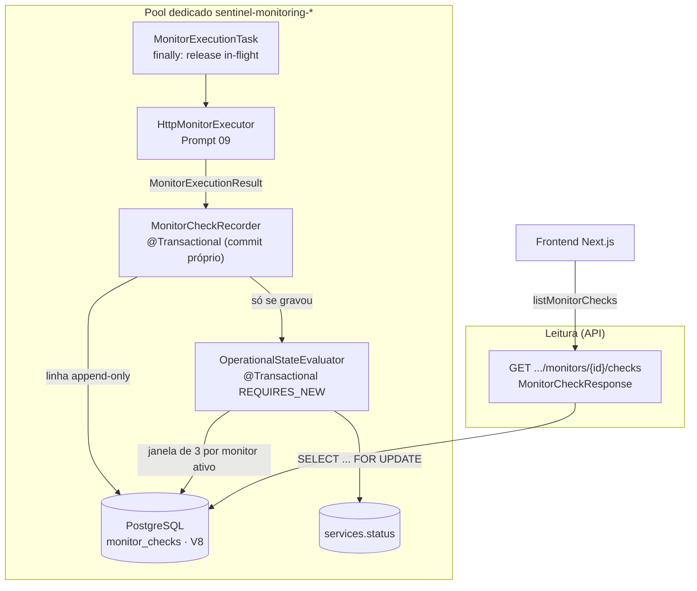

# Operational State — Sentinel

> **Prompt 10 de 18** — histórico de checagens e estado operacional dos serviços. Este documento descreve **o que está construído**: a tabela `monitor_checks` (migration `V8`), a classificação persistida de cada execução, a janela de avaliação (N = 3) que escreve `Service.status`, os estados `UNKNOWN`/`OPERATIONAL`/`DEGRADED`/`UNAVAILABLE` com recuperação natural e a API de histórico. A execução que produz essas linhas é a do [monitoring-engine.md](monitoring-engine.md) (Prompt 09); a configuração declarativa dos monitores é a do [monitors.md](monitors.md).

## 1. Escopo implementado

| Item | Estado |
| --- | --- |
| Migration `V8__create_monitor_checks_table.sql` (histórico append-only, aditiva) | Construído |
| `MonitorCheck` (entidade JPA em `com.sentinel.project.monitor.model`) + `MonitorCheckRepository` | Construído |
| `CheckOutcome` (4 valores, com o refinamento 3xx) e `CheckFailureCategory` (7 valores, espelho 1:1 do Prompt 09) | Construído |
| `MonitorCheckRecorder` — grava a linha e FAZ COMMIT (transação própria) | Construído |
| `OperationalStateEvaluator` — janela de 3, tabela de agregação, lock pessimista e única escrita de `Service.status` | Construído |
| `MonitorExecutionTask` — pipeline de duas etapas com fronteira por etapa (sem `@Async`) | Construído |
| `Service.setStatusInternal` + `ServiceRepository.findByIdWithLock` + `MonitorRepository.findActiveIdsByServiceId` | Construído |
| `GET .../monitors/{monitorId}/checks` (`MonitorCheckResponse` + `MonitorService.checks`) | Construído |
| Frontend `listMonitorChecks` + histórico "Last checks" no detalhe do monitor | Construído |
| Séries temporais e agregados por período (métricas por faixa) | Construído no **Prompt 11** — ver [history-metrics.md](history-metrics.md) |
| Retenção/expurgo, uptime %, alertas e notificações | **Fora do escopo** (Prompt 12+) |

## 2. Arquitetura



O scheduler e o dispatcher continuam sendo os do Prompt 09 — este prompt acrescenta **duas etapas depois do resultado**, na mesma thread da task, e um endpoint de leitura.

## 3. Persistência: `monitor_checks` (V8)

| Coluna | Tipo | Nota |
| --- | --- | --- |
| `id` | `UUID PRIMARY KEY` | gerado **pela aplicação** (`@PrePersist`), por isso sem `DEFAULT` |
| `monitor_id` | `UUID NOT NULL` → `monitors (id)` **`ON DELETE RESTRICT`** | a linha é histórico do monitor; excluir monitor com histórico é recusado |
| `started_at` / `finished_at` | `TIMESTAMPTZ NOT NULL` | instantes do relógio do Sentinel |
| `duration_millis` | `BIGINT NOT NULL` | derivado dos instantes |
| `http_status` | `INTEGER` (anulável) | só existe quando **houve resposta** |
| `outcome` | `VARCHAR(30) NOT NULL` + `CHECK` | domínio `SUCCESS`/`DEGRADED_SIGNAL`/`TARGET_FAILURE`/`SENTINEL_INTERNAL_FAILURE` |
| `failure_category` | `VARCHAR(30)` + `CHECK` (anulável) | domínio `DNS`/`CONNECT`/`TIMEOUT`/`TLS`/`HTTP_ERROR`/`SSRF_REVALIDATION`/`INTERNAL` |
| `message` | `VARCHAR(500) NOT NULL` | mensagem de domínio **sanitizada e truncada pela aplicação** |
| `created_at` | `TIMESTAMPTZ NOT NULL` | callback de vida JPA |

Índice `idx_monitor_checks_monitor_started_desc (monitor_id, started_at DESC)` cobre as duas leituras do prompt: janela de avaliação e histórico paginado.

### Decisões de desenho (travadas por `MonitoringEngineBoundaryTest`)

- **Sem `UNIQUE (monitor_id, started_at)`.** Os testes controlam o `Clock` (relógio congelado) e duas execuções do mesmo monitor podem nascer com `startedAt` idêntico — um `UNIQUE` descartaria silenciosamente a segunda linha e produziria **falso-negativo** em sequências de teste. A garantia de "exatamente 1 check por execução normal" vem da **arquitetura** (guarda de in-flight do Prompt 09 + uma task por execução) e é provada por **teste de contagem** (`everyExecutionPersistsExactlyOneCheckRow`), não por restrição de banco.
- **Sem `executionId`** — YAGNI: o Prompt 09 não tem identificador de execução e reabrir aquele contrato para uma coluna sem leitor seria custo sem retorno.
- **Sem `service_id` redundante** — o serviço é derivável (`monitor_checks.monitor_id → monitors.id → monitors.service_id`); a coluna duplicaria dado e criaria duas fontes de verdade para a mesma hierarquia.
- **Append-only**: não existe `updated_at` nem `@PreUpdate`. A linha nasce completa e nunca muda. Retenção/expurgo é evolução futura — **não existe job de delete** nesta versão.
- **`ON DELETE RESTRICT`**: mesmo racional das V6/V7 — histórico não é apagado por cascata.

## 4. Pipeline: duas etapas com fronteira própria

`MonitorExecutionTask.run()` (Prompt 09, reescrito neste prompt):

1. `dispatcher.recordResult(result)` — contadores/log (sem transação);
2. `recorder.record(result)` — grava a linha e **commita** (bean `@Transactional`);
3. **só se (2) deu certo** → `evaluator.evaluate(monitorId)` (`@Transactional(REQUIRES_NEW)`).

Cada etapa tem `try/catch` próprio:

| Falha | Efeito |
| --- | --- |
| gravação falha (banco fora, FK estourada) | a **avaliação é pulada** (nunca se calcula estado a partir de histórico que não foi gravado); contador de erro interno sobe; a task continua e o in-flight é liberado no `finally` |
| só a avaliação falha | o **histórico fica de pé** (durabilidade independente); o estado fica velho até o próximo check |
| exceção que escapa do executor | contada como erro interno; nenhuma das duas etapas roda |

**Não existe `@Async`** e não existe método transacional grande: as duas etapas rodam na própria thread do pool, cada uma com sua transação — a fronteira está nas duas chamadas, não em threads diferentes.

## 5. Classificação persistida de UMA checagem

`MonitorCheckRecorder` traduz o resultado transitório do Prompt 09 em linha persistida:

| Situação (Prompt 09) | `CheckOutcome` | `CheckFailureCategory` |
| --- | --- | --- |
| Resposta **2xx** | `SUCCESS` | — |
| Resposta **3xx** (redirect nunca seguido) | `DEGRADED_SIGNAL` | — |
| Resposta 4xx/5xx | `TARGET_FAILURE` | `HTTP_ERROR` |
| `TIMEOUT`/`DNS`/`TLS`/`CONNECT` | `TARGET_FAILURE` | espelho 1:1 (mesmo nome) |
| `SSRF_REVALIDATION`/`INTERNAL` | `SENTINEL_INTERNAL_FAILURE` | espelho 1:1 |

- O **único refinamento** deste prompt sobre a classificação do motor é o 3xx: o motor diz `SUCCESS` (a requisição completou e houve resposta), a persistência registra `DEGRADED_SIGNAL` (não é sucesso pleno).
- `SUCCESS` e `DEGRADED_SIGNAL` **nunca** têm categoria.
- **Mensagem**: sanitizada (`\r`, `\n` e demais caracteres de controle → espaço; tab preservado; trim; truncagem em 500 chars **sem cortar par substituto**). Nunca carrega corpo, headers, cookies, tokens, URL com query string ou stack trace — o transporte nem retém o corpo.

## 6. Avaliação do estado operacional

### Janela

- **3 checks mais recentes RELEVANTES de cada monitor ativo do serviço** (a query exclui `SENTINEL_INTERNAL_FAILURE`: falha nossa não é evidência sobre o alvo; monitor só com checks internos tem janela vazia).
- **Uma janela POR MONITOR** — cada monitor é avaliado sobre a própria lista; a leitura nunca concatena janelas. O conjunto total é limitado a `monitores ativos × 3` (a história inteira nunca é varrida, índice `(monitor_id, started_at DESC)`).
- **Por que todos os monitores ativos**: o estado é do SERVIÇO. Avaliar só o monitor que acabou de rodar faria o status "flapper" no último-escritor (dois monitores, um bom e um ruim, alternariam o status conforme qual terminasse por último). Recalcular o serviço inteiro a cada check torna o resultado estável e independente da ordem de chegada.

### Evidência de cada check

| Desfecho persistido | Evidência |
| --- | --- |
| `SUCCESS` (2xx) | saudável |
| `DEGRADED_SIGNAL` (3xx) | degradado |
| `TARGET_FAILURE` **sem** `http_status` (DNS/CONNECT/TIMEOUT/TLS) | inacessível local |
| `TARGET_FAILURE` **com** `http_status` (4xx/5xx) | falha respondida |
| `SENTINEL_INTERNAL_FAILURE` | sem evidência (nunca chega: a query a exclui) |

### Tabela de agregação (primeira linha aplicável vence — **regra POR MONITOR**)

| # | Condição | Estado |
| --- | --- | --- |
| 1 | sem nenhuma evidência em **nenhum** monitor (todas as janelas vazias, ou só checks internos) | `UNKNOWN` |
| 2 | todos os checks relevantes saudáveis | `OPERATIONAL` |
| 3 | **TODOS** os monitores ativos com evidência (janela não vazia) **E todos** em condição de indisponibilidade | `UNAVAILABLE` |
| 4 | qualquer outro caso com falha ou degradação | `DEGRADED` |

**Indisponibilidade é decidida POR MONITOR** (nunca sobre a janela agregada): um monitor está em condição `UNAVAILABLE_LOCAL` somente quando os **próprios 3** checks relevantes dele são todos `TARGET_FAILURE` **sem resposta** consecutivos. Aplicar o threshold de 3 sobre a concatenação das janelas daria falso-positivo com N≥2 monitores — casos travados por teste:

| Janelas por monitor | Estado |
| --- | --- |
| A=`[U,U]`, B=`[U]` (nenhum com 3 seguidos) | `DEGRADED` |
| A=`[U,U,U]`, B=`[H]` (parte do serviço responde) | `DEGRADED` |
| A=`[U,U,U]`, B sem nenhum check (nem todos com evidência) | `DEGRADED` |
| A=`[U,U,U]`, B=`[U,U,U]` (todos com evidência, todos indisponíveis) | `UNAVAILABLE` |
| monitor único `[U,U,U]` | `UNAVAILABLE` |

A distinção central: **sem resposta por 3 checagens no MESMO monitor, com todos os monitores também indisponíveis, é `UNAVAILABLE`; resposta com erro é `DEGRADED`** (o serviço existe e responde, mas não funciona).

### Ordem interna e concorrência (`@Transactional(REQUIRES_NEW)`)

1. `monitorRepository.findById` — só para descobrir o `serviceId`;
2. `serviceRepository.findByIdWithLock` — **`SELECT ... FOR UPDATE` ANTES das leituras**;
3. leitura das janelas **sob lock** + cálculo puro (`classify`);
4. escrita de `Service.status` **só se mudou** (evita gravação e bump de `updatedAt` sem mudança).

Ler depois do lock serializa avaliações concorrentes de monitores do mesmo serviço: nenhuma escreve estado calculado a partir de janela velha. A **única escrita** de `Service.status` no código é `OperationalStateEvaluator` (travado por teste de fronteira).

**Recuperação é natural pela janela**: não existe máquina de estados nem trava de "só volta quando melhorar". `UNAVAILABLE → [200, 200, 200]` desliza para `DEGRADED` e depois `OPERATIONAL` sozinho, porque a janela é rolante e o cálculo é puro (sem memória além do histórico).

## 7. API de histórico

```
GET /api/v1/organizations/{organizationId}/projects/{projectId}/services/{serviceId}/monitors/{monitorId}/checks?page=0&size=20
```

| Aspecto | Contrato |
| --- | --- |
| Resposta | `200` `Page<MonitorCheckResponse>` (`{content, totalElements, totalPages, number, size}`), ordenado por `startedAt` **descendente** no server |
| `page` / `size` | defaults `0` / `20`; `size` em 1..100 (fora da faixa → `400`; `page < 0` → `400`); **não existe `sort`** — a ordem é contrato do método |
| Campos do item | `id`, `monitorId`, `startedAt`, `finishedAt`, `durationMillis`, `httpStatus`, `outcome`, `failureCategory`, `message`, `createdAt` |
| O que **nunca** aparece | `serviceId`/`projectId`/`organizationId`/`url`/corpo/headers/URL — o DTO é SÓ resultado (o inverso de `MonitorResponse`, que é só configuração) |
| Papel | **qualquer papel** (leitura); pais inativos continuam legíveis (mesmo arranjo do `GET` do monitor) |
| Erros | `404` genérico para monitor de outro serviço/tenant e id malformado (anti-enumeração); `401` sem sessão; `405` em método não-GET |

O `monitorId` vem do **path** (já provado pela cadeia do tenant), então o DTO nunca toca a associação `MonitorCheck.monitor` (LAZY) — zero `SELECT` extra por linha.

**Frontend**: `listMonitorChecks` em `src/lib/api.ts` (+ `buildMonitorCheckParams`) e a seção "Last checks" no detalhe expandido de `MonitorsPanel.tsx` — página própria (`CHECKS_PAGE_SIZE = 10`), badge por desfecho, `HTTP <status>`, categoria, mensagem e paginação; vazio, erro com Retry e carregamento têm estados próprios. `ServicesPanel.tsx` não mudou: ele já exibe `StatusBadge status={service.status}`, que este prompt passou a preencher de verdade.

## 8. Testes

- **Backend — 43 testes novos**, nenhum teste existente quebrado:
  - `MonitorCheckRecorderTest` (10, unidade pura) — tradução 2xx/3xx/4xx/5xx, espelho de categorias, sanitização (controle → espaço, tab preservado, trim), truncagem em 500 sem cortar par substituto e recusa de `monitorId` nulo antes de tocar o repositório;
  - `OperationalStateEvaluatorTest` (15, unidade pura) — cada LINHA da tabela de agregação (incluindo os **5 casos multi-monitor** que travam a regra por monitor), + mapeamento desfecho → evidência;
  - `MonitorCheckApiTest` (9, integração) — contrato do DTO (conjunto exato de campos), newest-first, paginação e limites, escopo por monitor, qualquer papel, pais inativos, histórico vazio, `404` da cadeia, `401` e `405`;
  - `MonitoringSchedulerTest` (+6 → 12, integração) — percorre a tabela inteira (`UNKNOWN → OPERATIONAL → DEGRADED → UNAVAILABLE → recuperação`), 500×3 nunca vira `UNAVAILABLE`, 302×3 persiste `DEGRADED_SIGNAL`, contagem (1 linha por execução), `startedAt` repetido coexistindo (sem `UNIQUE`) e **falhas internas persistidas sem mover o status**;
  - `MonitoringDispatcherTest` (+2 → 8) — falha na gravação pula a avaliação e libera o monitor; falha na avaliação preserva o histórico;
  - `MonitoringEngineBoundaryTest` (4, reescrito) — nenhuma `@Entity` no pacote do engine, `MonitorCheck` mapeado, V8 estrutural (append-only, sem `UNIQUE`/`execution_id`/`service_id`/`updated_at`) e escritor único de `Service.status`.
- **Frontend — 6 testes novos** (`src/lib/monitors.test.ts`, **28 no arquivo** / 79 no total) — query do histórico, path de **cinco** níveis, anuláveis (`httpStatus`/`failureCategory`), `404` sem derrubar sessão.
- Comando: `mvn clean test` (perfil `test`, Testcontainers PostgreSQL) e `mvn -DskipTests package`; frontend `npm run lint`, `npm run type-check`, `npm run test`, `npm run build`.
- Nenhum teste depende de rede: o transporte do motor é stub (`respondWith`/`failWith`) e a API usa MockMvc.

## 9. Fronteira do que este prompt NÃO é

Travado por `MonitoringEngineBoundaryTest`:

1. **Nenhuma `@Entity` em `com.sentinel.monitoring.*`** — o motor orquestra; quem persiste é `com.sentinel.project.monitor.model.MonitorCheck`;
2. **UMA tabela de histórico**, nasce em **UMA migration** (`V8`) e é **append-only** — sem `UNIQUE (monitor_id, started_at)`, sem `execution_id`, sem `service_id` redundante, sem `updated_at`;
3. **`Service.status` só é escrito pelo `OperationalStateEvaluator`** — nenhum endpoint altera status (o `active` continua sendo o único eixo de ciclo de vida).

## 10. Limitações registradas (não alteradas neste prompt)

- **`createdAt` usa `Instant.now()` (parede do sistema)** enquanto `startedAt`/`finishedAt` vêm do `Clock` configurável do motor. É intencional e não afeta a avaliação (a janela ordena por `startedAt`, com `createdAt` só como desempate) nem o DTO (é apenas um campo informativo). Trocar por `Clock` acoplaria o recorder a uma dependência nova de tempo sem ganho comportamental.
- **`OperationalStateEvaluator.evaluate()` lê o `Monitor` ANTES do lock do `Service`** (primeiro passo, só para descobrir o `serviceId`). A janela é lida DEPOIS do lock, então o único dado sujeito a staleness é a associação monitor→serviço — que muda apenas no delete do monitor, operação rara. Aceitável: mover a leitura para dentro do lock abriria o caminho monitor-lock→service-lock e a ordem de trava entre entidades.

## 11. Fora do escopo (prompts futuros)

- Retenção/expurgo de `monitor_checks` (hoje cresce sem limite — decisão explícita de escopo).
- Uptime % temporal do serviço como entidade própria e dashboards.
- Alertas, notificações e incidentes (consumidores naturais de `Service.status`).
- Métricas de aplicação (Micrometer) para contadores do motor e da avaliação.
- Outros tipos de checagem (`PING`, `TCP`, `DNS`) — o `type` continua `HTTP`.
