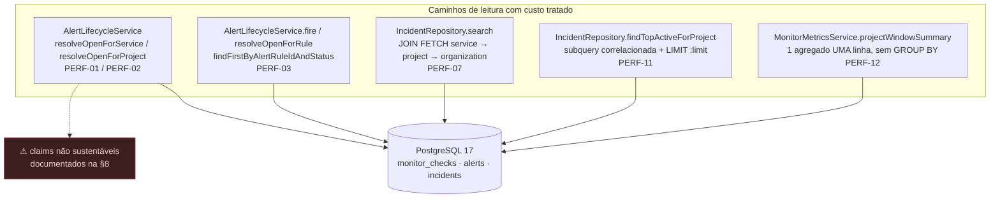

# Performance — Sentinel

> **Prompt 17 de 18** — o que foi **mediido, limitado ou corrigido** em relação a custo de consulta, e o que continua **não medido**. Este documento cobre os itens `PERF-xx` que têm código ou teste no repositório (mass-resolution paginada, `LIMIT 1` no pré-check, `JOIN FETCH` sem N+1 na listagem de incidentes, custo da subquery correlacionada do painel, agregação única do projeto) e declara **explicitamente** onde a documentação existente afirma mais do que o código entrega. Sem migration, sem índice novo, sem cache, sem dependência nova.



## 1. Escopo implementado

| Item | Estado | Observável em |
| --- | --- | --- |
| **PERF-01 / PERF-02** — resolução em massa `resolveOpenForService` / `resolveOpenForProject` no caminho `Page<Alert>` + `Pageable`, com **lote de 100 aplicado de fato** (critério #73) | Construído | `AlertParentInactiveTest` (+1), `AlertMassResolutionBatchTest` (+3) |
| **PERF-03** — pré-check de dedup vira `findFirstByAlertRuleIdAndStatus` (derived limiting, `setMaxResults(1)` nasce na query) | Construído | `AlertDedupTest` (+1) |
| **PERF-07** — `IncidentRepository.search` com `JOIN FETCH` da cadeia do tenant; paginação e teto de statements provados por teste | Construído | `IncidentApiTest` (+2) |
| **PERF-11** — custo da subquery correlacionada de `findTopActiveForProject` documentado (risco aceito, `LIMIT` corta antes de contar) | Construído (JavaDoc) | `IncidentRepository` |
| **PERF-12** — agregação do projeto em **uma** query de UMA linha + política de fórmula única (dívida aprovada D2) | Construído (JavaDoc) | `MonitorMetricsService`, `MonitorCheckRepository.summaryByProject` |
| Índice novo, plano de execução novo, cache, `@Async`, job de pré-cálculo | **Fora do escopo** | §7 |
| Benchmark de carga, `EXPLAIN ANALYZE` automatizado, APM | **Não implementado** | §7 |

## 2. Método

Toda afirmação de custo aqui é de uma de três formas: (a) **teste que observa** (contagem de statements, paginação observada), (b) **SQL que se lê na query**, ou (c) **afirmação declarada como não-verificada**. Não há benchmark neste prompt — e o documento diz isso na §7 em vez de insinuar medição que não foi feita.

## 3. PERF-01 / PERF-02 — resolução em massa paginada

`AlertLifecycleService.resolveOpenForService` e `resolveOpenForProject` (chamados quando serviço/projeto fica inativo) passaram de `List<Alert>` para `Page<Alert>` + `Pageable`.

**O que o teste prova** (`AlertParentInactiveTest`, +1): duas regras disparando na mesma janela viram **dois** alertas `FIRING`; ao desativar o serviço, **nenhum** pode ficar para trás — perder o segundo por corte de página seria um alerta preso em `FIRING` para sempre. O assert é `hasSize(2)` + todos `RESOLVED`/`PARENT_INACTIVE`.

**O que o lote entrega de fato** (correção do critério #73): os dois callers produtivos passam `PageRequest.of(0, 100, Sort(startedAt ASC, id ASC))` e repetem a leitura **sempre da página 0** até a página sair vazia — `AlertLifecycleService.resolveInBatches`. A consulta nasce com **teto** (`fetch first 100 rows only`, o dialeto do Hibernate 7) e **ordem total**; o loop tem duas condições de parada: página vazia e ausência de avanço entre leituras. Repetir do zero em vez de um offset crescente é o que evita pular linhas — `resolve()` encolhe o próprio conjunto do filtro `FIRING`, e um offset crescente deixaria alertas para trás presos em `FIRING` para sempre.

**Evidência** (`AlertMassResolutionBatchTest`, 3 testes, banco real via Testcontainers): 250 alertas num serviço, 270 espalhados por 3 serviços de um projeto e 130 pela rede de segurança do engine — todos volumes maiores que um lote. A janela de SQL capturada por `StatementInspector` mostra exatamente `ceil(n/100) + 1` leituras de conteúdo, **todas** limitadas e ordenadas, zero leitura auxiliar por linha (`from alert_rules` = 0) e serviço vizinho/projeto vizinho intactos. Reverter para `Pageable.unpaged()` derruba os 3 testes (uma leitura, sem teto) — mutação executada durante a entrega.

## 4. PERF-03 — `LIMIT 1` no pré-check

O pré-check de deduplicação do engine (`fire`) e o alvo da resolução por regra viraram `findFirstByAlertRuleIdAndStatus` — *derived query limiting*: o Spring Data aplica `setMaxResults(1)` **na própria query**.

**Por que era um bug latente**: o índice parcial `uq_alerts_open_rule` (V10) cobre **apenas** `status = 'FIRING'`. Disparou → resolveu → disparou → resolveu deixa **duas** linhas `RESOLVED` da mesma regra, legítimas. Um `@Query` com `Optional<Alert>` sem limite encontraria as duas e lançaria `IncorrectResultSizeDataAccessException` — no caminho de resolução, chamado **a cada ciclo**.

**Evidência**: `AlertDedupTest.perf03_duas_linhas_resolved_da_mesma_regra_nunca_estouram_o_pre_check` monta exatamente as duas linhas `RESOLVED` (verificado por SQL no teste) e observa o pré-check devolver uma linha só.

## 5. PERF-07 — `JOIN FETCH` da cadeia do tenant na listagem

`IncidentRepository.search` ganhou:

```sql
JOIN FETCH i.service s
JOIN FETCH s.project p
JOIN FETCH p.organization o
```

`IncidentResponse` lê a árvore inteira (três ids de escopo); sem o fetch seriam **três selects separados por linha da página** (N+1). As três associações são `@ManyToOne` — nenhuma multiplica linhas, então a paginação não é distorcida e o `DISTINCT` seria redundante (o count derivado gerado pelo Spring Data **remove** os `join fetch` e devolve a contagem verdadeira).

**Dois testes** (`IncidentApiTest`, +2):

| Teste | Observa |
| --- | --- |
| `list_paginatesFiveIncidentsIntoThreePagesWithoutGapsOrDuplicates` | 5 incidentes com `size=2` → 3 páginas (2+2+1), sem lacuna nem duplicata, ordem `startedAt DESC, id DESC`, `totalElements=5`/`totalPages=3` |
| `list_pageOfTenLoadsTenantChainInOneShotNeverNPlusOne` | `Statistics` do Hibernate ligado **só na janela da chamada**, contando prepared statements: página de 10 → esperado 2 (conteúdo + count derivado), folga até 6; um N+1 real daria `1 + 3×10 = 31` |

## 6. PERF-11 — subquery correlacionada do painel (risco aceito, agora escrito)

`findTopActiveForProject` conta `associatedAlertsCount` numa subquery correlacionada **por linha devolvida**. O JavaDoc novo documenta a planilha de custo em vez de deixar o leitor descobrir:

- roda **no máximo `limit` vezes** (10 no contrato do painel) — nunca N vezes por projeto inteiro;
- `idx_alerts_incident` (V11) torna cada contagem uma varredura de poucas linhas;
- `LIMIT :limit` corta as linhas **antes** de qualquer contagem;
- a alternativa (JOIN + GROUP BY) inflaria a página inteira só para contar.

É risco aceito e declarado, não otimismo.

## 7. PERF-12 — agregação única do projeto (dívida aprovada D2)

`MonitorMetricsService.projectWindowSummary` (o resumo que o painel publica) depende de `MonitorCheckRepository.summaryByProject`: **uma** query nativa, **uma** linha, **sem `GROUP BY`**, `count(*) FILTER (...)` + `avg/min/max FILTER (...)` sobre `monitor_checks ⋈ monitors ⋈ services WHERE project_id` — o banco varre a janela uma vez e devolve contagens brutas. Nada de loop por serviço, nada de agregação em Java por serviço.

A parte matemática, que é onde agregação costuma mentir:

- as **taxas são calculadas UMA vez**, em `toSummary`, a partir das **contagens somadas** — nunca é média de percentuais de serviços (média de porcentagens puxa o valor de um serviço com 1000 checks a 50%);
- a **latência média** vem do banco sobre as linhas brutas (`avg` de `duration_millis` filtrado em SUCCESS/DEGRADED) — nunca média de médias de buckets;
- denominador zero → `null` (`"sem dado"`), nunca 0 implícito.

Essa política já estava escrita em `DashboardQueryService` e em `docs/dashboard.md`; a dívida D2 era **tê-la também no ponto onde as fórmulas vivem** — `MonitorMetricsService` é quem implementa `toSummary` e quem o painel chama. O JavaDoc da classe agora declara a mesma regra.

## 8. Claims **não** sustentáveis pelo código

Registrado aqui — e repetido no relatório final — porque parte da documentação veio de geração automática e afirma mais do que o bytecode entrega. No Prompt 17 **nada disto foi editado** (fora de D1/D2); a revisão pós-entrega (ciclo 1) aplicou depois as recomendações da tabela, **somente em JavaDoc**. É informação para revisão.

> **Atualização (critério #73)**: as linhas 1 e 3 deixaram de valer para o **caminho produtivo** — os dois callers agora recebem `PageRequest.of(0, 100, sort)` e o Javadoc do `AlertRepository` foi reescrito. Resta como `unpaged()` **apenas** o helper de teste `AbstractAlertEngineIntegrationTest.openAlertsOf`, que lê o conjunto aberto de um cenário pequeno (fora do escopo desta correção).

| Claim | Onde | O que o código faz de fato | Recomendação |
| --- | --- | --- | --- |
| *"retorna `Page<Alert>` para **evitar carregar todos os registros em memória** em casos de grande volume"* | `AlertRepository.findByServiceIdAndStatus` e `findByProjectIdAndStatus` (Javadoc) | **Cumprido no caminho produtivo**: os dois callers passam `PageRequest.of(0, 100, sort)` (`AlertLifecycleService.resolveInBatches`) → **com `LIMIT`** (`fetch first ? rows only` no Hibernate 7) e **sem `COUNT`** nos lotes que não lotam (`PageableExecutionUtils.getPage` nem invoca o `LongSupplier`). O helper de teste `AbstractAlertEngineIntegrationTest.openAlertsOf` continua `Pageable.unpaged()`. | Reescrito no #73; qualificar apenas o helper de teste |
| *"`Monitor.timeoutMillis` é o **ÚNICO** orçamento temporal desta checagem"* | `HttpMonitorExecutor` (Javadoc novo) | `JdkHttpTransport` constrói o cliente com `connectTimeout(10s)` fixo. Para `timeoutMillis > 10000` (o campo aceita até 30000), uma conexão pendurada é cortada aos **10 s**, não ao orçamento do monitor. | Qualificar: "orçamento da **resposta**; a conexão tem teto fixo de 10 s" |
| *"Paginado para performance"* como benefício já ativo | idem | **Verdadeiro hoje** para `resolveOpenForService`/`resolveOpenForProject` (lote de 100 provado em `AlertMassResolutionBatchTest`); ainda não é verdade para o helper de teste `openAlertsOf`. | Idem à linha 1 |

Os dois primeiros estavam **fora** do escopo de edição do Prompt 17 (só D1 e D2 foram aprovadas como dívidas de JavaDoc) e mudaram apenas na revisão pós-entrega, **só em JavaDoc**. O diff líquido de `HttpMonitorExecutor.java` em relação ao baseline é, portanto, **somente JavaDoc** — nenhuma linha de código foi acrescentada ou removida. Não havia overload no baseline para remover: o que tenha existido foi criado e retirado dentro da mesma sessão (líquido zero contra o baseline).

## 9. O que **não** foi feito

| Item | Estado |
| --- | --- |
| Índice novo (`CREATE INDEX`) | Nenhum — catálogo termina na `V12` |
| `EXPLAIN ANALYZE` / plano de execução revisado em ambiente com dados reais | Não executado |
| Benchmark de carga / latência p95 da API | Não executado |
| Cache (`@Cacheable`, Redis) e pré-cálculo em background | Não existe |
| Particionamento / `monitor_checks` com retention policy | Não existe |
| `Pageable` paginado no teste `openAlertsOf` | Continua `Pageable.unpaged()` (helper de teste, fora do escopo do #73) — o caminho produtivo, sim, paginou em lote de 100 (§3) |
| Tuning de pool, HikariCP, JVM flags | Fora do escopo |
| Frontend: bundle budget, lazy loading, Lighthouse | Não medido |

## 10. Testes novos neste prompt (performance)

| Arquivo | Novos | Cobre |
| --- | --- | --- |
| `project/AlertParentInactiveTest` | +1 | PERF-01 / PERF-02 |
| `project/AlertDedupTest` | +1 | PERF-03 |
| `project/IncidentApiTest` | +2 | PERF-07 (paginação + contagem de statements) |
| `project/AlertMassResolutionBatchTest` | +3 | PERF-01 / PERF-02 — critério #73 (lote de 100, volume > 1 lote, isolamento, SQL observada) |

## 11. Verificação executada nesta entrega

| Verificação | Comando | Resultado |
| --- | --- | --- |
| Compilação backend (main + test) | `mvn -q test-compile -DskipTests` | exit 0 |
| Lint frontend | `npm run lint` (em `frontend/`) | exit 0 |
| Type-check frontend | `npm run type-check` (em `frontend/`) | exit 0 |
| Testes backend | `mvn test` | **exit 0 — 862 testes, 0 falhas, 0 erros, 0 ignorados** (execução do Prompt 17, 2026-10-07) |
| Testes backend (re-verificação do critério #73) | `mvn clean test` | **exit 0 — 865 testes, 0 falhas, 0 erros, 0 ignorados** (85 relatórios Surefire somando 865/0/0/0, execução 2026-10-08: baseline 862 + 3 novos) |
| Testes frontend | `npm run test` (em `frontend/`) | **exit 0 — 207 testes, todos passando** |
| Build backend (jar) | `mvn -DskipTests package` | exit 0 |
| Migrations / índices | catálogo `V1…V12` | inalterado |
| Dependências | `pom.xml` / `package.json` | inalterados |
