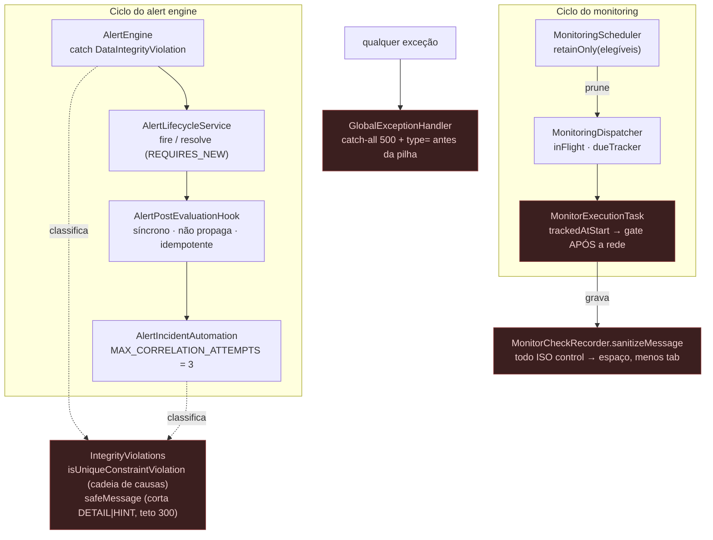

# Resilience — Sentinel

> **Prompt 17 de 18** — o que o sistema faz quando algo dá errado **no meio** de um ciclo: checagem em voo de um monitor que some, corrida entre dois ciclos que abrem o mesmo alerta/incidente, violação de integridade que não é a corrida que conhecemos, exceção sem handler e texto vindo de fora que chega ao banco. Este documento descreve **o que está construído** — cada mecanismo com o teste que o observa — e **o que continua aberto**. Nenhum contrato de API mudou, nenhuma tabela nova, nenhuma dependência nova.



## 1. Escopo implementado

| Item | Estado | Observável em |
| --- | --- | --- |
| **RES-01** — cancelamento de execução em voo: monitor removido/desativado no MEIO da checagem não persiste histórico nem é avaliado | Construído | `MonitoringDispatcherTest` (+1, RES-01) |
| **RES-02** — `createdAt`/`updatedAt` do `Incident` com a regra dos callbacks JPA documentada no próprio método (dívida aprovada D1) | Construído (JavaDoc) | `Incident.onCreate`/`onUpdate` |
| **RES-03** — orçamento temporal da checagem: `Monitor.timeoutMillis` governa a **resposta** e a conexão tem teto próprio de 10 s no `JdkHttpTransport` — JavaDoc do executor qualificado para dizer isso | Construído (JavaDoc) | `HttpMonitorExecutor` |
| **RES-04** — contrato do `AlertPostEvaluationHook` fixado em JavaDoc (síncrono, não propaga, não decide o veredito, idempotente) + listener `AFTER_COMMIT` | Construído | `AlertPostEvaluationHook`, `AlertIncidentAutomationListener` |
| **RES-05** — `IntegrityViolations`: classifica violação pela **cadeia de causas** e limpa `DETAIL`/`HINT` do Postgres | Construído | `IntegrityViolationsTest` (novo, 9) |
| **RES-07** — corrida benigna × violação real em `AlertEngine` e `AlertIncidentAutomation`, com teto de 3 tentativas e `WARN` no esgotamento | Construído | `AlertIncidentConcurrencyTest` (+2), `FlakyAutomationConfig` |
| **RES-09** — `type=` da exceção antes da pilha no catch-all `500` | Construído | `GlobalExceptionHandler` (JavaDoc + linha de log) |
| **RES-10** — `MonitorCheckRecorder.sanitizeMessage`: todo caractere ISO control → espaço, menos `\t` | Construído | `MonitorCheckRecorderTest` (+2) |
| **RES-08** — corrida benigna no desvincular de alerta (`UPDATE ... 0 linhas`) vira `DEBUG`, nunca erro | Construído | `IncidentService.unlinkAlert` |
| **RES-06** — não existe como item neste prompt (sem plano recuperável no repositório) | Não atribuído | — |
| Retry automático de falha transitória de rede/banco, `@Retryable`, `CircuitBreaker`, fila de reprocessamento | **Não implementado** | §9 |

## 2. Método

1. **código** lido no estado atual do working tree (não a intenção de design);
2. **teste** que observa o comportamento, sempre que o comportamento é observável;
3. **nada foi promovido a "feito"** sem uma das duas — e quando a evidência é só estrutural, o texto diz.

Os IDs `RES-xx` aparecem **nos próprios testes** (comentários de seção). Não há arquivo de plano no repositório — portanto este documento não inventa escopo para `RES-03/06/08`: se não há código nem teste, não há item.

## 3. RES-01 — cancelamento de execução em voo

**Problema.** O monitoring roda `tick → dispatch → task → rede → gravar → avaliar`. Se o monitor é removido (ou desativado, ou seu serviço/projeto desativado) durante o trecho de rede, a checagem antiga ainda seria persistida e passaria pelo `OperationalStateEvaluator` e pelo `AlertTrigger` — estado e alerta nascendo de um monitor que já não existe.

**Solução** (3 peças, mesma fonte de verdade):

| Peça | Papel |
| --- | --- |
| `MonitoringScheduler` → `dueTracker.retainOnly(eligibleIds)` | a entrada do monitor **some** quando ele sai da elegibilidade |
| `MonitorExecutionTask.run()` | captura `trackedAtStart = dueTracker.isTracked(id)` **antes** da rede e roda o gate **depois** da rede, **antes** de `logResult` / `recordResult` / `persistAndEvaluate` |
| `DueTracker.isTracked` | mesma estrutura lida pelos dois lados |

**Duas decisões que não são obvias** (ambas documentadas no JavaDoc da task):

1. **Só cancela se a entrada JÁ existia no início** (`trackedAtStart == true`). Um monitor recém-criado ainda não tem horário gravado — o `commit` do tick só acontece depois que o dispatcher **aceita** — então ausência de entrada é o estado **normal** dele. Sem essa distinção, o gate cancelaria checagens perfeitamente válidas de monitores novos.
2. **Não existe pré-check antes da rede**: entre `submit` e `commit` existe a mesma janela; um gate ali faria a task desistir cedo demais. O único sinal confiável é a entrada **sumir** durante o voo.

O cancelamento é silencioso para a API (`log.debug`) — não há histórico parcial a expor.

**Evidência**: `MonitoringDispatcherTest` seção `RES-01` (+1 teste) — o monitor sai da elegibilidade no meio da checagem e o teste observa que nada foi persistido nem avaliado.

## 4. RES-02 — timestamps do `Incident` (dívida aprovada D1)

`IncidentService` recebe `Clock` injetado (`com.sentinel.monitoring.Clock`, o mesmo do motor de monitoramento), mas os callbacks JPA (`@PrePersist onCreate`, `@PreUpdate onUpdate`) rodam **dentro** do JPA e não enxergam essa injeção — é o padrão do projeto usar `Instant.now()` ali.

**O que mudou neste prompt**: os dois métodos passaram a carregar JavaDoc explicando exatamente isso (quem decide o relógio, por que `Instant.now()` aqui, e que `createdAt` nasce uma única vez enquanto `updatedAt` é reescrito a cada `@PreUpdate`). O comportamento **não** mudou — só a dívida de documentação foi quitada. A classe já declarava a regra no nível de classe; a dívida era o método.

## 5. RES-04 — contrato do hook pós-avaliação

`AlertPostEvaluationHook.evaluateService` agora tem o contrato escrito em JavaDoc, porque é um ponto de acoplamento (o `AlertPostEvaluationHook` do `AlertEngine` → automação) e um contrato implícito aqui vira bug no próximo implementador:

| Regra | Por quê |
| --- | --- |
| **Síncrono, no mesmo thread** da avaliação | não existe fila própria; o tempo do callback atrasa `evaluateService` |
| **Não propaga** — o engine captura e loga | a automação nunca derruba o ciclo de avaliação |
| **Não decide o veredito** | roda **depois** das transições; só deriva efeito do que já foi decidido |
| **Pode repetir** → precisa ser **idempotente** | é chamado a cada avaliação, inclusive quando nada mudou |

A outra metade da fronteira é o `AlertIncidentAutomationListener` (`@TransactionalEventListener(phase = AFTER_COMMIT)`): a automação reage **depois** do commit do nascimento do alerta, nunca durante a transação de criação — daí a `REQUIRES_NEW` do orquestrador ser realmente independente.

## 6. RES-05 + RES-07 — violação de integridade: corrida benigna × defeito

### 6.1 A classe nova

`com.sentinel.error.IntegrityViolations` (9 testes):

- **`isUniqueConstraintViolation(ex, constraintName)`** caminha a **cadeia de causas** (teto de 16 níveis, com guarda contra causa auto-referente) procurando o **nome exato** da constraint. Duas constraints são assinaturas de corrida benigna: `uq_alerts_open_rule` (V10) e `uq_incidents_auto_open_per_service` (V12). Casar só a mensagem de topo transformaria corrida benigna em erro real — ou esconderia um defeito;
- **`safeMessage(ex)`** pega a mensagem da causa mais específica, corta o padrão `\s+(Detail|Hint):.*` (o `DETAIL: Key (coluna)=(valor) already exists` expõe o valor da linha) e trunca em **300 caracteres** antes de qualquer log.

### 6.2 Onde é usado

| Local | Se é a corrida conhecida | Se **não** é |
| --- | --- | --- |
| `AlertEngine.fire` (insert do alerta) | `log.debug("concurrent alert creation deduplicated…")` — ciclo seguinte já encontra o alerta | `log.error` com `safeMessage` — **defeito** |
| `AlertIncidentAutomation.automate` (correlação) | retry em transação nova, até `MAX_CORRELATION_ATTEMPTS = 3` (1 original + 2 retries); **teto atingido → `WARN` + retorno normal** | `log.error` + **rethrow** (o listener captura; o alerta já nasceu) |

**Por que o teto não vira exceção**: a automação é *best-effort* — o alerta já existe, e o reconciliador do ciclo seguinte tenta de novo. Um loop aberto aqui seria pior que perder uma abertura automática. **Por que a violação real sobe**: esconder um `CHECK`/`NOT NULL` quebrado como "corrida" seria o erro clássico de mascarar defeito.

**Evidência**: `FlakyAutomationConfig` injeta a violação **uma vez por tentativa** — o próprio contador de chamadas do teste é o que prova o teto de 3 (`RES-07`); `AlertIncidentConcurrencyTest` (+2) cobre corrida benigna × defeito; `IntegrityViolationsTest` (9) cobre a cadeia, `DETAIL`/`HINT`, teto 300 e causa auto-referente.

### 6.3 Corrida benigna no desvincular

`IncidentService.unlinkAlert`: o `UPDATE ... WHERE incident_id IS NULL` casou **0 linhas** (o alerta já apontava para outro incidente, ou estava livre) → `log.debug`, porque o `204` do controller **é** o contrato do cliente. O diagnóstico fica, o erro não.

## 7. RES-09 — catch-all `500` sem vazamento

`GlobalExceptionHandler.handleGeneric` devolve `500 INTERNAL_ERROR` com corpo genérico (nunca tipo, mensagem nem stack trace). A mudança é só **onde** o tipo aparece no log:

```
antes: log.error("Unhandled exception on {} {}", method, uri, ex);
agora: log.error("Unhandled exception on {} {} type={}", method, uri, ex.getClass().getSimpleName(), ex);
```

`type=` vem **antes** da pilha: o nível ERROR já identifica a exceção mesmo quando o appender truncar o stack; `ex` continua como último argumento slf4j (é ele que liga a pilha ao marcador). Cliente não vê nada disso — coberto por `GlobalExceptionHandlerTest.genericExceptionReturns500WithGenericMessageAndNoInternals`.

## 8. RES-10 — texto de fora não entra cru no banco

`MonitorCheckRecorder.sanitizeMessage` é a **fonte única** do texto gravado em `monitor_checks.message` (ver `security-hardening.md` §5.1 para o contrato exato). Aqui importa o lado da resiliência: a coluna é `VARCHAR` com `CHECK` de não-vazio — sem a sanitização, um `ESC`/`C0` vindos de uma resposta HTTP estranha seria aceito pelo banco e depois reexibido (log/terminal injection), e o histórico de checagens viria com caracteres que a UI não renderiza.

Contrato (2 testes novos): todo `Character.isISOControl` → **espaço**, **menos** `\t`; substituição por espaço (não remoção contígua, para preservar offset auditável); trim depois. Não é XSS/HTML sanitization — esta coluna nunca é markup.

## 9. Lacunas conhecidas — **não** implementado

| Lacuna | Estado |
| --- | --- |
| Retry/backoff automático para falha transitória (rede, lock, `TransientDataAccessException`) | Não existe (nenhuma `@Retryable`, `resilience4j` ausente do `pom.xml`) |
| Circuit breaker para destino externo | Não existe — `HttpMonitorExecutor` classifica falha e segue |
| Fila de reprocessamento / dead-letter de checagem ou evento | Não existe — falha vira resultado classificado, sem reexecução |
| Persistência de "monitor removido em voo" como evento | Não existe (cancelamento é `log.debug`, sem linha em `monitor_checks`) |
| Timeout do cliente HTTP **global** vs por fase | Ver `performance.md` §8 — existe nuance declarada: `connectTimeout(10s)` fixo no `JdkHttpTransport` × `Monitor.timeoutMillis` (100–30000) |
| `RES-03`, `RES-06`, `RES-08` | Sem plano nem implementação recuperáveis no repositório — **não** inventados aqui |
| Teste de corrida `refresh × logout` / `refresh × rotação manual` | Não existe (o coberto é refresh × refresh — `security-hardening.md` §4.2) |
| Degradation controlada / `Retry-After` / load shedding | Não existe |

## 10. Testes novos neste prompt (resiliência)

| Arquivo | Novos | Cobre |
| --- | --- | --- |
| `error/IntegrityViolationsTest` (novo) | 9 | RES-05 — cadeia de causas, `DETAIL`/`HINT`, teto 300, auto-referência |
| `monitoring/MonitoringDispatcherTest` | +1 | RES-01 — cancelamento em voo |
| `monitoring/MonitorCheckRecorderTest` | +2 | RES-10 — C0..C1 e trim |
| `project/AlertIncidentConcurrencyTest` | +2 | RES-07 — teto de 3 × violação real |
| `error/GlobalExceptionHandlerTest` | (existente) | RES-09 — 500 genérico |

Total backend: **837 → 862** (+25, reconciliado contra os relatórios do Surefire — a divisão completa está em `security-hardening.md` §8).

## 11. Verificação executada nesta entrega

| Verificação | Comando | Resultado |
| --- | --- | --- |
| Compilação backend (main + test) | `mvn -q test-compile -DskipTests` | exit 0 |
| Lint frontend | `npm run lint` (em `frontend/`) | exit 0 |
| Type-check frontend | `npm run type-check` (em `frontend/`) | exit 0 |
| Testes backend | `mvn test` | **exit 0 — 862 testes, 0 falhas, 0 erros, 0 ignorados** |
| Testes frontend | `npm run test` (em `frontend/`) | **exit 0 — 207 testes, todos passando** |
| Migrations | catálogo `V1…V12`, nenhuma `V13` | inalterado |
| Dependências | `pom.xml` / `package.json` | inalterados |
