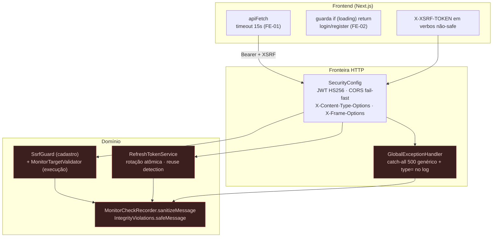

# Security Hardening — Sentinel

> **Prompt 17 de 18** — endurecimento de segurança **sem mudança de contrato de API e sem migration**: fechamento das classes de ataque que os Prompts 08/09/03 deixaram em aberto (diferencial de parser no SSRF, corrida no refresh token, vazamento de detalhe interno em log/erro) + endurecimento do cliente (timeout de requisição, guarda de duplo submit). Este documento descreve **o que está construído**: a guarda `SsrfGuard` com a evidência de formas não-canônicas de IPv4, a rotação atômica do refresh token sob concorrência, a sanitização de telemetria (`MonitorCheckRecorder.sanitizeMessage`, `IntegrityViolations.safeMessage`, `GlobalExceptionHandler`), as mudanças em `frontend/src/lib/api.ts` (FE-01/FE-02) e as **lacunas que continuam abertas**. **Nenhuma migration, nenhuma dependência nova, nenhum endpoint novo.**

## 1. Escopo implementado

| Item | Estado |
| --- | --- |
| Evidência B1 — formas **não-canônicas** de IPv4 na guarda SSRF, com prova do caminho por porta de decisão (`SsrfGuardNonCanonicalTargetTest`, 6 testes) | Construído |
| Revalidação do alvo **imediatamente antes da conexão** (`SsrfGuardMonitorTargetValidator` → `MonitorTargetValidator` → `SSRF_REVALIDATION`) | Construído (Prompt 09), sem bypass configurável |
| Teste de **corrida de refresh**: 4 refreshes simultâneos → exatamente `1×200` + `3×401`, nunca dois tokens ativos | Construído |
| Classificação de violação de integridade pela **cadeia de causas** (`IntegrityViolations`) + log sem `DETAIL`/`HINT` do Postgres | Construído |
| Sanitização de controle ISO (ANSI/ESC) em toda mensagem persistida (`MonitorCheckRecorder.sanitizeMessage`) | Construído |
| Catch-all `500` genérico com `type=` **antes** da pilha no log (`GlobalExceptionHandler`) | Construído |
| FE-01 — timeout de **toda** requisição do frontend (15 s → `ApiError 408`) | Construído |
| FE-02 — guarda de duplo submit em `login` e `register` | Construído |
| `docs/security-hardening.md` (este documento) | Construído |
| Migration nova, tabela nova, dependência nova, endpoint novo | **Fora do escopo** (§9) |
| Rate limiting, bloqueio de conta, MFA, trilha de auditoria, secret scanning em CI | **Não implementado** (§9) |

## 2. Método — como cada afirmação foi verificada

Nenhuma afirmação deste documento é baseada em intenção de design. Cada linha corresponde a:

1. **código-fonte** lido no estado atual do working tree;
2. **teste** que observa o comportamento (quando existe);
3. **contagem** reconciliada com o relatório do Surefire (`backend/target/surefire-reports`, execução `2026-10-07T04:54`).

Quando a evidência é só estrutural (código sem teste observável), o texto diz "não verificado por teste". As lacunas estão na §9 — nada foi promovido a "feito".

## 3. SSRF — cadastro **e** execução

### 3.1 Duas portas, uma política

A política de ranges é escrita **uma vez** em `SsrfGuard` (`com.sentinel.project.security`) e usada nos dois momentos em que uma URL pode entrar no sistema:

| Momento | Chamada | Falha observável |
| --- | --- | --- |
| **Cadastro/atualização** do monitor | `MonitorService` → `ssrfGuard.validate(url)` em transação, **antes de persistir** | `400 MONITOR_TARGET_NOT_ALLOWED` |
| **Execução** da checagem | `HttpMonitorExecutor` → `targetValidator.validate(monitor.getUrl())` imediatamente antes da conexão | `CheckOutcome.TARGET_FAILURE` + `CheckFailureCategory.SSRF_REVALIDATION` |

A implementação de produção é `SsrfGuardMonitorTargetValidator`, que **não reimplementa** nenhuma regra: adapta o mesmo guard à fronteira do executor. O Javadoc da classe registra que não existe propriedade de configuração que troque este bean por um permissivo — em produção o guard real é o único caminho (nos testes que precisam de um validador poroso, outro bean é injetado *no contexto de teste*: injeção de dependência, não configuração de runtime).

### 3.2 Ordem das checagens (8 portas, todas antes de qualquer conexão)

1. `java.net.URI` (nada de regex própria) — sintaxe inválida rejeita;
2. scheme só `http`/`https`;
3. host presente;
4. sem `userinfo`;
5. sem `fragment`;
6. porta ausente ou em `1..65535`;
7. fast-path `localhost`/`*.localhost` bloqueado **antes** de qualquer resolução;
8. literal IP classifica **direto** (sem DNS); hostname resolve via `DnsResolver` e **todos** os endereços precisam ser públicos (mixed público+privado bloqueia).

Mensagens do contrato público são estáveis e não citam IP, range nem a regra exata: `"This target is not allowed for security reasons."` e `"Unable to resolve target host"`.

### 3.3 Evidência B1 — diferencial de parser (`SsrfGuardNonCanonicalTargetTest`, 6 testes)

O risco real não é "a guarda deixa passar 127.0.0.1", é **a guarda e o transporte lerem o mesmo literal de formas diferentes**. O teste fecha três portas e prova qual caminho cada forma percorre, usando um stub de `DnsResolver` que **registra** toda consulta e falha por padrão (nenhum teste depende de DNS do ambiente):

| Porta | Mecanismo | Teste |
| --- | --- | --- |
| 1 | `java.net.URI.getHost()` — o **mesmo** parser que `java.net.http.HttpClient` usa; formas "parecidas com IPv4 mas inválidas" (`127.1`, `999.1.1.1`, `1.2.3.4.5`, `0x7f.0.0.1`, `+127.0.0.1`, `127.0.0.1.`) nascem com `host == null` → rejeitadas **antes** de resolver | `hostThatUriRefusesIsBlockedBeforeAnyDnsLookup` |
| 2 | `SsrfGuard.parseIpv4` — só host com **exatamente 4 octetos** de até 3 dígitos é classificado localmente; **decimal, nunca octal** | `nonCanonicalLiteralIpIsClassifiedLocallyAndBlockedWhenNotPublic`, `ipv4MappedIpv6LoopbackIsBlockedAsLiteralWithoutDns` |
| 3 | Demais formas numéricas caem no caminho DNS, cujo classificador é o **mesmo** `java.net.InetAddress` usado pelo `SystemDnsResolver` e pelo transporte — irresolvível **falha fechada** | `numericFormsBeyondFourOctetsFallThroughToDnsAndFailClosed`, `numericNonCanonicalHostsResolveToNonPublicAddressesWithJdkParser` |

**Não-finding documentado** (não escondido): `0177.0.0.1` (4 dígitos) passa pela guarda **ao ser resolvido** e o JDK lê `177.0.0.1` — decimal, igual ao `Integer.parseInt` da própria guarda. Em octal seria `127.0.0.1`, mas **nenhum dos dois lados usa octal**, então alvo aceito e alvo conectado são o mesmo endereço público. Coberto por `acceptedNonCanonicalFormIsReadAsDecimalByGuardAndTransport`.

### 3.4 Limitação declarada (já está no Javadoc do transporte)

O guard **revalida a cada conexão**, mas **não há revalidação por redirect** porque **não há redirect**: `JdkHttpTransport` é construído com `HttpClient.Redirect.NEVER`, um 3xx volta como resposta e é classificado (`DEGRADED_SIGNAL`), nunca seguido. Se um dia redirects forem permitidos, cada salto terá de passar pelo guard antes da nova conexão. DNS rebinding entre a validação e a conexão é coberto pela revalidação no `MonitorTargetValidator` **imediatamente antes** de conectar.

## 4. Sessão — rotação do refresh token sob concorrência

O contrato do Prompt 03 (opaco em cookie `HttpOnly`, `SameSite=Strict`, rotação a cada refresh, revogação em reuso) já existia. O que o Prompt 17 **prova** é o comportamento sob corrida, que é onde esse design costuma quebrar.

### 4.1 Evidência — `concurrentRefreshWithSameCookieElectsExactlyOneWinnerAndNeverTwoActiveTokens`

`RefreshTokenIntegrationTest` dispara **4 refreshes simultâneos com o MESMO cookie** e observa:

| Observação | Assert |
| --- | --- |
| Statusos | `containsExactlyInAnyOrder(200, 401, 401, 401)` — **um** vencedor, os perdedores caem no caminho de reuso |
| Vencedor | recebe `accessToken` não-vazio **e** cookie rotacionado diferente do original |
| Perdedores | `code == REVOKED_CODE` |
| Estado final | token original revogado; `activeTokensOf(user) <= 1` — **nunca dois ativos** |

A mecânica é o `UPDATE` condicional da rotação (a linha só pode ser reescrita de ativo para revogado uma vez); o perdedor encontra o token já revogado, o que é tratado como **reuso** e revoga a família — a mesma detecção de reuso já coberta por `refreshTokenReuseRevokesEntireFamily`.

### 4.2 O que isto NÃO cobre

- Não há teste de corrida `refresh × logout` nem `refresh × rotação manual`; o coberto é **refresh × refresh**.
- Não há teste de expiração de access token sob concorrência (o access token é stateless por construção).

## 5. Telemetria e erros sem vazamento

### 5.1 `MonitorCheckRecorder.sanitizeMessage` (RES-10) — o que **persiste**

Fonte única do texto gravado em `monitor_checks.message`. Contrato exato (2 testes novos):

- todo `Character.isISOControl(char)` vira **espaço**, **menos** `\t` — em regex `[\p{Cc} && [^\t]]`: C0 (`U+0000`–`U+001F`), `U+007F` (DEL) e C1 (`U+0080`–`U+009F`) saem; tabulação fica (única forma legível de alinhar na UI);
- substituição por **espaço**, não remoção contígua → a palavra não se funde com a vizinha e o offset original permanece auditável;
- trim de borda **depois** da substituição;
- **não** é sanitização de HTML/XSS (a coluna nunca é renderizada como markup) nem colapso de espaços.

O efeito de segurança é a defesa de **log/terminal injection**: `ESC` (`U+001B`) é ISO control, então a sequência ANSI que formata ou recolhe terminal nunca chega ao histórico.

### 5.2 `IntegrityViolations` (RES-05 / RES-07) — o que **classifica e loga**

Classe nova em `com.sentinel.error`, 9 testes:

- `isUniqueConstraintViolation(ex, constraintName)` **caminha a cadeia de causas** (teto de 16 níveis, com proteção contra causa auto-referente) procurando o **nome exato** da constraint — `uq_alerts_open_rule` (V10) e `uq_incidents_auto_open_per_service` (V12). Casar só contra a mensagem de topo transformaria corrida benigna em erro real, ou o contrário;
- `safeMessage(ex)` leva a mensagem da **causa mais específica**, corta o padrão `\s+(Detail|Hint):.*` (o `DETAIL: Key (coluna)=(valor) already exists` traz o valor da linha que colidiu) e trunca em **300 caracteres** antes de qualquer log.

Usado por `AlertEngine` e `AlertIncidentAutomation` para distinguir "corrida benigna" de "violação real" (ver `resilience.md` §6).

### 5.3 `GlobalExceptionHandler.handleGeneric` (RES-09) — o que **chega ao cliente**

O catch-all devolve `500 INTERNAL_ERROR` com corpo genérico (nunca tipo, mensagem nem stack trace do servidor). A mudança é só na **linha de log**: `type={ex.getClass().getSimpleName()}` vem **antes** da pilha, então o nível ERROR já identifica a exceção mesmo quando o appender truncar o stack; `ex` continua como último argumento slf4j (é o que liga a pilha ao marcador).

Verificado por `GlobalExceptionHandlerTest.genericExceptionReturns500WithGenericMessageAndNoInternals` — lança `IllegalStateException` com mensagem `"secret internal detail: db password xyz"` e asserta que a resposta não a contém.

## 6. Frontend

### 6.1 FE-01 — timeout de requisição (15 s)

Sem teto, uma API que não responde deixa a tela em `loading` para sempre (spinner infinito, botão desabilitado sem saída). Em `frontend/src/lib/api.ts`:

- `REQUEST_TIMEOUT_MS = 15_000` e `REQUEST_TIMEOUT_MESSAGE` exportados — fonte única, o cliente nunca monta frase própria;
- `startRequestTimeout()` usa `AbortController` + `setTimeout` (não `AbortSignal.timeout`: não é observável em fake timers e o projeto não declara `browserslist`) e devolve `cancel()` para o `finally` — nenhum timer sobrevive à chamada;
- o aborto cobre **conexão e leitura do corpo** (`res.text()`), onde uma resposta a gotejamento também prenderia a chamada;
- o aborto **nosso** vira `ApiError(408, "REQUEST_TIMEOUT", …)`: `408` foi escolhido por não colidir com nenhum status tratado hoje (`401` derruba a sessão, `403`/`409` têm tratamento próprio);
- um `signal` vindo do chamador **não** é sobrescrito — a semântica original é preservada;
- `ensureCsrfToken()` entra no mesmo `try`, então um health check sem resposta também vira `408` em vez de pendurar o formulário.

### 6.2 FE-02 — guarda de duplo submit

`setLoading(true)` só re-renderiza no **próximo tick**, então dois cliques ou dois `Enter` rápidos disparariam `login()`/`register()` duas vezes — o `disabled` do botão sozinho não cobre o clique já em voo. Em `login/page.tsx` e `register/page.tsx` a ordem é fixa:

1. `event.preventDefault();` — antes de tudo, senão o form navegaria;
2. `if (loading) return;` — antes de tocar no estado;
3. `setLoading(true);`
4. `await login(…)` / `await register(…)`.

`auth-pages.test.ts` (4 testes) lê o **fonte** das páginas (mesmo padrão de `alerts.test.ts` — o runner é `environment: "node"`, sem jsdom) e asserta a **ordem exata dos quatro marcos**.

### 6.3 Herdado do Prompt 03, mantido

`Authorization: Bearer` em memória, `X-XSRF-TOKEN` só em verbos não-safe, `credentials: "include"` para o cookie `HttpOnly`, `SESSION_EXPIRED_EVENT` em qualquer `401`, `X-Organization-Id` só quando o path não carrega a org (evita o `404` de divergência do `TenantInterceptor`).

## 7. Superfície REST e autorização (defesas existentes, sem mudança)

Registrado porque é parte da postura de segurança que a homologação pergunta, **não** por ter mudado neste prompt:

| Defesa | Onde | Travado por |
| --- | --- | --- |
| `404` genérico anti-enumeração em 4–5 níveis de cadeia | todos os `@TenantScoped` | `IdorAdversarialTest`, `*IdorTest` |
| Autoridade lida **por requisição** (o token reflete promoção/rebaixamento sem refresh) | `TenantContext` | `StaleAuthorizationTest` |
| Último `ADMIN` sob lock pessimista | `MembershipService` | `LastAdminConcurrencyTest` |
| Fail-fast das origens CORS no startup (wildcard + `allowCredentials` é erro de boot) | `SecurityConfig` | `SecurityConfigOriginsTest` |
| `405` global nos verbos de escrita | `GlobalExceptionHandler` | `writeVerbsReturn405` |
| `400 VALIDATION_ERROR` genérico para corpo malformado (sem vazar o parser) | `GlobalExceptionHandler` | `AlertRuleValidationTest` |
| Headers `X-Content-Type-Options: nosniff` + `X-Frame-Options: DENY` | `SecurityConfig` | declarado em `README.md` |
| `ddl-auto: validate` + Flyway `validate-on-migrate: true` | `application.yml` | `AlertMigrationTest` (checksums V1–V12) |
| Actuator expõe só `health,info` com `show-details: never` | `application.yml` | não verificado por teste |

## 8. Testes novos neste prompt

Backend — **837 → 862** (+25), reconciliado contra os relatórios do Surefire:

| Arquivo | Novos | Cobre |
| --- | --- | --- |
| `project/security/SsrfGuardNonCanonicalTargetTest` (novo) | 6 | §3.3 — Evidência B1 |
| `error/IntegrityViolationsTest` (novo) | 9 | §5.2 — cadeia de causas, `DETAIL`/`HINT`, teto 300, causa auto-referente |
| `identity/token/RefreshTokenIntegrationTest` | +1 | §4.1 — 4 refreshes simultâneos |
| `monitoring/MonitorCheckRecorderTest` | +2 | §5.1 — C0..C1 e trim de borda |
| `monitoring/MonitoringDispatcherTest` | +1 | RES-01 (ver `resilience.md`) |
| `project/AlertDedupTest` | +1 | PERF-03 (ver `performance.md`) |
| `project/AlertIncidentConcurrencyTest` | +2 | RES-07 (ver `resilience.md`) |
| `project/AlertParentInactiveTest` | +1 | PERF-01/02 (ver `performance.md`) |
| `project/IncidentApiTest` | +2 | PERF-07 (ver `performance.md`) |

Frontend — **199 → 207** (+8), `vitest run`: `lib/auth-pages.test.ts` (novo, 4) + `lib/api.test.ts` (+4, FE-01).

## 9. Lacunas conhecidas — **não** implementado

Nada abaixo foi feito, e nenhum documento deste prompt o apresenta como pronto. São pendências reais de homologação:

| Lacuna | Estado | Observação |
| --- | --- | --- |
| **Rate limiting** (por IP, por usuário, nos endpoints de login/refresh) | Não existe | nenhuma dependência nem filtro no `pom.xml`/`SecurityConfig` |
| **Bloqueio / backoff de conta** e CAPTCHA no login | Não existe | — |
| **MFA / TOTP** | Não existe | declarado ausente desde o Prompt 01 |
| **Trilha de auditoria** (quem mudou o quê, quando) | Não existe | `incident_events` é timeline de domínio, **não** audit log; não há `REVOKE DELETE` nem retenção |
| **Recuperação de senha / verificação de e-mail** | Não existe | — |
| **Secret scanning / SAST / dependency scan em CI** | Não existe | `.github/` não tem workflow de segurança |
| **CSP / HSTS / `Referrer-Policy`** | Não verificado | só `nosniff` e `X-Frame-Options` estão declarados |
| **Rotacionar `JWT_SECRET` sem downtime** | Não existe | secret único; troca invalida os tokens emitidos |
| **Revalidação por redirect** | Não aplicável hoje | não há redirect (`Redirect.NEVER`); se houver, cada salto exige revalidação |
| **mTLS / TLS entre serviços** | Não aplicável | monólito, banco único |
| **Body size limit** em filtro próprio | Não verificado por teste | o limite de tamanho vive na bean validation dos DTOs |
| **Corrida `refresh × logout`** | Não coberto por teste | §4.2 |

## 10. Verificação executada nesta entrega

| Verificação | Comando | Resultado |
| --- | --- | --- |
| Compilação backend (main + test) | `mvn -q test-compile -DskipTests` | exit 0 |
| Lint frontend | `npm run lint` (em `frontend/`) | exit 0, sem achados |
| Type-check frontend | `npm run type-check` (em `frontend/`) | exit 0, sem achados |
| Testes backend | `mvn test` | **exit 0 — 862 testes, 0 falhas, 0 erros, 0 ignorados**; 84 relatórios Surefire somando 862/0/0/0, execução de 2026-10-07 05:57–06:03 |
| Testes frontend | `npm run test` (em `frontend/`) | **exit 0 — 207 testes em 10 arquivos, todos passando** (execução 2026-10-07 05:56) |
| Integridade de migrations | catálogo `V1…V12`, nenhuma `V13`; `ddl-auto: validate` | inalterado |
| Dependências | `pom.xml` / `package.json` | inalterados |
| Varredura de números obsoletos | `grep -rn "837\|199 testes\|P17 não" README.md docs/ frontend/README.md` | `docs/dashboard.md` corrigido (837/199 viraram baseline **rótulada** do Prompt 16 + a base atual 862/207); `README.md` e `frontend/README.md` limpos; as demais ocorrências são as **transições 837 → 862 / 199 → 207** escritas nos próprios documentos deste prompt. Nenhuma afirmação obsoleta permanece. |
